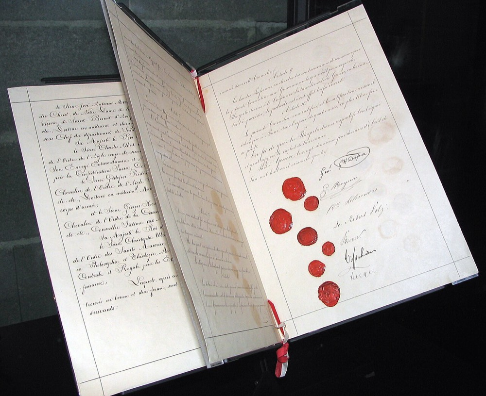

[← Protecting Humanity Through Law in War and Peace](README.md) · [Lectures 3–4 →](02-actors-obligations-and-peacetime-frameworks.md)

# Lectures 1–2: Humanity in international law

*The original 1864 Geneva Convention.* Humanity codified: protection of the wounded and sick, the first step from reciprocity towards protecting the person.  
Kevin Quinn, Ohio, US · CC BY 2.0 · [Wikimedia Commons](https://commons.wikimedia.org/wiki/File:Original_Geneva_Conventions.jpg)

## Rules to know cold

1. Humanity has two senses: humankind (the collective) and humaneness (a quality of conduct, compassion and restraint), as in Coupland, IRRC 2001. Both shape IL: 'crimes against humanity' versus 'principles of humanity'.
2. The Martens Clause (1899 Hague Preamble; API Art 1(2)): in cases not covered, civilians and combatants remain under the principles of international law derived from established custom, the principles of humanity and the dictates of public conscience. Meron reads it as interpretive guidance and a source of pressure for custom, not an independent source (Nuclear Weapons AO para 87).
3. 'Elementary considerations of humanity' (Corfu Channel; Nicaragua para 218) are a source of obligation independent of treaty. CA3 is a 'minimum yardstick'.
4. The humanization of IHL (Meron 2000): the human rights influence on IHL, the expansion of NIAC rules (Tadić Jurisdiction), and the move from State-centric reciprocity to individual protection.
5. The individual moved from object to subject: rights holders (IHRL), duty bearers (ICL: 'crimes against IL are committed by men, not by abstract entities', IMT). Peters calls this 'Humanity as the A and Ω of sovereignty'; Teitel's 'Humanity's Law'.
6. Hostis humani generis (enemy of mankind, the pirate) versus hostia humani generis (Bikundo: the victim offered up in humanity's name, exemplary justice). This is a critical reading of ICL's selectivity.
7. Critical views: Urueña says 'humane' is a contested normative standard, open to power and exclusion. Decolonising humanity: who defines it, and the colonial origins of IHL.
8. Humanity links to jus cogens and erga omnes obligations: the prohibitions of genocide, torture, CAH and slavery, and the basic rules of IHL (Wall para 157: 'intransgressible').
9. Coupland proposes a working definition: humanity 'arises from and signifies restraining the capacity for armed violence and limiting its effects on security and health'. On this view humanity is the 'lowest common denominator' of most of international law, not just IHL and IHRL: the UN Charter and arms control restrain violence for national security, IHRL protects personal security, and IHL 'stands in the middle' (personal security while national security is being decided by force).
10. Coupland argues that 'humanity-sentiment' (humaneness) is the counterweight to inhumanity, so crimes against humanity are crimes against humanity-humankind committed through acts of inhumanity. He wants to move humanity out of its 'ambiguous' natural-law corner into the domain of health, where the effects of armed violence can be measured and evidenced. Critical use: this makes humanity objective and universal, but risks reducing a normative idea to measurable harm.
11. Meron's limits on the Martens Clause: it 'does not allow one to build castles of sand'. Except in extreme cases, the principles of humanity and dictates of public conscience cannot by themselves make a weapon or method unlawful. Its real effects are elsewhere: it pushes customary law to rest on opinio juris rather than battlefield practice, weakens reciprocity, gives NGOs a lever, and argues against a non liquet. He doubts it has had any influence on the battlefield itself.
12. Van Beers, Corrias and Werner identify three paradoxes in 'enemy of mankind' language: humanity transcends State sovereignty yet empowers States to exercise extraordinary (universal) jurisdiction; it places individuals outside normality yet requires recognising their legal personality; it claims universality yet depends on particular cultural and political understandings. They reject both naive enthusiasm and sceptical dismissal: invoking humanity is never innocent, because it empowers, legitimises, includes and excludes.
13. Bikundo's thesis is that ICL 'embodies the international community through iconic presentation'. The phrase hostis humani generis does two things: it supplies jurisdiction where there would be none, and it dehumanises whoever it is applied to. Given the geographic selectivity of cases, the claim that 'humanity sits in judgment over inhumanity' is better put as one segment of humanity judging another ('selective universality'): the accused become scapegoats, the judges sovereigns.

## Key passages

> In cases not covered by this Protocol or by other international agreements, civilians and combatants remain under the protection and authority of the principles of international law derived from established custom, from the principles of humanity and from the dictates of public conscience.
>
> — **Additional Protocol I (1977)**, Art 1(2), the Martens Clause

*Why it matters:* Humanity as a source or interpretive principle: the narrow, middle and broad readings (Meron, Cassese).

## What the lecturers stressed

- Lecture 1 frames 'humanity as subject' with open questions: does it have concrete meaning, or is it irrelevant or imperialistic? Context of deployment is key — Koskenniemi: concepts of humanity or dignity 'take a completely different color, depending on the political project of those invoking the terms'. Does it assume natural law? Is it a general principle of (international) law? Does humanity have 'enemies'?
- Martens Clause: 1899 text, 'populations and belligerents remain under the protection and empire of the principles of international law, as they result from the usages established between civilized nations, from the laws of humanity, and the requirements of the public conscience'; the 1907 text reads 'inhabitants and the belligerents' and 'the dictates of the public conscience'. Pictet (1956): 'the principle of humanity stands out on its own … all other principles hang from it'.
- What the Martens Clause does (Lecture 2): rejects 'not prohibited means permitted'; keeps protection alive in gaps; links interpretation to public conscience. Nuclear Weapons AO: the Martens Clause 'has proved to be an effective means of addressing the rapid evolution of military technology' (para 78); it belongs to the rules of API that were already custom when adopted, reaffirmed in API Art 1(2) (para 84); its 'continuing existence and applicability is not to be doubted', as an affirmation that IHL principles apply to nuclear weapons (para 87). The 'functional validity … objective barrier' wording on the Lecture 2 slide does not appear anywhere in the Court's opinion (paras 1–105), so don't quote it as the ICJ's words. Its function remains disputed: interpretive principle, source of law, or catalyst for new rules.
- 1977 version (API Art 1(2)): 'usages established among civilized peoples' became 'established custom', 'laws of humanity' became 'principles of humanity', and the clause moved from a preamble into an operative article. Stronger institutionally, but 'established custom' may narrow one route for legal development.
- 1949: humanity centred on the protected person. Common Article 3 is the minimum in NIAC; protection attaches to human beings, not only reciprocity.
- Humanity at a crossroads: ICRC President Spoljaric to the UNSC on the 'disregard for our shared humanity'. In Sept 2024 the ICRC and six States (Brazil, China, France, Jordan, Kazakhstan, South Africa) launched the Global Initiative to Galvanize Political Commitment to IHL. About 120 States joined, with seven workstreams (prevention, national IHL committees, IHL and peace, civilian infrastructure, hospitals, ICT, naval warfare) and a leaders' statement at UNGA80 on 21 Sept 2025. The High-Level Conference to Uphold Humanity in War meets in Amman, Jordan on 7 Dec 2026 and is expected to adopt a political declaration, not a new treaty or mechanism. Question posed: can humanity mobilise commitment without becoming vague or selectively invoked?
- Human dignity's foundations: Judeo-Christian thought (the person as 'someone, not something'), Kant (dignity as autonomy), Pico della Mirandola, Schiller ('give him food and shelter … dignity will follow'). In adjudication, 'thin' dignity just restates the catalogue of rights; 'thick' dignity is a substantive value of its own.
- Humanity as the engine of ICL (Lecture 3): Jackson at Nuremberg ('abnormal and inhuman conduct'; 'civilization cannot tolerate their being ignored, because it cannot survive their being repeated'); Rome Statute preamble ('atrocities that deeply shock the conscience of humanity'); IMT: crimes are 'committed by men, not by abstract entities'.
- Main IHL principles listed by Heinsch: distinction, prohibition of attacking persons hors de combat, prohibition of indiscriminate attacks, proportionality, prohibition of unnecessary suffering, humanity, military necessity. Hague law (means and methods) versus Geneva law (protection of persons hors de combat).

## Cases and materials

### Corfu Channel
*ICJ · 1949*

Albania's duty to warn rested on 'elementary considerations of humanity, even more exacting in peace than in war'.

**Use it for:** Humanity as a source of obligation outside treaty.

### Legality of Nuclear Weapons AO
*ICJ · 1996*

The cardinal principles of IHL are distinction and the prohibition of unnecessary suffering. The Martens Clause is an effective means of addressing rapid technological change. Fundamental IHL rules are 'intransgressible'.

**Use it for:** The Martens Clause; the principles of humanity; new weapons (and AI later).

### Tadić (Jurisdiction Appeal)
*ICTY · 1995*

'A State-sovereignty-oriented approach has been gradually supplanted by a human-being-oriented approach.' Customary war crimes exist in NIAC (paras 97, 134).

**Use it for:** The humanization narrative.

## Test yourself

Open the questions (answers are folded under each)

**Q. What does the Martens Clause say, and what is its legal status?**

Answer

Where there are gaps, persons remain protected by custom, the principles of humanity and the dictates of public conscience. Its status is contested: at minimum an interpretive aid that closes the 'everything not prohibited is permitted' gap; on a bolder view, an autonomous source (Meron is cautious).

**Q. What are Coupland's two meanings of humanity?**

Answer

Humankind, the collective human race, and humaneness, the quality of compassion and restraint in behaviour. IL protects the first through the second.

**Q. What is Bikundo's 'hostis' versus 'hostia humani generis'?**

Answer

From the enemy of mankind (the pirate, an outlaw) to the sacrificial victim. ICL selects exemplary defendants and punishes them in humanity's name, a critique of its selectivity and theatre.

**Q. Give three examples of 'humanity' operating as law.**

Answer

The Martens Clause; elementary considerations of humanity (Corfu Channel); crimes against humanity; jus cogens and erga omnes protections; the CA3 minimum yardstick.

**Q. How did the Martens Clause change between 1899 and API Art 1(2) (1977)?**

Answer

'Usages established among civilized peoples' became 'established custom'; 'laws of humanity' became 'principles of humanity'; 'populations and belligerents' became 'civilians and combatants'; it moved from the preamble into an operative article. Institutionally stronger, but 'established custom' may exclude emerging usages.

**Q. What did the ICJ say about the Martens Clause in Nuclear Weapons?**

Answer

It is 'an effective means of addressing the rapid evolution of military technology' (para 78); like other API rules that were already custom, it was reaffirmed in API Art 1(2) (para 84); its 'continuing existence and applicability is not to be doubted', and it affirms that IHL principles apply to nuclear weapons (para 87). Note: the 'functional validity … objective barrier' wording on the Lecture 2 slide is not in the Court's opinion.

**Q. Thick versus thin conceptions of human dignity?**

Answer

Thin: dignity is a shorthand for the catalogue of human rights. Thick: dignity is an independent substantive value that can ground new rights or limit State action (e.g. Kantian autonomy).

**Q. What is Coupland's definition of humanity, and why does it widen the field?**

Answer

Humanity 'arises from and signifies restraining the capacity for armed violence and limiting its effects on security and health'. So not only IHL and IHRL but also the UN Charter, self-defence rules and arms control 'promote humanity'; IHL sits between national security (arms control) and personal security (IHRL). Humanity becomes the 'lowest common denominator' of international law (Coupland 2001, pp 986–988).

**Q. What does Meron mean by 'castles of sand' (Martens Clause)?**

Answer

The clause cannot, alone and except in extreme cases, delegitimise weapons or methods of war. It helps interpretation, argues against a non liquet, tilts custom towards opinio juris and away from reciprocity, and empowers NGOs. New prohibitions are better reached through distinction, proportionality and unnecessary suffering than by stretching the clause (Meron 2000, pp 87–88).

**Q. What are van Beers et al's three paradoxes of 'humanity' in ICL?**

Answer

(1) It transcends sovereignty yet empowers States to exercise extraordinary jurisdiction; (2) it puts individuals outside normality yet must recognise their legal personality (and dignity, even of the perpetrator); (3) it claims universality yet rests on particular cultural and political understandings. Hence the question of auctoritas: who decides what humanity means?

