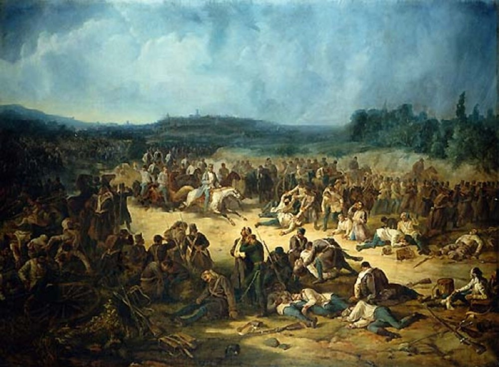

[← Protecting Humanity Through Law in War and Peace](README.md) · [← Lectures 3–4](02-actors-obligations-and-peacetime-frameworks.md) · [Lecture 6 →](04-occupation.md)

# Lecture 5: Armed conflict: classification and co-application

*The Battle of Solferino (1859), which led Henry Dunant to found the Red Cross.* The origins of modern IHL in the suffering Dunant witnessed.  
Unknown author · Public domain · [Wikimedia Commons](https://commons.wikimedia.org/wiki/File:Battaglia_di_Solferino_(Henry_Dunant).jpg)

**Mind map:** [Classifying armed conflict and co-applying IHRL](https://tomasemilioeee-a11y.github.io/pil-humanity-study-guide/mind-maps/classification.html), interactive, with recall mode and search.

## Rules to know cold

1. IAC (CA2): any resort to armed force between States, with no intensity threshold (Tadić para 70; ICRC Commentary). It includes total or partial occupation, even without resistance. API Art 1(4) covers wars of national liberation.
2. NIAC (CA3): protracted armed violence between governmental authorities and organised armed groups, or between such groups (Tadić para 70). Two criteria: intensity (number, duration and intensity of clashes, weapons, casualties, displacement, SC involvement) and organisation (command structure, ability to carry out operations, discipline, ability to implement IHL; Haradinaj, Boškoski). APII has a higher threshold: territorial control, and the State must be a party.
3. Internationalised NIAC: a foreign State's intervention on the side of the armed group, or overall control by a State over the group (Tadić Appeals para 137), turns it into an IAC. 'Transnational' conflicts with non-state actors across borders (e.g. against ISIS) are generally treated as NIAC.
4. Conflicts can transform (from internal disturbances to NIAC to IAC). Classification may be mixed or 'parallel' in the same territory (Nicaragua para 219).
5. Co-application: IHRL continues in armed conflict (Nuclear Weapons para 25; Wall para 106: some rights only IHRL, some only IHL, some both; DRC v Uganda para 216). For the right to life, IHL as lex specialis determines what is 'arbitrary' (para 25).
6. Lex specialis is increasingly questioned (Milanovic's 'lost origins': it originally meant harmonious interpretation, not displacement). Duffy shows the trend of courts adjudicating co-applicability.
7. Hassan v UK (2014): in an IAC, Art 5 ECHR is read in harmony with GCIII and GCIV internment powers, without a formal derogation, keeping the safeguards of review and non-arbitrariness.
8. Introduction to targeting: distinction (API 48), the definition of military objectives (API 52(2): by nature, location, purpose or use, effective contribution to military action and definite military advantage), proportionality (51(5)(b)), precautions (57), prohibition of superfluous injury or unnecessary suffering (35(2)), indiscriminate weapons.
9. Bantekas and Oette argue IHL is best seen not as a system of rights but as protection of 'protected persons': its humanisation is influenced by human rights but should be kept apart from rights talk. Human rights answer the power imbalance between a State and those it governs; IHL rests on the reciprocal expectations of equal sovereigns (and self-interest). Rules such as the bans on indiscriminate attacks or denial of quarter cannot be enforced by their beneficiaries in battle, and IHL is premised on a permission to kill those taking a direct part in hostilities.
10. Bantekas and Oette read the ICJ's lex specialis (Nuclear Weapons para 25; Wall para 106) as a conflict-of-norms rule, not a tool of interpretation: where an IHL rule truly cannot be reconciled with a human rights rule, IHL prevails. Critics say this artificially fragments the two bodies of law. The HRC (GC 31 para 11: 'complementary, not mutually exclusive') and the Inter-American Commission (using VCLT Art 31(3)(c), each body interpreted in the light of the other) take the harmonising view.
11. Why human rights bodies rarely apply IHL directly (Bantekas and Oette): their mandate is limited to their own treaty, they lack IHL expertise, they risk acting ultra vires and colliding with ICL case law, and accepting lex specialis would mean admitting their own treaty is subordinate. So they translate IHL into human rights terms. In Chechnya (Isayeva, Yusupova and Bazayeva) and south-east Turkey (Ergi) the ECtHR accepted that lethal force against insurgents could be justified but required feasible precautions to minimise incidental civilian loss, mirroring API Art 57. Unlike IHL, this duty binds only the government side.

## Key passages

> …an armed conflict exists whenever there is a resort to armed force between States or protracted armed violence between governmental authorities and organized armed groups or between such groups within a State.
>
> — **Prosecutor v Tadić**, ICTY Appeals Chamber, Decision on Jurisdiction (1995), para 70

*Why it matters:* The classification test: IAC on any resort to force; NIAC needs intensity and organisation.

## What the lecturers stressed

- Three theories of the IHL–IHRL relationship (Heinsch): strict separation (IHL in war, IHRL in peace), complementarity, and convergence (cumulative application for the most effective protection). UN Secretary-General's Bulletin 1999: 'cumulative application of all norms which protect the individual'.
- History of co-application: Tehran Human Rights Conference 1968, Res XXIII ('peace is the underlying condition for the full observance of human rights and war is their negation'); the ICRC delegate: the UDHR and the Geneva Conventions 'are both derived from one and the same ideal'.
- Authorities for co-application: Wall AO para 106 (three situations); ILC Fragmentation Study Group 2006 (norms bearing on one issue should be interpreted to give a single set of compatible obligations); 30th International Red Cross Conference, Res 3 (2007).
- The gap in internal disturbances: the ICRC definition (a serious confrontation with violence but no armed conflict) means IHL does not apply, only IHRL subject to derogation. The Turku Declaration (1990) on minimum humanitarian standards tried to fill it, with little success.
- IHL is non-derogable: built for extreme situations, it already balances military necessity and humanity. IHRL's non-derogable core: life, torture, slavery, imprisonment for contractual debt, recognition before the law, non-retroactivity, freedom of thought, conscience and religion.
- Protected persons: IHL protects categories (combatants, civilians, wounded and sick, POWs); IHRL protects all human beings within jurisdiction (HRC GC 31: territory, jurisdiction, power or effective control, including forces abroad; some bodies add direct and foreseeable impact). Central tension: universality versus jurisdiction as a threshold.
- Why classification matters (examples: Iran, Ukraine, Gaza): it determines the applicable law. IAC: GCs I–IV, API, weapons treaties, customary IHL. NIAC: CA3, APII, customary IHL, and IHRL as gap filler. Below the threshold: national law and IHRL.

## Cases and materials

### Tadić (Jurisdiction and Appeals)
*ICTY · 1995 / 1999*

Defined armed conflict and NIAC (protracted armed violence plus organised groups), and set the overall control test for internationalising a conflict.

**Use it for:** The classification test in every problem question.

### Wall AO
*ICJ · 2004*

The protection of human rights conventions does not cease in armed conflict. There are three possible situations (some rights exclusively IHL, some exclusively IHRL, some both). The ICCPR, ICESCR and CRC apply extraterritorially in occupied territory.

**Use it for:** Co-application; extraterritoriality.

### Hassan v UK (GC)
*ECtHR · 2014*

Detention of an Iraqi in an IAC was compatible with Art 5 when read in light of IHL internment powers, even though the UK had not derogated, provided there were safeguards against arbitrariness.

**Use it for:** Harmonious interpretation; detention.

### Haradinaj / Boškoski
*ICTY · 2008*

Indicative factors for intensity (seriousness of attacks, spread, mobilisation, weapons) and organisation (headquarters, command, logistics, ability to negotiate and speak with one voice).

**Use it for:** Applying the NIAC threshold to facts.

### Isayeva, Yusupova and Bazayeva v Russia; Ergi v Turkey
*ECtHR · 2005; 1998*

In NIAC-type operations (missile attack on a civilian convoy in Chechnya; an ambush operation in Turkey), the use of lethal force against insurgents could be legitimate, but Art 2 was violated because the State did not take feasible precautions in choosing means and methods to avoid or minimise incidental loss of civilian life, nor investigate effectively.

**Use it for:** How human rights courts import IHL-type precautions and proportionality into Art 2 without applying IHL; co-application in NIAC.

## Test yourself

Open the questions (answers are folded under each)

**Q. Tadić definition of armed conflict?**

Answer

Armed conflict exists whenever there is a resort to armed force between States, or protracted armed violence between governmental authorities and organised armed groups or between such groups within a State.

**Q. What are the two NIAC criteria, and the factors for each?**

Answer

Intensity: frequency and gravity of attacks, weapons, casualties, displacement, SC attention. Organisation: command structure, headquarters, capacity to plan and execute operations, discipline and ability to implement IHL, negotiation capacity.

**Q. How does an internal conflict become international?**

Answer

Through direct intervention of another State's troops, or a foreign State's overall control over the armed group (Tadić: financing, equipping plus coordinating or helping plan operations).

**Q. What is Milanovic's critique of lex specialis?**

Answer

Its origins are about interpretation, not hierarchy. Courts use it loosely; it doesn't explain which rule prevails. Better to reason through harmonious interpretation and norm conflict avoidance.

**Q. What are the three situations in the Wall para 106?**

Answer

Some rights may be exclusively matters of IHL, some exclusively of IHRL, and others matters of both, in which case IHL is lex specialis.

**Q. Name the three theories of the IHL–IHRL relationship.**

Answer

Strict separation (IHL for war, IHRL for peace); complementarity (they complement each other); convergence (cumulative application of all protective norms, UNSG Bulletin 1999). Today's mainstream: co-application with harmonious interpretation (Wall para 106; ILC Fragmentation 2006).

**Q. What are 'internal disturbances and tensions', and which law applies?**

Answer

Serious confrontations with violence that do not reach NIAC (APII Art 1(2) excludes riots and sporadic violence). IHL does not apply; IHRL applies, subject to derogation, plus domestic law. The Turku Declaration (1990) proposed minimum humanitarian standards to fill the gap.

**Q. Why do human rights courts apply 'IHL through the back door' rather than IHL itself?**

Answer

Their mandate covers only their own treaty; applying IHL directly risks ultra vires findings, clashes with ICL case law and an admission that IHL overrides their treaty (lex specialis). So they read Art 2 to require precautions and proportionality in military operations (Isayeva; Ergi). Effect: in NIAC, human rights procedures give victims far stronger remedies than IHL (Bantekas and Oette, pp 1268–1270).

