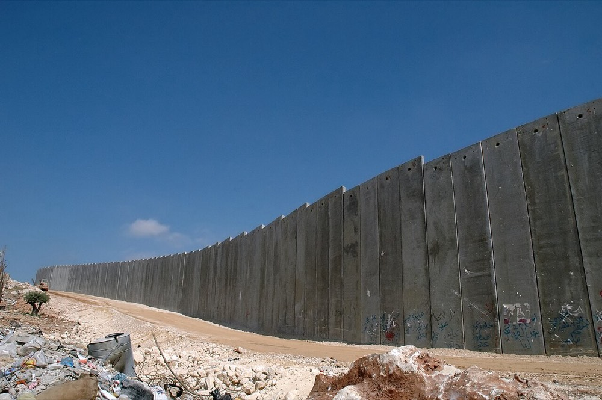

[← Protecting Humanity Through Law in War and Peace](README.md) · [← Lecture 5](03-armed-conflict-classification-and-co-application.md) · [Lecture 7 →](05-extraterritorial-jurisdiction.md)

# Lecture 6: Occupation

*The West Bank barrier.* Wall AO (2004) and OPT AO (2024): occupation law, settlements, self-determination and third-State duties.  
Justin McIntosh · CC BY 2.0 · [Wikimedia Commons](https://commons.wikimedia.org/wiki/File:Israeli_West_Bank_Barrier.jpg)

## Rules to know cold

1. Art 42 of the Hague Regulations: territory is occupied when actually placed under the authority of the hostile army. The test is effective control: foreign forces able to exert authority, without the sovereign's consent, and the sovereign unable to exercise its authority (Armed Activities para 173; ICTY Naletilić). The GCIV regime applies from first contact for persons (the Pictet functional approach).
2. The end of occupation is debated. A 'functional approach' (Gaza: ongoing control of borders, airspace, sea, population registry, so occupation obligations continue for functions retained, per the 2024 AO).
3. Art 43 HR: the occupant must restore and ensure public order and civil life, respecting the laws in force unless absolutely prevented. The occupant is a temporary trustee (usufructuary of public property, HR Art 55).
4. GCIV protections: prohibition of forcible transfers and deportations (Art 49(1)), prohibition of transferring the occupant's own population (Art 49(6), settlements), prohibition of collective punishment (33), destruction of property only if absolutely necessary (53), provision of food and medical supplies (55–56), relief (59), assigned residence and internment for imperative security (78).
5. Annexation is prohibited by the ban on acquiring territory by force; GCIV Art 47 adds that annexation cannot deprive protected persons of the Convention's protection. In the 2024 OPT AO, prolonged occupation is not unlawful per se (its length 'does not in itself change its legal status', para 109); Israel's continued presence is unlawful because of its sustained abuse of its position through annexation, an assertion of permanent control and the frustration of self-determination (paras 261–262): Israel must end its presence as rapidly as possible, evacuate settlers and make reparation; other States must not recognise or aid.
6. IHRL in occupation: the occupant has jurisdiction through effective control over the area (Al-Skeini; Wall). There is debate over whether IHRL is primary for law enforcement (policing) and IHL for hostilities (Lubell). Dinstein emphasises the IHL framework as primary but complemented by IHRL.
7. Use of force in occupied territory: the law enforcement paradigm (IHRL) for policing, the conduct-of-hostilities paradigm only where hostilities resume. Detention under GCIV 78 with review. Cultural property (1954 Hague Convention and protocols).
8. Self-determination: prolonged occupation denies the right of peoples to self-determination, an erga omnes obligation (Wall para 155; Chagos; 2024 AO).
9. Bantekas and Oette: occupation sits 'between war and peace' and is chiefly governed by IHL, so the full armoury of human rights is not automatically transplanted. But the occupant 'becomes the government responsible' for the territory, not an interim administrator stripped of responsibility, and it may treat inhabitants as lawful targets only if renewed violence reaches the threshold of armed conflict; otherwise its duties resemble human rights in a strained peace. Note that the occupation treaties speak of 'guarantees', not rights.

## Key passages

> Territory is considered occupied when it is actually placed under the authority of the hostile army. The occupation extends only to the territory where such authority has been established and can be exercised.
>
> — **Hague Regulations (1907)**, Art 42

*Why it matters:* Occupation is a question of fact: effective control, not a declaration.

> …the Court will need to satisfy itself that the Ugandan armed forces in the DRC were not only stationed in particular locations but also that they had substituted their own authority for that of the Congolese Government.
>
> — **DRC v Uganda**, ICJ (2005), para 173

*Why it matters:* Substitution of authority: Uganda occupied Ituri, so it was responsible for failing to protect there (Art 43).

> The sustained abuse by Israel of its position as an occupying Power, through annexation and an assertion of permanent control over the Occupied Palestinian Territory and continued frustration of the right of the Palestinian people to self-determination, violates fundamental principles of international law and renders Israel's presence in the Occupied Palestinian Territory unlawful.
>
> — **Legal Consequences arising from the Policies and Practices of Israel in the OPT**, ICJ Advisory Opinion (19 July 2024), para 261

*Why it matters:* The legality of an occupation itself, assessed through jus ad bellum and self-determination.

> …all States are under an obligation not to recognize as legal the situation arising from the unlawful presence of Israel in the Occupied Palestinian Territory. They are also under an obligation not to render aid or assistance in maintaining the situation created by Israel's illegal presence…
>
> — **OPT Advisory Opinion**, ICJ (2024), para 279

*Why it matters:* Third-State duties: non-recognition and non-assistance (compare ARSIWA Art 41).

## What the lecturers stressed

- Occupation in five steps (Heinsch): (1) Hague Regs Art 42 threshold — territory actually placed under the hostile army's authority, only where it is established and can be exercised; (2) effective control in practice — foreign forces present without valid consent, displacing the local government and able to act in its place; (3) no fighting or declaration needed (CA2(2): even without armed resistance); (4) duties follow control (Art 43 HR); (5) annexation does not remove protection (GCIV Art 47).
- 2016 ICRC Commentary: effective control is the main characteristic, but it does not require exercising full authority — the capacity to exercise it suffices; occupation persists despite resistance or temporary loss of parts of the territory.
- Occupation without boots on the ground? ICTY Naletilić & Martinović (2003, paras 217–218): sufficient forces present or able to deploy within a reasonable time. The ability to invade alone is not occupation.
- Gaza: the 2005 withdrawal did not end all obligations. OPT AO 2024 paras 91–94: continuous physical presence is not decisive; Israel retained powers over borders, movement, taxation and the buffer zone, so its obligations remain commensurate with its effective control (functional approach). The central question: what authority survives withdrawal, and which duties follow?
- GCIV structure: general protection of the whole population (Arts 13–26); protected persons' common provisions (general clause Art 27; specific prohibitions Arts 31–34: no coercion, no measures causing physical suffering or extermination, no collective punishment, intimidation or terrorism, pillage, hostage-taking); aliens in a party's territory (Arts 35–46); occupied territories (Arts 47–78); internment rules (Arts 79–135).
- Art 27 GCIV: respect for persons, honour, family rights, religion, manners and customs; humane treatment; protection against violence, insults and public curiosity; special protection for women against rape and indecent assault; no adverse distinction.
- Internment thresholds: aliens in a party's own territory only if the security of the Detaining Power makes it 'absolutely necessary' (Arts 41–42); in occupied territory only for 'imperative reasons of security' (Art 78), as a measure of last resort with review.

## Cases and materials

### Legal Consequences of Israel's Policies in the OPT AO
*ICJ · 2024*

Israel's continued presence in the OPT is unlawful because of annexation policies, settlements and the denial of self-determination. It must end as rapidly as possible, cease new settlement activity, evacuate settlers and make reparation. All States have a duty of non-recognition and non-assistance. It found breaches of CERD Art 3 (segregation and apartheid language left open). Occupation obligations in Gaza persist commensurate with the effective control retained.

**Use it for:** Prolonged occupation; the functional approach; third-State duties.

### Armed Activities (DRC v Uganda)
*ICJ · 2005*

Uganda was an occupying power in Ituri because it substituted its own authority for that of the Congolese government. It was responsible for failing to prevent looting and violations by others, and IHRL applied in occupied territory.

**Use it for:** The effective control test; occupant's obligations; co-application.

### Wall AO
*ICJ · 2004*

The wall's route in occupied territory and the associated regime violated IHL (GCIV Art 49(6)) and IHRL (freedom of movement, work, health, education), and impeded self-determination.

**Use it for:** Occupation and human rights; settlements.

## Test yourself

Open the questions (answers are folded under each)

**Q. What is the test for occupation?**

Answer

Hague Regulations Art 42, effective control: hostile forces are present without consent, able to exercise authority in place of the ousted sovereign, which is unable to exercise its own authority.

**Q. What are the occupant's core duties under Art 43 HR?**

Answer

To take all measures in its power to restore and ensure, as far as possible, public order and civil life, while respecting the laws in force unless absolutely prevented. It is a trustee and temporary administrator, not a sovereign.

**Q. What did the 2024 AO say about prolonged occupation?**

Answer

Occupation that has become permanent through annexation policies and settlements violates the prohibition of acquiring territory by force and self-determination. Israel's presence is unlawful; it must withdraw as rapidly as possible and make reparation. Third States must not recognise or assist.

**Q. Which paradigm governs the use of force by an occupant against a demonstrator?**

Answer

Law enforcement (IHRL right to life, GC 36, McCann standards): force is permissible only when strictly necessary to protect life. The conduct-of-hostilities paradigm applies only if there are hostilities with an organised armed group.

**Q. Can there be occupation without troops on the ground?**

Answer

Possibly, if authority is retained: Naletilić (forces able to deploy within a reasonable time to enforce authority) and the OPT AO 2024 paras 91–94 (Gaza: continuous presence not decisive; obligations commensurate with the effective control retained). The mere capacity to invade is not enough.

**Q. Internment under GCIV: aliens versus occupied territory?**

Answer

Aliens in a party's own territory: only if the security of the Detaining Power makes it absolutely necessary (Arts 41–43). Occupied territory: only for imperative reasons of security (Art 78), with a regular procedure, appeal and six-monthly review. Both are exceptional and non-punitive.

