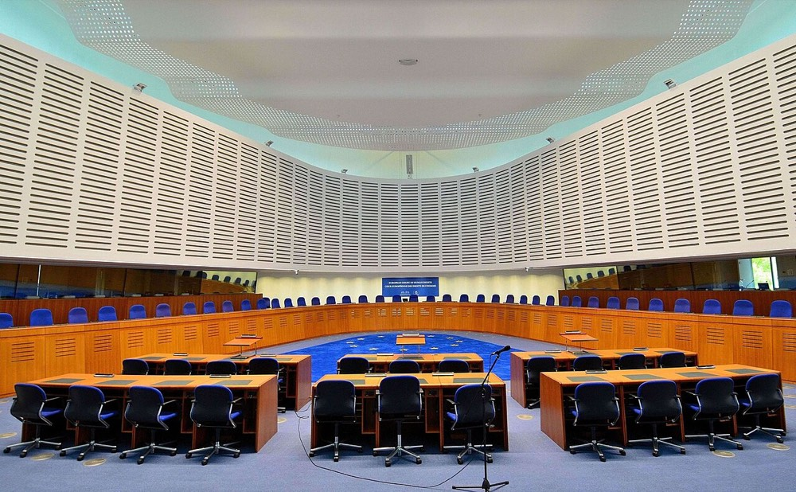

[← Protecting Humanity Through Law in War and Peace](README.md) · [← Lecture 6](04-occupation.md) · [Lectures 8–9 →](06-human-rights-mechanisms.md)

# Lecture 7: Extraterritorial jurisdiction

*The Grand Chamber courtroom of the European Court of Human Rights, Strasbourg.* Al-Skeini, Georgia v Russia (II), Ukraine and the Netherlands v Russia: who is 'within the jurisdiction'?  
Adrian Grycuk · CC BY-SA 3.0 pl · [Wikimedia Commons](https://commons.wikimedia.org/wiki/File:Courtroom_European_Court_of_Human_Rights_01.JPG)

## Rules to know cold

1. Human rights treaties apply to persons 'within the jurisdiction' of the State (ECHR Art 1; ICCPR Art 2(1) 'within its territory and subject to its jurisdiction', read disjunctively by the HRC in GC 31 para 10 and the ICJ in the Wall).
2. Spatial model: effective control over an area, through its own forces or a subordinate local administration (Loizidou; Cyprus v Turkey; Ilaşcu; Al-Skeini para 138; Ukraine and Netherlands v Russia for eastern Ukraine from 2014).
3. Personal model: State agent authority and control over an individual: custody (Öcalan, Al-Saadoon), diplomatic and consular agents, and the exercise of public powers (Al-Skeini sets out the principles at paras 133–137: para 135 public powers exercised with the territorial State's consent; para 136 use of force by agents bringing the individual under their control; para 137 'divided and tailored'. It applies them at para 149: the UK assumed some public powers of a sovereign government and responsibility for security in south-east Iraq, so 'through its soldiers engaged in security operations in Basrah' it exercised authority and control over those killed). Rights can be 'divided and tailored' (Al-Skeini para 137).
4. Functional and impact model: control over the enjoyment of a right. HRC GC 36 para 63: persons whose right to life is impacted by a State's activities in a direct and reasonably foreseeable manner. IACtHR OC-23/17 on transboundary environmental harm (the State of origin has effective control over activities causing harm). The CRC applied it in Sacchi v Argentina et al. (jurisdiction yes, but inadmissible for non-exhaustion).
5. The ECtHR was restrictive: Banković (NATO bombing of Belgrade, no jurisdiction, the ECHR's 'legal space') and Georgia v Russia II (2021: no jurisdiction during the 'active phase of hostilities', the 'context of chaos', though jurisdiction existed in the occupation phase); critics said this resurrected Banković. But Ukraine and the Netherlands v Russia (GC decision of 30 Nov 2022) held that Georgia II 'cannot … be seen as authority for excluding entirely … a specific temporal phase of an international armed conflict' (para 558) and that Banković's rejection of 'divided and tailored' rights is 'no longer an accurate statement' (para 571). The merits judgment (9 July 2025) found Russia's planned military attacks across Ukraine 2014–2022 'wholly at odds with any notion of chaos', so those affected were within its jurisdiction through State agent authority and control.
6. Carter v Russia (2021, the Litvinenko poisoning): a targeted killing by State agents abroad gave jurisdiction through physical power and control over the victim's life ('isolated and specific act'). Contrast this with Georgia v Russia II.
7. Ukraine and Netherlands v Russia (GC admissibility decision delivered 25 Jan 2023; GC merits 9 July 2025, unanimous): Russia had effective control over separatist areas from 11 May 2014 (military presence, decisive influence, political and economic support), and the separatists' acts are attributable to it. Jurisdiction also covers the post-24 Feb 2022 military attacks: Georgia (II)'s 'context of chaos' did not apply to extensive, planned attacks. Merits: administrative practices of killings, torture including rape, unlawful detention, forced labour, persecution, looting and destruction, and transfer of children, 11 May 2014 – 16 Sept 2022. MH17: Arts 2 (substantive and procedural), 3 (next of kin) and 13. Art 2 interpreted in harmony with IHL.
8. Surveillance: Wieder and Guarnieri v UK (2023): interception of communications in the UK of persons abroad falls within jurisdiction (the interference occurs in the UK territory), an expansive approach for Art 8.
9. States push back (US, Israel, UK): the treaty text is territorial, fear of over-stretch to military operations abroad, and the relationship with IHL as lex specialis.
10. Bantekas and Oette criticise Ilaşcu v Moldova and Russia (2004) for diluting the effective control test 'without sufficient legal justification': Russia had jurisdiction because the Transdniestrian regime stayed 'under the effective authority, or at the very least under the decisive influence' of Russia and survived thanks to its military, economic and political support. Contrast the ICJ's far more rigid 'complete dependence' test for treating a proxy as a State organ (Bosnia v Serbia 2007). Useful for the attribution-versus-jurisdiction debate in Ukraine and the Netherlands v Russia.

## Key passages

> …while the jurisdiction of States is primarily territorial, it may sometimes be exercised outside the national territory. Considering the object and purpose of the International Covenant on Civil and Political Rights, it would seem natural that, even when such is the case, States parties to the Covenant should be bound to comply with its provisions.
>
> — **Wall Advisory Opinion**, ICJ (2004), para 109

*Why it matters:* The ICCPR applies extraterritorially (Art 2(1) read disjunctively); HRC GC 31 para 10.

> It is clear that, whenever the State, through its agents, exercises control and authority over an individual, and thus jurisdiction, the State is under an obligation under Article 1 to secure to that individual the rights and freedoms under Section I of the Convention that are relevant to the situation of that individual. In this sense, therefore, the Convention rights can be 'divided and tailored'.
>
> — **Al-Skeini and Others v UK**, ECtHR Grand Chamber (2011), para 137

*Why it matters:* The personal model, which departs from Banković's 'indivisible' rights.

> …the United Kingdom… assumed in Iraq the exercise of some of the public powers normally to be exercised by a sovereign government… In these exceptional circumstances, the Court considers that the United Kingdom, through its soldiers engaged in security operations in Basra… exercised authority and control over individuals killed in the course of such security operations…
>
> — **Al-Skeini and Others v UK**, ECtHR Grand Chamber (2011), para 149

*Why it matters:* The public powers hook: why the Basra killings fell within UK jurisdiction.

## What the lecturers stressed

- Why it matters (Powderly): post-9/11 practice — detention abroad, strikes overseas, surveillance. Duffy: 'post-9/11 practice highlights the manipulation of the extraterritoriality issue to avoid applicability of human rights law'. The US (Guantánamo, rendition, Iraq, Afghanistan), Israel and the UK resisted. Yet obligations apply abroad 'so far as [a State] exercises a sufficient degree of power, authority or control'.
- Treaty wording: ICCPR Art 2(1) 'within its territory and subject to its jurisdiction'; ECHR Art 1 'within their jurisdiction'; ACHR Art 1(1); CRC Art 2(1); CAT Art 2(1) 'any territory under its jurisdiction'. The ICESCR and African Charter have no jurisdiction clause.
- Jurisdiction means something different in IHRL: in general IL it allocates competences (Zwanenberg); in IHRL it delimits who is protected — whether the person was within the State's power, not whether that power was lawfully exercised.
- Loss of control over one's own territory: the presumption of territorial jurisdiction can be rebutted, but positive obligations remain — reassert sovereignty and secure rights where possible (Ilaşcu v Moldova and Russia). Treaty bodies say obligations continue over the whole territory, at least negative ones (HRC recommendations to Ukraine 2022).
- Issa v Turkey: Art 1 cannot allow a State to commit violations abroad that it could not commit at home — the core rationale, repeated in Carter.
- Spatial model: Loizidou (1995) — effective control of an area through armed forces or a subordinate local administration, whether the military action was lawful or not. Banković (2001) para 71: extraterritorial jurisdiction is exceptional; the bombing of RTS was not covered.
- Personal model, as summarised in Ukraine and the Netherlands v Russia (dec. 2022) paras 570–571, building on Al-Skeini paras 136–137 (para 138 is the spatial model): custody abroad (Öcalan, Al-Skeini), significantly curtailed freedom of movement (Medvedyev v France), isolated and specific acts with an element of proximity (Isaak v Turkey's beating and shooting; Carter's targeted killing). Exercise of public powers with consent (Al-Skeini para 135).
- Georgia v Russia (II) (2021): paras 83 and 126 — during the active phase (8–12 August 2008), bombing and shelling in a 'context of chaos' means no effective control over territory and (para 137) no State agent authority over individuals; paras 142–143 — only IHL governs, and it is for States to give the Court such a task. Jurisdiction existed in the occupation phase (para 196: IHL occupation implies effective control, though effective control is broader).
- Implications the lecture raises: civilians bombed by their own State in a NIAC (Isayeva, Esmukhambetov v Russia) can reach the Court, but those bombed abroad in an IAC cannot — is the Court retreating from harmonious interplay with IHL? Would an individual application differ from an inter-State one?
- Carter v Russia (2021): the power to kill implies control. Paras 128–130 — targeted killings by agents abroad outside a military operation fall within jurisdiction (proximity principle extended beyond borders), consistent with Art 15(2), which only exempts deaths from lawful acts of war. Question: does 'proximity' make sense?
- Ukraine and the Netherlands v Russia: MH17 and wider violations in Donbass. Grand Chamber decision on jurisdiction and admissibility adopted 30 November 2022 (delivered 25 January 2023); Grand Chamber judgment 9 July 2025. Key questions: can the missile launch by separatists be attributed to Russia, how attribution relates to Art 1 jurisdiction, and whether the Court would revisit the 'context of chaos'.

## Cases and materials

### Banković v Belgium and Others
*ECtHR (GC) · 2001*

Victims of the NATO aerial bombing of RTS in Belgrade were not within the jurisdiction of the respondent States. Jurisdiction is primarily territorial; the Convention operates in the 'espace juridique' of Europe and rights can't be divided and tailored.

**Use it for:** The restrictive baseline (later abandoned in part).

### Al-Skeini v UK
*ECtHR (GC) · 2011*

The UK exercised public powers in south-east Iraq, and through its soldiers' security operations it had authority and control over individuals killed, so Art 2 applied, including the procedural duty to investigate. Rights can be divided and tailored.

**Use it for:** Spatial and personal models; the duty to investigate abroad.

### Georgia v Russia (II)
*ECtHR (GC) · 2021*

No jurisdiction over the active phase of hostilities (bombing and shelling) because of the 'context of chaos'. Jurisdiction existed over the subsequent occupation, detention, and the duty to investigate.

**Use it for:** The limits in hostilities; critique (Milanovic).

### Carter v Russia
*ECtHR · 2021*

The poisoning of Litvinenko in London by Russian agents was within Russia's jurisdiction because the agents exercised physical power and control over his life. Art 2 was violated.

**Use it for:** The functional-personal model for targeted killing.

### Ukraine and the Netherlands v Russia (merits)
*ECtHR (GC) · 2025*

9 July 2025, unanimous. Russia responsible for administrative practices of grave violations in eastern Ukraine and in the full-scale invasion (11 May 2014 – 16 Sept 2022). Jurisdiction extends to military attacks during active hostilities (Georgia (II) confined to its facts). MH17: Arts 2, 3, 13 violated. Just satisfaction reserved.

**Use it for:** Jurisdiction over active hostilities; attribution vs jurisdiction; IHL-informed Art 2.

### Sacchi et al. v Argentina et al.
*UN CRC · 2021*

The children were within the jurisdiction of the respondent States because of the foreseeable transboundary harm of emissions within the States' effective control (applying OC-23). The communication was inadmissible for failure to exhaust domestic remedies.

**Use it for:** The functional model in climate cases.

### Lebedeva and Others v Russia (strike-out)
*ECtHR · 2026*

Decision of 7 July 2026 (published 3 Sept 2026) struck out 879 remaining individual applications under Art 37(1)(c), citing Russia's refusal to execute judgments. Russia's international responsibility is unaffected, and about 5,700 conflict-related applications remain.

**Use it for:** Effectiveness limits after expulsion (Art 58: Russia ceased to be a party 16 Sept 2022).

## Test yourself

Open the questions (answers are folded under each)

**Q. What are the three models of extraterritorial jurisdiction?**

Answer

Spatial (effective control over an area: Loizidou, Al-Skeini para 138); personal (State agent authority and control over a person: Öcalan, Al-Skeini paras 136–137); functional or impact (control over the enjoyment of the right: GC 36 para 63, OC-23, Sacchi).

**Q. Why is Georgia v Russia II criticised?**

Answer

It denies jurisdiction for the most lethal acts (bombing in active hostilities) while finding it for lesser acts, a return to Banković. It creates a perverse incentive and contrasts with Carter v Russia.

**Q. What is 'dividing and tailoring' rights?**

Answer

When exercising authority and control over an individual abroad, the State must secure the rights relevant to that situation, not the full catalogue (Al-Skeini para 137, reversing Banković).

**Q. Jurisdiction (Art 1 ECHR) versus attribution (ARSIWA)?**

Answer

Jurisdiction is a threshold for treaty obligations to arise (control over area or person). Attribution determines whether conduct is the State's. The ECtHR sometimes merges them, e.g. for proxies in Ukraine and Netherlands v Russia.

**Q. How does 'jurisdiction' in IHRL differ from jurisdiction in general international law?**

Answer

In general IL it allocates State competences to act (prescribe, adjudicate, enforce). In IHRL it delimits the persons protected: whether the individual was within the State's power or control, regardless of whether that power was lawfully established.

**Q. What did Georgia v Russia (II) decide on the active phase of hostilities?**

Answer

No jurisdiction: in a 'context of chaos' during bombing and shelling there is neither effective control over territory (para 126) nor State agent authority over individuals (para 137); such acts are governed by IHL (paras 142–143). Jurisdiction did exist for the subsequent occupation, detention and the duty to investigate.

**Q. What is the 'Issa principle'?**

Answer

Art 1 ECHR cannot be interpreted to let a State perpetrate violations on another State's territory that it could not perpetrate on its own (Issa v Turkey; repeated in Carter v Russia para 128).

