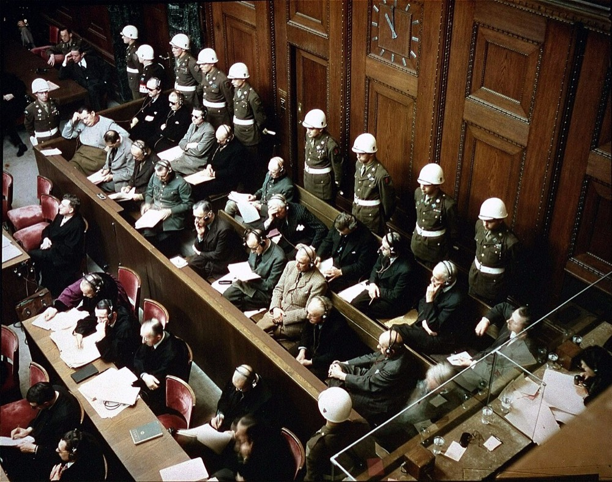

[← Protecting Humanity Through Law in War and Peace](README.md) · [← Lectures 8–9](06-human-rights-mechanisms.md) · [Lecture 12 →](08-ihl-enforcement-and-accountability.md)

# Lectures 10–11: International criminal justice: history and the ICC

*Defendants in the dock at the Nuremberg trial, 1945–46.* 'Crimes against international law are committed by men, not by abstract entities.' (IMT judgment)  
Raymond D’Addario · Public domain · [Wikimedia Commons](https://commons.wikimedia.org/wiki/File:Defendants_in_the_dock_at_nuremberg_trials.jpg)

**Mind map:** [International criminal justice and the ICC](https://tomasemilioeee-a11y.github.io/pil-humanity-study-guide/mind-maps/icc.html), interactive, with recall mode and search.

## Rules to know cold

1. IMT Nuremberg (London Charter 1945, Art 6): crimes against peace, war crimes, and CAH (linked to war). Individual responsibility, no defence of superior orders (mitigation only), and official position no bar. 2026 is the 80th anniversary of the judgment.
2. The IMTFE (Tokyo), Control Council Law No. 10 (zonal trials; CAH not linked to war), and the UN War Crimes Commission (an early form of complementarity, supporting national trials). Asia trials (Sellars). The 'victor's justice' critique (tu quoque, selectivity, ex post facto).
3. Legacies: the Nuremberg Principles (ILC 1950), the Genocide Convention (1948), the Geneva Conventions (1949, the Grave Breaches regime), and the ILC draft code. The Cold War froze plans for a permanent court.
4. The ICTY (1993) and ICTR (1994) were created by SC resolutions under Chapter VII (Tadić upheld their legality), with primacy over national courts. Innovations: NIAC war crimes, CAH without a war nexus, rape as genocide and torture (Akayesu, Furundžija), JCE, and command responsibility.
5. Hybrid tribunals: SCSL (Taylor), ECCC, STL (terrorism), and the Kosovo Specialist Chambers.
6. Rome Statute (1998, in force 2002): the debates were OTP independence (proprio motu with PTC review, Art 15), the SC role (referral under Art 13(b) and deferral under Art 16), complementarity (Art 17), immunities (Art 27 versus Art 98), aggression (deferred to Kampala), and victims (participation under Art 68(3), reparations under Art 75, the Trust Fund).
7. ICC jurisdiction: subject matter (Art 5), temporal (after 1 July 2002, Art 11), preconditions (territory or nationality of a State party or an Art 12(3) declarant, Art 12), triggers (State referral, SC referral, proprio motu under Art 13).
8. Admissibility (Art 17): a case is inadmissible if genuinely investigated or prosecuted by a State with jurisdiction, unless that State is unwilling (shielding, undue delay, lack of independence) or unable (collapse of the judicial system). The test is the same person and substantially the same conduct (Ruto, Gaddafi, Al-Senussi). Gravity applies under Art 17(1)(d). The two-step approach: is there an investigation, and is it genuine?
9. Immunities: Art 27 (official capacity irrelevant) versus Art 98(1). Al-Bashir Jordan Appeal (2019): there is no customary Head-of-State immunity before international courts, and an SC referral binds Sudan as if a party. Art 87(7) non-compliance findings: Mongolia (Putin, 2024), Hungary (Netanyahu, PTC I 24 July 2025), Italy (Almasri, 17 Oct 2025; referred 2026), Tajikistan (Putin's Oct 2025 visit; referred to the ASP 7 May 2026: a CIS immunity agreement cannot override Rome obligations).
10. Withdrawal (Art 127): it takes effect one year after notification, and the Court keeps jurisdiction over crimes committed while the State was a party. Burundi (authorised before its withdrawal took effect, Oct 2017). Philippines (withdrawal effective 17 Mar 2019; investigation only authorised 15 Sept 2021): Duterte Appeals Judgment of 22 Apr 2026 holds that a preliminary examination opened before withdrawal is a 'matter already under consideration by the Court' (Art 127(2)). Duterte: surrendered 12 Mar 2025; 3 CAH counts (murder and attempted murder) confirmed 23 Apr 2026; found fit (28 Sept 2026); trial opens 30 Nov 2026.
11. Contemporary challenges: US sanctions under EO 14203 (Feb 2025) on the Prosecutor, both deputies, 9 of 18 judges incl. President Akane (Aug 2026), and the ICC itself as an entity (9 Oct 2026); withdrawals by Niger, Burkina Faso, Mali (June 2026), Venezuela and Chad (July 2026), while Hungary revoked its withdrawal (29 May 2026); Prosecutor Khan removed by the ASP (24 July 2026); resources; the neo-imperial critique; Israel's challenges (Art 18 rejected by Appeals 15 Dec 2025; Art 19(2) jurisdiction challenge on remand pending).
12. Turning away from the ICC? The Special Tribunal for the Crime of Aggression against Ukraine (CoE–Ukraine agreement 25 June 2025; Rada ratification 15 July 2025; Enlarged Partial Agreement CM/Res(2026)5, 15 May 2026; seat in The Hague, full operations expected 2027), and domestic universal and extraterritorial jurisdiction (91 cases in 20 States in 2025, UJAR 2026): Koblenz al-Khatib on Syria; Lafarge convicted in Paris of financing terrorism in Syria (13 Apr 2026; CAH-complicity investigation continues); the Lundin Sudan war-crimes trial in Stockholm (verdict expected Dec 2026). 'Is the future domestic?'
13. Convergence of ICJ and ICL on genocide: Gambia v Myanmar (2026) treats 'only reasonable inference' as a general ICL test (Tolimir; Stakic) (para 442), reads superior responsibility into Art IV of the Genocide Convention (para 522), and relies on IIMM evidence collected to criminal standards (para 119). State and individual responsibility nonetheless remain distinct regimes, and State responsibility is 'not of a criminal nature' (para 295).
14. Fitness to stand trial at the ICC (Duterte, Trial Chamber III, decision of 28 Sept 2026, public 8 Oct 2026): fitness is 'an aspect of the broader notion of fair trial' (Arts 63(1), 64(8)(a), 67; Art 21(3) imports human rights). The test is whether the accused can meaningfully exercise his procedural rights: understand the conduct, purpose and possible consequences of the proceedings, instruct counsel and, if he wishes, make a statement, 'viewed overall and in a reasonable manner'. A medical diagnosis, or loss of memory of the events, is not decisive in itself. If unfit, the trial is adjourned (Rule 135(4)), not terminated. The Chamber relied on a unanimous three-expert panel, refused further tests and refused to let the Defence question the experts, ordered accommodations (hearing support, care with food and rest, a nurse) and continuous monitoring. Pre-Trial Chamber I had already found him fit for the pre-trial stage on 26 Jan 2026.
15. Unfitness precedents: Kabuga (IRMCT) was found unfit with dementia in June 2023 and died on 16 May 2026 with his trial unfinished; Ieng Thirith (ECCC) was found unfit in 2011, proceedings were stayed in 2012 and she died in 2015; Pinochet was declared unfit by Chile's Supreme Court in 2002 (though later rulings varied). Lesson: if fitness fails, ICL produces no verdict at all, and a fitness ruling is a snapshot, while a trial is a film. Empirical caution: one Australian study found opposing experts disagreed on fitness in 33 of 108 report pairs (Large et al 2009).
16. Chiarini on Duterte and Art 127: the Appeals Chamber majority (22 Apr 2026) turned the preliminary examination, an internal and unregulated prosecutorial step that can begin with reading an NGO report, into a mechanism that preserves jurisdiction beyond the one-year window, making withdrawal 'largely symbolic'. He prefers the dissents (de Brichambaut and Lordkipanidze 2023; Lordkipanidze 2026): the Art 12 preconditions must exist when jurisdiction is triggered, which under Art 13(c) means PTC authorisation, and 'one year is sufficient'. Whiting's point: it is incongruous that the Court keeps jurisdiction over a preliminary examination while the departing State's duty to cooperate covers only 'investigations and proceedings' begun before withdrawal (Art 127(2)). Use: legality and foreseeability versus the anti-impunity purpose.
17. Clapham's criminalisation point feeds the selectivity debate: through self-referrals (Uganda, CAR, DRC, Mali, Gabon) governments cooperate with the ICC so that non-state actors are tried, so the first ICC trials 'veered towards' rebel leaders rather than State agents, while prosecutions of State officials meet immunities and other obstacles (and the Malabo Protocol, Art 46A bis, protects serving leaders). Read with Bikundo's 'selective universality': one segment of humanity judging another.
18. Meron's defence of international criminal justice: the fact that atrocities continue does not disprove deterrence, any more than continuing murders disprove domestic criminal law. Tribunals also serve other goals: exposing the leaders who fanned hatred, education, supporting refugee return, building procedural law, and training a generation of lawyers. But ICL 'does not provide all the answers': national courts bear primary responsibility, combined with asset freezes, travel bans and stigmatisation. Jackson at Nuremberg: 'one of the most significant tributes that Power has ever paid to Reason'.
19. Complementarity debates for essays: inaction makes a case admissible without asking whether the State is unwilling or unable (Katanga, Appeals Chamber, 25 Sept 2009), which Robinson defends as simpler than critics claim ('The Mysterious Mysteriousness of Complementarity', 2010). Heller's 'shadow side': Art 17 does not let the ICC find a State 'unwilling' because its proceedings are unfair to the accused, so it pressures States towards harsh processes and convictions. On universal jurisdiction as the alternative, Langer shows it gravitates towards 'low-cost defendants' whose States will not retaliate ('The Diplomacy of Universal Jurisdiction' (2011) 105 AJIL 1).

## Key passages

> Crimes against international law are committed by men, not by abstract entities, and only by punishing individuals who commit such crimes can the provisions of international law be enforced.
>
> — **International Military Tribunal, Nuremberg**, Judgment (1946)

*Why it matters:* The founding statement of individual criminal responsibility under IL.

## What the lecturers stressed

- What is ICL (Heinsch): international rules creating direct individual responsibility for 'the most serious crimes of concern to the international community as a whole' — the four core crimes. Open question on the slides: should drug trafficking, human trafficking and slavery, terrorism, corruption or torture also count?
- Two problems for ICL within PIL: individuals long lacked rights and duties (exceptions: piracy, war crimes, cable crimes), and enforcement is horizontal (no real executive, no compulsory jurisdiction). ICL's 'double nature': criminal law (repression, detail, rights of the accused) and PIL (diplomacy, prevention, ambiguity) — a hybrid and a patchwork of common- and civil-law principles; its rules come from PIL sources and are interpreted by PIL rules.
- Early precedents: Conradin of Hohenstaufen (1268, 'unjust war'); Peter von Hagenbach (1474, siege of Breisach). Versailles 1919 Art 227: Kaiser Wilhelm II indicted but the Netherlands refused extradition. The interwar League convention for an ICC never entered into force.
- 1945 IMT (London Agreement, Art 6(a)–(c)); 1946 IMTFE; 1948 Genocide Convention; 1949 Geneva Conventions with grave breaches; 1950 ILC Nuremberg Principles; 1953 draft ICC statute; 1954 draft Code of Offences; halted in 1957 by the Cold War.
- Breakthrough: ILC resumes 1989; ICTY 1993 and ICTR 1994 (Chapter VII, IHL violations as a threat to peace); Tadić jurisdiction decision 1995; ILC Draft Code 1996; Rome Statute 1998, in force 2002. ICTY (closed 31 Dec 2017): grave breaches, laws or customs of war, genocide, CAH, no head-of-State immunity. ICTR (closed 31 Dec 2015): genocide, CAH, CA3 and APII violations — the first recognition of individual responsibility in NIAC. The IRMCT took over.
- Mixed tribunals: Kosovo (1999), East Timor (2000), SCSL (2002, Charles Taylor), Bosnia War Crimes Chamber (2002), ECCC (2003), Iraqi High Tribunal (2003/4), STL (2007), Kosovo Specialist Chambers (2015), Special Criminal Court CAR (2015), Special Tribunal for the Crime of Aggression against Ukraine (2025).
- Complementarity two-step (Art 17): (i) is there a national investigation or prosecution of the case? (ii) if so, is the State unwilling (shielding, unjustified delay, lack of independence — Art 17(2)) or unable (total or substantial collapse or unavailability of the judicial system — Art 17(3))? Same case: same person and substantially the same conduct (Ruto, Muthaura 2011); Gaddafi and Al-Senussi (PTC 2013): not the same incidents but the same gravamen of the crime.
- Gravity (Arts 17(1)(d), 53(1)(c)): scale, nature, manner of commission, impact (Comoros flotilla situation). Interests of justice (Art 53(1)(c), (2)(c)): deference to transitional justice and amnesties is the problem — e.g. Colombia's Special Jurisdiction for Peace.
- ICC procedure (Lecture 11): a hybrid of adversarial (contest between parties, disclosure, guilty plea) and inquisitorial (prosecutor gathers a dossier, judge-led trial, victim participation) models; early tribunals were adversarial, the ICC integrates civil-law features. 18 judges (List A criminal law, List B international law, six elected every three years); Pre-Trial, Trial and Appeals Divisions (PTC authorises proprio motu investigations, rules on jurisdiction and admissibility, issues warrants, confirms charges — Arts 15, 19, 57, 58, 61). Prosecutor elected for 9 years; 'situations, not cases' (18 situations, 34 cases). Rights of the accused (Arts 63, 66–67); victims participate (Art 68(3)) and claim reparations (Art 75).
- Immunities saga: Art 27 versus Art 98(1). Al-Bashir/Jordan (Appeals 2019): no customary head-of-State immunity before an international court, including for States executing its requests. Putin/Mongolia (PTC 2024): applied without an SC referral; Mongolia breached cooperation duties. Netanyahu/Hungary (PTC 2025): non-compliance, referral to the ASP under Art 87(7). Critics contest the customary basis for non-parties; the Court depends on States to enforce.
- Existential pressures (2025–26): US Executive Order 14203 (2025) targeting ICC work; on 9 Oct 2026 the ICC condemned sanctions against the institution itself. Niger, Burkina Faso and Mali notified withdrawal in June 2026 (effective June 2027); Hungary rescinded its notice on 29 May 2026. On 24 July 2026 the ASP removed Prosecutor Karim Khan under Art 46 for serious misconduct. Budget and liquidity constraints force prioritisation.
- Neo-imperial critique: unequal exposure, early African focus, whose account of violence counts, selective political support. Complicating it: self-referrals by Uganda, the DRC, CAR and Mali; the Ukraine and Palestine situations; independence within an unequal order. Question posed: would abandoning the ICC reduce unequal justice or remove an avenue for victims?
- Turning away from the ICC? Universal jurisdiction: Belgium and Spain narrowed their 'absolute' laws after diplomatic fallout; Germany gives the prosecutor discretion without a territorial link. The Ukraine aggression tribunal (CoE–Ukraine Agreement, 25 June 2025) fills the Art 15 bis(5) gap; serving troika members keep personal immunity; funding, enforcement and selectivity remain challenges.

## Cases and materials

### IMT Nuremberg judgment
*IMT · 1946*

Aggressive war is 'the supreme international crime'. Crimes against IL are committed by men, not abstract entities. Individuals have duties transcending national obedience.

**Use it for:** The foundations of individual responsibility.

### Al-Bashir (Jordan Referral Appeal)
*ICC Appeals Chamber · 2019*

There is no customary Head-of-State immunity vis-à-vis an international court. Art 27 applies to Sudan via SC Res 1593, and Jordan breached its duty to arrest.

**Use it for:** Immunities and cooperation.

### Situation in the Philippines / Prosecutor v Duterte (jurisdiction)
*ICC PTC I; Appeals Chamber (22 Apr 2026) · 2021–2026*

Investigation authorised (2021) and resumption upheld (Appeals 2023) despite withdrawal effective 17 Mar 2019. In Duterte the Appeals Chamber (majority, Lordkipanidze partly dissenting) held that Art 12(2) must be read with Art 127, and that the pre-withdrawal preliminary examination (opened and announced Feb 2018) was a 'matter under consideration by the Court' (Art 127(2)), 'the Court' there including the OTP. Burundi was distinguished, since there the investigation was authorised before withdrawal took effect. Charges confirmed 23 Apr 2026; trial from 30 Nov 2026.

**Use it for:** Art 127 withdrawal; complementarity.

### Prosecutor v Gaddafi and Al-Senussi (admissibility)
*ICC · 2013–14*

Gaddafi's case was admissible (Libya unable to secure custody or evidence). Al-Senussi's was inadmissible (genuine domestic proceedings).

**Use it for:** The 'same person, same conduct' test; unable versus unwilling.

### Kony (confirmation in absentia)
*ICC PTC III · 2025*

On 6 Nov 2025 all 39 counts of war crimes and CAH were confirmed in Kony's absence: the first in absentia confirmation (Art 61(2)(b)); the Appeals Chamber upheld the framework on 3 June 2025. Trial cannot proceed without the accused (Art 63).

**Use it for:** Fugitive suspects; limits of the ICC; contrast with the Special Tribunal's Art 28 in absentia trials.

### Prosecutor v Katanga and Ngudjolo (admissibility appeal)
*ICC Appeals Chamber · 2009*

Where no State with jurisdiction is investigating or prosecuting, the case is admissible; the unwillingness and inability questions in Art 17(2)–(3) arise only once there is national activity concerning the case ('inaction' makes a case admissible).

**Use it for:** Step one of the Art 17 test; self-referrals (the DRC surrendered him rather than prosecuting him for these crimes).

## Test yourself

Open the questions (answers are folded under each)

**Q. What are the three ICC trigger mechanisms, and when do the Art 12 preconditions apply?**

Answer

State party referral (Art 14), SC referral under Chapter VII (13(b), no Art 12 preconditions), and the Prosecutor proprio motu with PTC authorisation (Art 15). Art 12 (territory or nationality of a State party or declarant) applies to State referral and proprio motu.

**Q. What is the Art 17 admissibility test?**

Answer

Inadmissible if the case is being, or has been, genuinely investigated or prosecuted, unless the State is unwilling or unable; also ne bis in idem and insufficient gravity. Step 1: is there an actual investigation of the same person for substantially the same conduct? Step 2: is it genuine?

**Q. What happens to ICC jurisdiction when a State withdraws?**

Answer

Withdrawal takes effect one year after notification (Art 127). The Court retains jurisdiction over crimes committed while the State was a party, and the State's duty to cooperate covers matters already under consideration before the effective date (Art 127(2)). Burundi: investigation authorised before the withdrawal took effect. Philippines: authorised only in 2021, after the 2019 withdrawal, but the Appeals Chamber (Duterte, 22 Apr 2026) held that the preliminary examination opened in Feb 2018 was already a 'matter under consideration'.

**Q. Name three Rome conference fault lines.**

Answer

OTP independence (proprio motu); the SC's role (referral and Art 16 deferral); complementarity; immunities and cooperation; the definition of aggression; victim participation.

**Q. What is the victor's justice critique of Nuremberg?**

Answer

Only Axis defendants were tried; Allied crimes (Dresden, Katyn) were excluded; crimes against peace arguably ex post facto; judges came from the victor States. Also tu quoque arguments.

**Q. What is 'the same case' for Art 17 admissibility?**

Answer

The same person and substantially the same conduct (Ruto and Muthaura, Appeals 2011). Gaddafi and Al-Senussi (PTC 2013): national proceedings need not cover the same incidents, but must cover the same gravamen or essence of the crime.

**Q. Name three 2025–26 'existential pressures' on the ICC.**

Answer

US sanctions (EO 14203, 2025; sanctions against the institution itself condemned on 9 Oct 2026); withdrawal notices by Niger, Burkina Faso and Mali (June 2026, effective June 2027), with Hungary rescinding on 29 May 2026; the ASP's removal of Prosecutor Karim Khan under Art 46 (24 July 2026); resource scarcity.

**Q. How does the ICC's procedure mix legal traditions?**

Answer

Adversarial: party-led evidence, disclosure, cross-examination, guilty pleas (Art 65). Inquisitorial: the Prosecutor must investigate incriminating and exonerating circumstances equally (Art 54(1)(a)), the PTC confirms charges, judges may request evidence (Art 69(3)), victims participate (Art 68(3)), and a single verdict on guilt and sentence is the civil-law model (the slides); at the ICC itself sentencing is normally a separate decision after conviction (Art 76; e.g. Lubanga, Bemba, Ntaganda, Ongwen). Tension: e.g. victim participation versus fair-trial rights and expeditiousness.

**Q. How was Karim Khan removed, and who runs the OTP?**

Answer

Art 46(2)(b): by an absolute majority of States Parties by secret ballot. At a special ASP session (NY, 24 July 2026), 82 of 125 found serious misconduct and serious breach of duty after an OIOS inquiry; the Bureau had suspended him on 8 June 2026, even though a judges' panel (Mar 2026) reportedly found misconduct not established. Deputy Prosecutors Nazhat Shameem Khan and Mame Mandiaye Niang lead the OTP; applications for a new Prosecutor run 31 Oct 2026 to 31 Jan 2027.

**Q. Can a State revoke an Art 127 withdrawal before it takes effect, and which withdrawals are pending?**

Answer

Yes: a notification may be revoked before it takes effect (VCLT Art 68): Hungary (notified 2 June 2025, revoked 29 May 2026). Pending: Niger (18 June 2026), Burkina Faso and Mali (June 2026), Venezuela (24 July 2026), Chad (27 July 2026), each effective one year later. Obligations arising while a party continue (Art 127(2)).

**Q. What did the US do to the ICC on 9 Oct 2026?**

Answer

OFAC listed the ICC itself as an SDN under EO 14203, blocking its US property and barring US persons from providing funds, goods or services, with general licences for wind-down (to 7 Apr 2027), IT, pensions and detention. This came after 13 individual designations (Khan, both deputies, 9 judges incl. President Akane, a trial lawyer). The ICC 'strongly rejected' it the same day.

**Q. What is the ICC test for fitness to stand trial (Duterte 2026)?**

Answer

Fitness is part of the fair-trial guarantee. The accused must be able to meaningfully exercise his rights: understand the conduct, purpose and consequences of the proceedings, instruct counsel and, if he wishes, make a statement, 'viewed overall and in a reasonable manner'. Memory of the events and diagnoses are not decisive by themselves. Unfit means adjournment (Rule 135(4)). Duterte was found fit on 28 Sept 2026 with accommodations and monitoring.

**Q. Why do Chiarini and the dissents object to the Duterte jurisdiction ruling?**

Answer

A preliminary examination is an informal, internal OTP process, not an exercise of the Court's jurisdiction. The Art 12 preconditions should exist when jurisdiction is triggered (PTC authorisation under Art 15(4)); the Philippines' withdrawal took effect in March 2019 and authorisation came in Sept 2021. Treating the examination as a 'matter under consideration' lets the Prosecutor freeze jurisdiction indefinitely and makes the one-year window in Art 127 largely symbolic.

