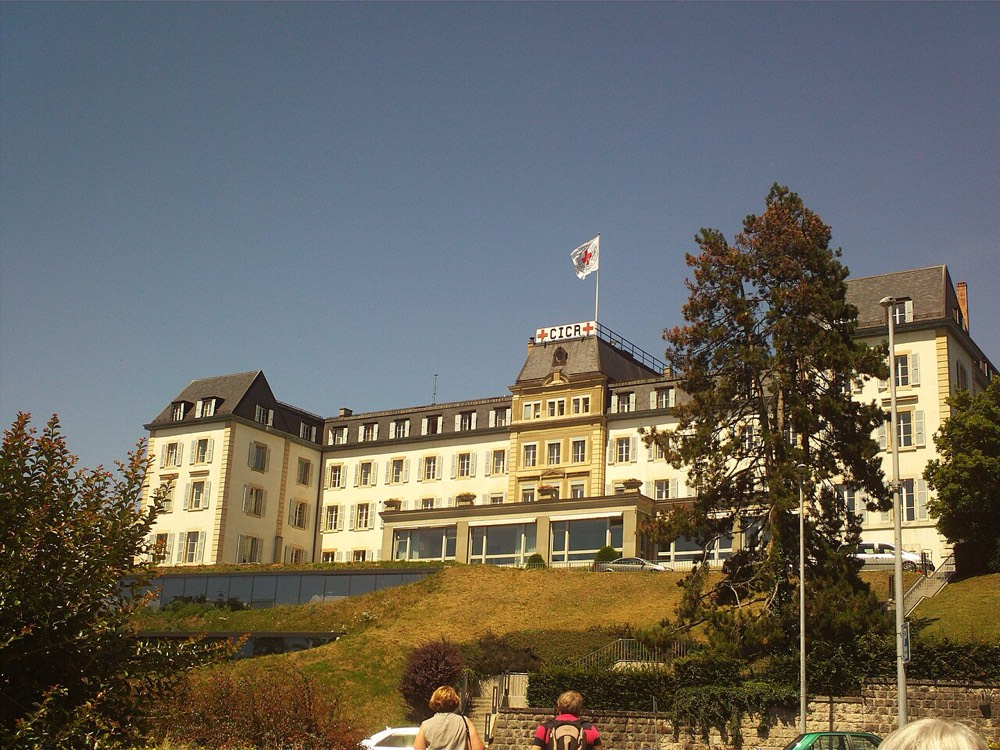

[← Protecting Humanity Through Law in War and Peace](README.md) · [← Lectures 10–11](07-international-criminal-justice-history-and-the-icc.md) · [Lecture 13 →](09-the-right-to-life-in-war-and-peace.md)

# Lecture 12: IHL enforcement and accountability

*ICRC headquarters, Geneva.* The ICRC acts in its own name as an impartial intermediary; IHL still lacks an institutional compliance mechanism.  
Ypsilon from Finland · CC0 · [Wikimedia Commons](https://commons.wikimedia.org/wiki/File:Red_Cross_headquarters.JPG)

## Rules to know cold

1. CA1: 'respect and ensure respect in all circumstances'. Internal (train, instruct, discipline, prosecute) and external (do not aid or assist violations; exert influence to bring violations to an end; ICRC 2016 Commentary). It is an obligation of due diligence; the external dimension is debated (US position: not legally binding).
2. Arms transfers: CA1, the ATT (Art 6: prohibition if knowledge that the arms would be used for genocide, CAH or grave breaches; Art 7: export assessment of the overriding risk of serious IHL violations), and the EU Common Position. Domestic cases: R (CAAT) v Secretary of State (UK Saudi exports, 2019 Court of Appeal: unlawful failure to assess past violations); Dutch Supreme Court on F-35 parts to Israel (3 Oct 2025: it quashed the appeal court's ban because courts may not substitute their own 'clear risk' assessment, and ordered the Minister to reassess under ATT criteria within six weeks; exports stayed halted).
3. Nicaragua v Germany (ICJ, 2024): Nicaragua alleged breaches of the Genocide Convention and CA1 through arms supply to Israel. Provisional measures were refused (circumstances not requiring them), but the Court reminded all States of their obligations regarding arms transfers.
4. Military manuals, legal advisers (API Art 82) and military justice systems are where compliance mostly happens. Weapons review (API Art 36).
5. Grave breaches regime (GCI 49–50; GCII 50–51; GCIII 129–130; GCIV 146–147; API 85): an obligation to search for and prosecute or extradite (aut dedere aut judicare), with mandatory universal jurisdiction. It applies only in IAC.
6. Command responsibility (API Arts 86–87; Rome Art 28): the superior knew or should have known (military) or consciously disregarded information (civilian), had effective control, and failed to take necessary and reasonable measures to prevent, repress or submit for prosecution. Bemba Appeals (2018) acquitted, emphasising remote commanders' limited measures.
7. Monitoring: the ICRC (confidential dialogue; the customary IHL study of 2005 with 161 rules), the International Humanitarian Fact-Finding Commission (API Art 90, activated for the first time in 2017, at the OSCE's request, to investigate the April 2017 incident in which an OSCE Special Monitoring Mission patrol was hit in eastern Ukraine (Luhansk)), UN COIs mandated by the HRC or SC, and documentation by NGOs.
8. The failure of the ICRC–Swiss initiative (Pejic 2016): States rejected a meeting of States and periodic reporting at the 2015 International Conference. IHL lacks an institutional compliance mechanism, unlike IHRL.
9. Accountability through ICL (war crimes) and State responsibility (ICJ; the Art 91 API compensation duty). The NIAC challenge: no grave breaches regime, no combatant immunity, armed groups' capacity, and a lack of reciprocity.
10. ICC enforcement record 2025–26: El Hishri (Libya, Mitiga prison) surrendered by Germany 1 Dec 2025 with charges confirmed 16 July 2026, whereas Italy released Almasri to Libya (Jan 2025) and was found non-compliant (17 Oct 2025, referred 2026). Cooperation depends on States.
11. Nicaragua v Germany (Genocide Convention / CA1 arms supply to Israel): provisional measures refused 30 Apr 2024. Nicaragua filed its Memorial 21 July 2025; Germany raised preliminary objections (no prior dispute, jurisdiction, admissibility), heard 7–10 Sept 2026. Judgment pending (likely 2027).
12. Pejic explains why the ICRC–Swiss process (2012–15) produced so little. While IHL's norms have been updated since 1864, compliance mechanisms 'unique to IHL' remain 'perplexingly absent'. States would not even reconfigure the three existing treaty mechanisms (Protecting Powers, the enquiry procedure, the IHFFC), and insisted that any new Meeting of States be State-driven, consensus-based, voluntary, non-binding, non-politicised, non-contextual and non-selective. Resolution 2 of the 32nd International Conference (2015) merely continued an intergovernmental process. (That process later ended without agreement before the 33rd Conference in 2019.)
13. Mettraux presents war crimes as IHL's answer to its own enforcement failure: ransom, reparations, reprisals and hostage-taking were all tried and proved ineffective, so individual criminal responsibility was attached to the core prohibitions. This broke two taboos: individuals are bound directly by international (penal) law, and States do not have exclusive jurisdiction, since every belligerent may try war criminals under custom and the idea of an international court grew from Moynier to the Kaiser's planned trial and Nuremberg.

## Key passages

> The High Contracting Parties undertake to respect and to ensure respect for the present Convention in all circumstances.
>
> — **Geneva Conventions (1949)**, Common Art 1

*Why it matters:* Internal and external dimension: a due diligence duty on third States (ICRC 2016 Commentary; Wall para 158).

## What the lecturers stressed

- Implementation in the broad sense (all measures ensuring respect) versus the strict sense (transforming IHL into domestic law). Needs: criminal and disciplinary sanctions; status of persons (combatants, medical and civil defence personnel) and objects; military manuals.
- Implementation activities: translation, dissemination, prosecution, marking protected persons and objects, preventing misuse of emblems, training qualified personnel, National Societies, National Information Bureaux. Preventive (dissemination, training, legal advisers) versus repressive (prosecution, disciplinary sanctions).
- Enforcement tools listed in sequence: reciprocity; reprisals; public opinion; Chapter VII; Protecting Powers and the ICRC; the Fact-Finding Commission; State and individual responsibility.
- Reprisals are limited by subsidiarity (last resort after protest, intermediaries, the SC), proportionality, and the prohibition of force. Treaty prohibitions: wounded and sick (GCI 46, GCII 47), POWs (GCIII 13(3)), protected civilians (GCIV 33(3)), the civilian population (API 51(6)), cultural property (API 53), objects indispensable to survival (API 54(4)), the environment (API 55(2)), dams and nuclear stations (API 56(4)). ICRC customary rules 145–148: stringent conditions in IAC; none against GC-protected persons or objects; no belligerent reprisals in NIAC.
- Protecting Power (API Art 2(c)): a neutral State designated by one party and accepted by the other. Tasks: visits, supervision of relief and evacuations, support in legal proceedings, transfer of information, good offices. Used rarely since 1945 (Suez, Goa 1961, India–Pakistan 1971, Falklands 1982).
- The ICRC acts in its own name as an impartial, neutral, independent intermediary, not on a party's instructions; parties must allow visits to detainees; it has a right of initiative (Statutes Art 5(3)), especially in NIAC.
- International Humanitarian Fact-Finding Commission (API Art 90): permanent, impartial, non-political; competence only for States that accept it in advance or ad hoc; no right of initiative; only States may request; facts only, no legal assessment. First used in Eastern Ukraine at the OSCE's request.
- State versus individual responsibility: subject (State versus person), violation (IHL), consequence (reparation versus punishment). Grave breaches of GCs and API are war crimes.
- Conclusion on the slides: enforcement has long been problematic; some tools are soft and others (reprisals) may trigger more violations; it became serious only in the last 20 years with ICL; the ICRC is still looking for effective compliance systems.

## Cases and materials

### Nicaragua v Germany (provisional measures)
*ICJ · 2024*

The request was rejected because the conditions weren't met on the evidence (Germany had reduced exports). The Court recalled all States' obligations under CA1 and the Genocide Convention regarding arms transfers.

**Use it for:** The external dimension of CA1 before the ICJ.

### R (Campaign Against Arms Trade) v Secretary of State
*England and Wales Court of Appeal · 2019*

The government's decision to continue arms sales to Saudi Arabia was unlawful because it made no assessment of whether past IHL violations had occurred, which was relevant to the 'clear risk' test.

**Use it for:** Domestic enforcement of IHL through export controls.

### Bemba (Appeals)
*ICC · 2018*

Bemba's conviction under Art 28 was reversed. The Trial Chamber erred in assessing the 'necessary and reasonable measures' of a remote commander (and on the scope of charges).

**Use it for:** The limits of command responsibility.

## Test yourself

Open the questions (answers are folded under each)

**Q. What does the external dimension of CA1 require?**

Answer

Negatively: not encourage, aid or assist violations by other parties (e.g. arms transfers knowing of a clear risk). Positively: take feasible measures to bring violations to an end, a due diligence standard (ICRC 2016).

**Q. What are the elements of command responsibility under Art 28(a)?**

Answer

An underlying crime; effective control (and command or authority); knowledge or 'should have known'; failure to take necessary and reasonable measures to prevent, repress or submit for prosecution; and the crimes resulted from the failure to exercise control properly (causation).

**Q. What does the grave breaches regime require of States?**

Answer

Enact legislation with effective penal sanctions, search for persons alleged to have committed grave breaches regardless of nationality, and try them or hand them over (aut dedere aut judicare). Universal and mandatory, but only in IAC.

**Q. Why did the ICRC–Swiss compliance initiative fail?**

Answer

States resisted a Meeting of States with reporting and thematic discussions, fearing politicisation and loss of control. The 32nd International Conference (2015) adopted only a weak process to continue talks.

**Q. List the enforcement mechanisms of IHL from the lecture.**

Answer

Reciprocity; reprisals (heavily restricted); public opinion; Chapter VII; Protecting Powers and the ICRC; the International Humanitarian Fact-Finding Commission (API Art 90); State responsibility (reparation, API Art 91) and individual criminal responsibility (grave breaches, war crimes).

**Q. What are the limits of the IHFFC?**

Answer

Competence only if States accepted it (in advance or ad hoc); only States can request an enquiry; no right of initiative; it establishes facts and does not make legal assessments. It was used for the first time in Eastern Ukraine at the OSCE's request.

**Q. When are belligerent reprisals still lawful?**

Answer

Only in IAC, against persons and objects not protected by treaty or custom, as a last resort, proportionate and after warning (ICRC Rule 145). Prohibited against GC-protected persons and objects (Rules 146–147) and entirely in NIAC (Rule 148).

**Q. What conditions did States impose on any new IHL compliance forum (Pejic)?**

Answer

State-driven and consensus-based; voluntary and non-binding; non-politicised, non-contextual (no naming specific conflicts) and non-selective; universal and impartial; no new legal obligations and no reconfiguring of existing mechanisms. The result, Resolution 2 (2015), only continued talks. Contrast IHRL's reporting and complaint systems.

