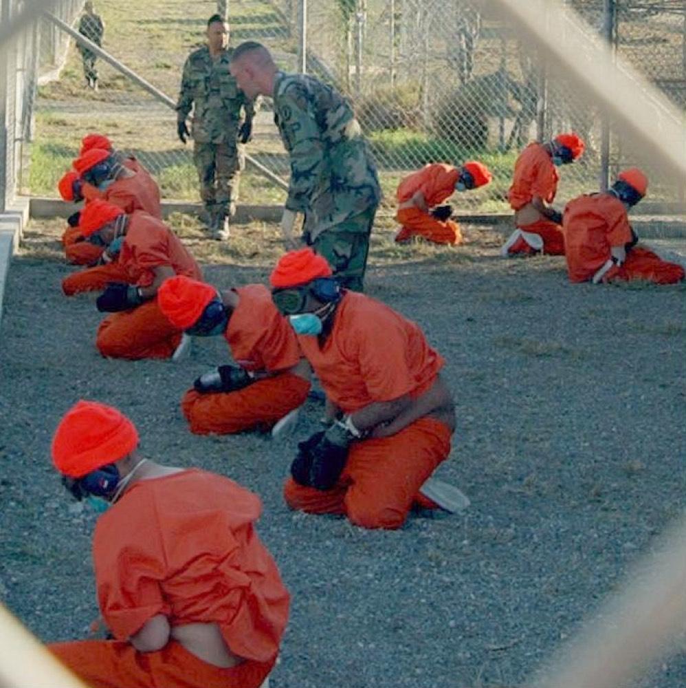

[← Protecting Humanity Through Law in War and Peace](README.md) · [← Lecture 13](09-the-right-to-life-in-war-and-peace.md) · [Lecture 15 →](11-torture-and-ill-treatment-starvation-and-aid.md)

# Lecture 14: Liberty, detention and fair trial

*Detainees at Camp X-Ray, Guantánamo Bay, January 2002.* The 'legal black hole': status, grounds, treatment and review (Rasul, Boumediene, Hassan).  
Shane T. McCoy, U.S. Navy · Public domain · [Wikimedia Commons](https://commons.wikimedia.org/wiki/File:Camp_x-ray_detainees.jpg)

**Mind map:** [Liberty, detention and fair trial](https://tomasemilioeee-a11y.github.io/pil-humanity-study-guide/mind-maps/liberty.html), interactive, with recall mode and search.

## Rules to know cold

1. ICCPR Art 9 (no arbitrary arrest or detention; reasons, prompt appearance before a judge, habeas corpus, compensation; GC 35). ECHR Art 5 (an exhaustive list of permitted grounds in 5(1)(a)–(f); safeguards in 5(2)–(5)).
2. Arbitrariness is broader than unlawfulness: inappropriateness, injustice, lack of predictability, necessity and proportionality (GC 35 para 12). Security detention outside criminal proceedings is extremely limited in peacetime.
3. Positive obligations: protection against slavery and trafficking (Rantsev), refugees and migrants (immigration detention as a last resort; no detention of children), and enforced disappearance.
4. Fair trial (ICCPR Art 14; ECHR Art 6): an independent and impartial tribunal, presumption of innocence, defence rights. The core is non-derogable in practice (GC 29, GC 32).
5. IAC: POWs may be interned until the end of active hostilities (GCIII 21, 118) without individual review. Civilians may be interned only if 'absolutely necessary' for security (GCIV 42) or for 'imperative reasons of security' in occupation (78), with initial and six-monthly review.
6. NIAC: CA3 and APII protect detainees (humane treatment, fair trial by a 'regularly constituted court'), but there is no explicit legal basis for internment. Serdar Mohammed: the High Court (Leggatt J, 2014) held that NIAC IHL gives no power to detain. The UK Supreme Court (2017) found authority in the SC resolutions, left the IHL question open (the Justices were divided), and held that the review procedures fell short of Art 5(4). The ICRC says custom implicitly permits it. Plemanac and Teferra on the limits of security detention.
7. Co-application: Hassan v UK (IAC internment compatible with Art 5 read in light of IHL, without derogation). For NIAC, derogation is probably needed, or an IHRL legal basis.
8. Extraordinary rendition and black sites (Duffy): shared responsibility of host and complicit States. El-Masri v FYROM (2012): torture, enforced disappearance and arbitrary detention. Al Nashiri and Abu Zubaydah v Poland (2014): Poland's complicity in CIA black sites; Art 3 and Art 5 violations, risk of the death penalty.
9. Detention by non-state armed groups: obligations under CA3 (humane treatment), and the ICRC's push for standards.
10. Administrative (preventive) detention is not expressly prohibited by IHRL but is detention without trial, so it must be prescribed by law, necessary for a legitimate aim and subject to continuous judicial review; prolonged detention without trial has been argued to be ill-treatment in itself. In practice it is used to stifle opposition and was revived in counter-terrorism (Guantánamo, Belmarsh). Example: Israel's Incarceration of Unlawful Combatants Law 2002 (14 days without judicial review, lawyer access restricted up to 7 days, renewable 6-month orders) and Military Order 1651 for the West Bank (96 hours without review; 6-month renewable orders on undefined 'regional or public security'; classified evidence). Even under IHL such detention must be exceptional (GCIV 78).
11. Military and special courts: the HRC still allows military courts to try civilians in exceptional cases (GC 32 para 22), but HRC member Salvioli (Akwanga v Cameroon, 2011) argues that only an absolute ban is compatible with ICCPR Art 14, given the history of courts-martial used against political opponents and to shield soldiers. The African Commission (Egyptian Initiative for Personal Rights and Interights v Egypt, 2011, State Security Emergency Court, torture-based confessions, no appeal) held that tribunals not using duly established procedures 'shall not be created to displace the jurisdiction' of ordinary courts. Relevant to Guantánamo military commissions and to CA3's 'regularly constituted court'.

## What the lecturers stressed

- Five questions for any detention problem: (1) applicable law (IAC, NIAC, none; which IHRL obligations); (2) status of the detainee; (3) authority and grounds; (4) treatment; (5) review and release.
- IHRL baseline: ICCPR Art 9 (legal basis, not arbitrary); ECHR Art 5(1) (enumerated grounds only); safeguards: reasons, prompt judicial control in criminal cases, habeas corpus. Detention review (ICCPR 9(4), ECHR 5(4): may the person remain detained?) is distinct from a criminal trial (ICCPR 14, ECHR 6: did they commit an offence?). Security internment does not establish guilt.
- Context: the US Military Order of 13 November 2001 — detention and military commissions for non-citizens designated by the President, with an express denial of any remedy in any court, domestic, foreign or international.
- Arbitrary detention is prohibited in IAC and NIAC (ICRC customary Rule 99) — here IHL and IHRL are in harmony. Internment is preventive; punishment requires separate proceedings.
- IAC: GCI and II (medical and religious personnel), GCIII (POWs until the end of hostilities; Art 13 humane treatment, no reprisals, protection from public curiosity), GCIV Arts 42–43 ('absolutely necessary', regular review) and Art 78 (imperative security reasons, appeal and review in occupation); API Art 75 (prompt reasons in a language understood) as a minimum standard for all situations. Unlawful confinement is a grave breach (GCIV Art 147).
- NIAC: the prohibition of arbitrary detention is customary; Duffy — 'detention is not an alternative to criminal law'; whether NIAC IHL itself authorises internment is contested (Akande; Serdar Mohammed, High Court 2014). CA3 binds organised armed groups too. The ICRC seeks consensus rules, as with DPH. Open question: apply IAC rules by analogy, or IHRL undiluted because there is no lex specialis? Is undiluted IHRL realistic for 'battlefield detention'?
- Guantánamo: no POW status for anyone, more than two years without an Art 5 'competent tribunal', 5 m² cells, sleep deprivation, no lawyers. A 'legal black hole'? Under the IAC framework everyone is either a combatant (GCIII) or a civilian (GCIV, subject to its Art 4 nationality conditions), with IHRL as the floor. Combatant criteria: membership of armed forces or integrated militias, or militias meeting the four Hague conditions (applied to the Taliban and al-Qaeda). Location and type of conflict matter.
- IHRL on security detention: a margin of appreciation for terrorism suspects, but pre-trial detention is the exception (Duffy); derogation must be necessary and proportionate; detention must never be arbitrary, unacknowledged or prolonged, and needs safeguards. Abu Zubaydah v Poland (2014) para 523: terrorism gives no carte blanche under Art 5; also Al-Hawsawi v Lithuania (2024).
- US courts: Rasul v Bush (2004) and Boumediene v Bush (2008) secured habeas review in the DC District Court; Combatant Status Review Tribunals gave way to Administrative and then Periodic Review Boards.
- Hassan v UK (GC 2014): Tarek Hassan was captured armed with intelligence documents and held at Camp Bucca. The UK argued jurisdiction should not apply in active hostilities (para 76); the Court refused, citing the ICJ on concurrent application (para 77). The lack of a derogation does not prevent taking IHL into account when interpreting Art 5 (paras 102–103), but safeguards remain (para 104): a legal basis in IHL, competent body review, no arbitrariness.

## Cases and materials

### Hassan v UK (GC)
*ECtHR · 2014*

In an IAC, internment authorised by GCIII and GCIV may be accommodated within Art 5 even though it is not among the listed grounds, provided there is a legal basis, protection against arbitrariness, and review.

**Use it for:** Co-application in detention.

### El-Masri v FYROM (GC)
*ECtHR · 2012*

FYROM was responsible for the detention, ill-treatment amounting to torture (at Skopje airport by the CIA in the presence of Macedonian officials), and transfer to Afghanistan. It also violated the right to truth.

**Use it for:** Extraordinary rendition; complicity; torture.

### Serdar Mohammed v Ministry of Defence
*UK Supreme Court · 2017*

UK forces in Afghanistan (NIAC) had authority to detain beyond 96 hours based on UNSC resolutions, but violated Art 5(4) by not providing adequate review. The Court was divided on whether IHL provides authority for NIAC detention.

**Use it for:** The legal basis for NIAC detention.

### Abu Zubaydah v Poland
*ECtHR · 2014*

Poland hosted a CIA black site and was responsible for the applicant's torture, secret detention and transfer. Terrorism investigations do not give authorities carte blanche under Art 5 (para 523).

**Use it for:** Complicity in rendition; Art 5 limits in counter-terrorism.

### Boumediene v Bush
*US Supreme Court · 2008*

Guantánamo detainees have the constitutional privilege of habeas corpus; the review procedure under the Detainee Treatment Act was an inadequate substitute.

**Use it for:** Ending the 'legal black hole'.

## Test yourself

Open the questions (answers are folded under each)

**Q. What is the difference between POW internment and civilian internment in IAC?**

Answer

POWs: status-based, until the end of active hostilities, with no review needed (GCIII). Civilians: an exceptional security measure, 'absolutely necessary' or 'imperative reasons of security', individualised, with periodic review (GCIV 42–43, 78).

**Q. Why is NIAC detention problematic?**

Answer

CA3 and APII regulate treatment but don't provide an explicit power to intern. IHRL requires a legal basis and judicial review, so States need domestic law, SC authorisation, or a derogation.

**Q. What did Hassan decide, and why is it controversial?**

Answer

Art 5 is interpreted to accommodate IHL internment in IAC without derogation. Critics say the Court rewrote an exhaustive list and should have required Art 15 derogation.

**Q. Which rights are violated by extraordinary rendition?**

Answer

Liberty (arbitrary and secret detention), torture and ill-treatment, enforced disappearance, the right to truth and to an effective remedy, and non-refoulement (risk of torture or the death penalty). Complicity of participating States (El-Masri; Al Nashiri).

**Q. What are the five questions for any detention problem?**

Answer

(1) Applicable law: IAC, NIAC or none, and which IHRL obligations? (2) Status of the detainee. (3) Authority and grounds for detention. (4) Treatment and conditions. (5) Review and release: how can it be challenged, and when must it end?

**Q. Detention review versus criminal trial?**

Answer

Review asks whether a person may lawfully remain detained and can lead to release (ICCPR 9(4), ECHR 5(4); GCIV 43, 78). A trial asks whether the person committed an offence and leads to acquittal or conviction (ICCPR 14, ECHR 6). Security internment never establishes guilt.

**Q. When is administrative (security) detention compatible with IHRL?**

Answer

Only exceptionally: a clear legal basis, necessity for a legitimate aim, prompt and continuous judicial review with real access to the evidence and a lawyer, and no use as a substitute for criminal proceedings. Regimes with long periods without judicial control, undefined security grounds and classified evidence (e.g. Israel's 2002 Unlawful Combatants Law and Military Order 1651) fail these standards (Bantekas and Oette pp 710–712; Duffy: 'detention is not an alternative to criminal law').

