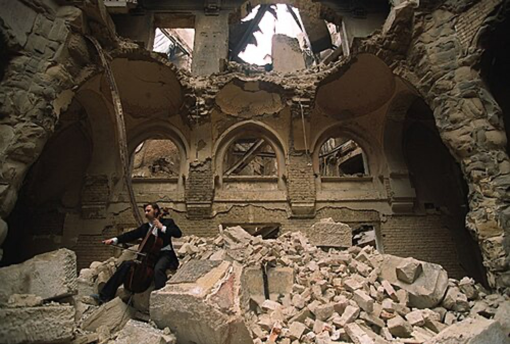

[← Protecting Humanity Through Law in War and Peace](README.md) · [← Lecture 16](12-the-crime-of-aggression.md) · [Lecture 18 →](14-crimes-against-humanity.md)

# Lecture 17: War crimes

*Vedran Smailović plays in the ruined National Library, Sarajevo, 1992.* The siege of Sarajevo: Galić, terror against the civilian population as a war crime.  
Mikhail Evstafiev · CC BY-SA 3.0 · [Wikimedia Commons](https://commons.wikimedia.org/wiki/File:Evstafiev-bosnia-cello.jpg)

**Mind map:** [War crimes](https://tomasemilioeee-a11y.github.io/pil-humanity-study-guide/mind-maps/war-crimes.html), interactive, with recall mode and search.

## Rules to know cold

1. Definition (Tadić Jurisdiction para 94): a serious violation of a rule of IHL (treaty or custom) that protects important values and entails individual criminal responsibility under IL.
2. Rome Art 8 structure: (2)(a) grave breaches of the GCs (IAC); (2)(b) other serious violations in IAC; (2)(c) serious violations of CA3 (NIAC); (2)(e) other serious violations in NIAC. Art 8(1): jurisdiction 'in particular' when committed as part of a plan or policy or large-scale commission (a gravity filter, not an element).
3. Contextual elements (Elements of Crimes): (1) the conduct took place in the context of and was associated with an armed conflict (nexus: Kunarac, the conflict 'played a substantial part' in the perpetrator's ability, decision or manner); (2) awareness of the factual circumstances establishing armed conflict; (3) the victims are protected persons (for grave breaches) or not taking active part in hostilities.
4. Categories (Robinson and Cryer): against persons (wilful killing, torture, hostage-taking, outrages on personal dignity, rape and sexual violence, child soldiers under 15 per Lubanga); attacks on prohibited targets (civilians, civilian objects, humanitarian personnel, protected buildings such as hospitals and cultural property, per Al Mahdi); excessive incidental damage (8(2)(b)(iv), 'clearly excessive', IAC only); property (pillage, destruction not justified by military necessity); prohibited means (poison, chemical and biological weapons, expanding bullets); prohibited methods (perfidy, starvation, no quarter, human shields).
5. Differences between IAC and NIAC have narrowed through custom (Tadić para 127) and amendments (2010, 2017, 2019). Gaps remain in the Rome Statute: disproportionate attacks only in IAC.
6. Modes of liability: commission (Art 25(3)(a), co-perpetration with control over the crime, per Lubanga), ordering, aiding and abetting, common purpose (25(3)(d)), and command responsibility (Art 28).
7. Command responsibility: effective control, knowledge or 'should have known', failure to take necessary and reasonable measures, causation (ICC). The ICTY lacked the causation requirement (Čelebići; Halilović).
8. Hathaway et al. 'What is a War Crime?': there is no comprehensive definition, and the categories are inconsistent across instruments. They propose a test. Meron: international tribunals' contribution to war crimes law (the expansion to NIAC, the role of custom). Mettraux traces the history of the law of war crimes (Leipzig to Nuremberg to the ad hoc tribunals).
9. Mettraux's definition: a war crime is 'a serious violation of the laws or customs of war for which the perpetrator incurs individual criminal responsibility as a direct result of the operation of international law', with three elements: an armed conflict (including occupation), a violation of IHL with a nexus to that conflict, and international criminalisation. The history is 'layered': limits on war, then customs, then laws, then crimes; responsibility moved from sovereigns to individuals, in roughly seven phases from the 12th century to the post-1990s tribunals. Conclusion: war crimes are 'the point at which IHL meets international criminal law'.
10. Meron on legality: Nuremberg had to rely on custom because the 1929 Geneva Convention did not apply on the eastern front, the Hague Convention's si omnes clause was contested, and neither treaty expressly criminalised its violations. The ILC's 1994 draft simply referred to 'crimes under general international law', whereas the Rome Statute lists and defines each crime, including those applicable in NIAC. This 'specificity approach', reinforced by the Elements and the tribunals' detailed case law, 'harmonizes more closely with the principle of nullum crimen' and is now ascendant.
11. Defences: duress and superior orders. In Erdemović (ICTY Appeals 1997) the majority held duress is no complete defence to killing innocent civilians (only mitigation). Cassese, dissenting, said the law 'should not set intractable standards' demanding martyrdom. Rome Art 31(1)(d) now allows duress as a full defence where there is a threat of imminent death or serious bodily harm, the person acts necessarily and reasonably to avoid it and does not intend greater harm than the one avoided. Superior orders (Art 33) are a defence only if the person was legally obliged to obey, did not know the order was unlawful and it was not manifestly unlawful; orders to commit genocide or CAH are always manifestly unlawful. Contrast the IMT and ICTY: mitigation only.

## What the lecturers stressed

- History: the 1919 Commission on the Responsibility of the Authors of the War; Nuremberg Charter Art 6(b) (murder, ill-treatment or deportation of civilians, murder of POWs, killing hostages, plunder, wanton destruction not justified by military necessity); ICTY Art 2 (grave breaches) and Art 3 (laws or customs of war); ICTR Art 4 (CA3 and APII violations).
- Tadić's three-part formulation: a serious infringement (a rule protecting important values, grave consequences for the victim), a customary or applicable treaty rule, and individual criminal responsibility. Non-serious example: a combatant taking a loaf of bread in an occupied village (Hague Regs Art 46(1)).
- Contextual elements: (I) an armed conflict exists (Tadić definition, covering inter-State, government v group, and group v group); (II) classification, because it decides which list applies — Hadžihasanović: what is a war crime in IAC is not necessarily one in NIAC; (III) nexus. Art 8(1)'s 'plan or policy or large-scale commission' is a jurisdictional guide, not a customary element.
- IAC types: CA2 (Pictet: 'the respect due to human personality is not measured by the number of victims'; but a specific intention by one State to engage another — border incidents are debated; Wilmshurst: classification is often subjective in practice); occupation (CA2(2), Hague Regs 42); wars of national liberation (API Art 1(4), with a unilateral declaration to the Swiss depositary — the Polisario Front in 2015).
- NIAC types: CA3 (intensity and organisation, distinct from riots and banditry); APII (State forces involved, organised groups under responsible command with territorial control enabling sustained operations; not riots or sporadic violence) — CA3 keeps an autonomous existence. Rome Art 8(2)(f): CA3-level threshold plus 'protracted' (Delalić). Cross-border NIACs against groups in an 'unwilling or unable' host (Solis) remain controversial.
- Tadić's 'revolutionary moment' (1995): customary law criminalises serious CA3 violations, shown by State practice, national prosecutions, military manuals and unanimous SC resolutions (e.g. on Somalia).
- Foreign intervention in a NIAC: on the government's side, the conflict stays internal; on the rebels' side, a 'double qualification' (IAC and NIAC in parallel). Indirect intervention: Tadić Appeals overall control (organising, coordinating or planning plus financing, training, equipping — no specific orders needed).
- Nexus: Tadić ('an obvious link'); Kunarac — the conflict must have played a substantial part in the perpetrator's ability, decision, manner or purpose. Indicators: perpetrator is a combatant; victim a non-combatant or member of the opposing party; the act serves the military campaign; committed as part of official duties.
- Six categories: crimes against non-combatants; attacks on prohibited targets (religious, cultural, medical); attacks causing excessive civilian damage; crimes against property (pillage); prohibited means (poison, chemical and biological weapons); prohibited methods (starvation, terror, child soldiers).
- Art 8 as adopted in 1998 listed 34 acts for IAC (8(2)(a): 8; (b): 26) and 16 for NIAC ((c): 4; (e): 12). The 2010 Kampala amendment added three weapons crimes to (e) (giving the slides' 19), the 2017 amendments added three weapons crimes to both (b) and (e), and the 2019 amendment added starvation to (e)(xix). The amendments bind only ratifying States. The Elements of Crimes, drafted by States, aim at certainty and curb judicial creativity.
- What you must prove: (1) an armed conflict; (2) its nature; (3) a protected person or object (not needed for sexual violence); (4) nexus; (5) actus reus; (6) mens rea — intent and knowledge under Art 30 unless otherwise provided.
- Lecture 18 recap of IHL core principles as war crimes (Heinsch): Art 8(2)(b)(i) attacks on civilians ('distinction persons'), (ii) civilian objects ('distinction objects'), (iii) humanitarian or peacekeeping missions, (iv) clearly excessive incidental harm or widespread, long-term and severe environmental damage ('proportionality'), (v) undefended towns, (xx) weapons causing superfluous injury, if comprehensively prohibited and annexed. Note: there is no war crime for failing to take precautions.
- Military objectives (API 52(2); ICRC Rule 8): by nature, location, purpose or use making an effective contribution to military action, whose destruction, capture or neutralisation offers a definite military advantage in the circumstances ruling at the time. Civilian objects are defined negatively (52(1)); in doubt, a normally civilian object such as a school or place of worship is presumed not to be used militarily (52(3)).
- Indiscriminate attacks (API 51(4)(a)–(c); Rules 11–12): not directed at a specific military objective, or using means that cannot be directed or whose effects cannot be limited. Area bombardment treating separate objectives as one in a populated area is prohibited (51(5)(a)).
- Proportionality (API 51(5)(b)): two problems flagged — comparing unlike values (no numerical formula for 'excessive') and judging under uncertainty (based on information reasonably available before the attack, not the outcome). Broad State interpretations may be one of the biggest causes of civilian casualties.
- Precautions in attack (API 57) and against the effects of attack (API 58). Unnecessary suffering (API 35(1)–(2)): the choice of means is not unlimited; 35(3) widespread, long-term and severe environmental damage.

## Cases and materials

### Tadić (Jurisdiction Appeal)
*ICTY · 1995*

The four conditions for war crimes (para 94). Violations of CA3 and customary rules in NIAC entail individual criminal responsibility (para 134).

**Use it for:** The foundational test; war crimes in NIAC.

### Kunarac (Appeals)
*ICTY · 2002*

The nexus requirement: the armed conflict need not have caused the crime, but must have played a substantial part in the perpetrator's ability to commit it, decision to commit it, the manner of commission, or its purpose.

**Use it for:** The nexus to armed conflict.

### Lubanga (Trial and Appeals)
*ICC · 2012 / 2014*

Conscripting, enlisting and using children under 15 to participate actively in hostilities in NIAC. Co-perpetration requires an essential contribution under the 'control over the crime' theory.

**Use it for:** The first ICC conviction; child soldiers; modes of liability.

### Al Mahdi
*ICC · 2016*

A guilty plea to the war crime of intentionally directing attacks against religious and historic monuments in Timbuktu, with reparations to the community.

**Use it for:** Cultural heritage; reparations.

### Abd-Al-Rahman (Ali Kushayb)
*ICC Trial Chamber I · 2025*

On 6 Oct 2025 he was convicted of 27 counts of war crimes and CAH (Darfur 2003–04, Janjaweed); sentenced to 20 years on 9 Dec 2025. The first conviction in an SC-referred situation (Res 1593); appeals pending.

**Use it for:** War crimes in NIAC; SC referral; leadership on the ground.

### Yekatom and Ngaïssona
*ICC Trial Chamber V · 2025*

On 24 July 2025 Anti-Balaka leaders were convicted of war crimes and CAH against Muslim civilians in CAR (2013–14); Yekatom 15 years, Ngaïssona 12 years; appeals pending.

**Use it for:** Attacks on civilians; persecution in NIAC.

## Test yourself

Open the questions (answers are folded under each)

**Q. What are the four Tadić conditions for a war crime?**

Answer

(1) A violation of a rule of IHL; (2) the rule is customary or applicable treaty law; (3) the violation is serious (breaches a rule protecting important values, with grave consequences); (4) it entails individual criminal responsibility under IL.

**Q. What are the contextual elements of war crimes under the Rome Statute?**

Answer

The conduct took place in the context of and was associated with an IAC or NIAC (nexus); the perpetrator was aware of the factual circumstances establishing armed conflict; protected status of the victims or objects.

**Q. Name the four subsections of Rome Art 8(2).**

Answer

(a) grave breaches (IAC); (b) other serious violations of the laws and customs (IAC); (c) serious violations of CA3 (NIAC); (e) other serious violations (NIAC).

**Q. Which war crime exists in IAC but not in NIAC in the Rome Statute, and why does it matter?**

Answer

Launching attacks knowing they will cause clearly excessive incidental civilian harm (8(2)(b)(iv)). In NIAC, prosecutors must rely on intentional attacks on civilians, a gap in protection.

**Q. What six things must the Prosecutor prove for a war crime?**

Answer

(1) An armed conflict existed; (2) its character (IAC or NIAC), deciding which Art 8 list applies; (3) the victim or object was protected (except sexual violence); (4) a nexus to the conflict; (5) the actus reus; (6) the mens rea (Art 30 intent and knowledge unless otherwise provided).

**Q. What are Kunarac's nexus indicators?**

Answer

The perpetrator is a combatant; the victim is a non-combatant; the victim belongs to the opposing party; the act serves the ultimate goal of a military campaign; the crime is committed as part of, or in the context of, the perpetrator's official duties.

**Q. How is a NIAC classified when a foreign State intervenes?**

Answer

Intervening for the government: it remains a NIAC. Intervening for the rebels with its own troops: double qualification (an IAC between the States, a NIAC between government and rebels). Indirect intervention: if the State has overall control over the group (Tadić), the whole conflict becomes international.

**Q. Is duress a defence to killing civilians?**

Answer

ICTY (Erdemović, Appeals 1997): not a complete defence to killing innocents, only mitigation; Cassese dissented ('intractable standards', martyrdom). ICC: yes, under Art 31(1)(d), if there is a threat of imminent death or serious bodily harm, the reaction is necessary and reasonable, and the person does not intend greater harm than the one sought to be avoided. Superior orders are separate (Art 33: limited defence, never for genocide or CAH).

**Q. What are Mettraux's three elements of a war crime, and where do war crimes sit?**

Answer

(1) An armed conflict, including occupation; (2) conduct violating IHL with a nexus to that conflict; (3) international law criminalises it, so individual responsibility arises directly from international law. War crimes are 'the point at which IHL meets international criminal law': an extra criminal layer on top of core IHL prohibitions, born from the failure of reprisals and reparations as enforcement.

