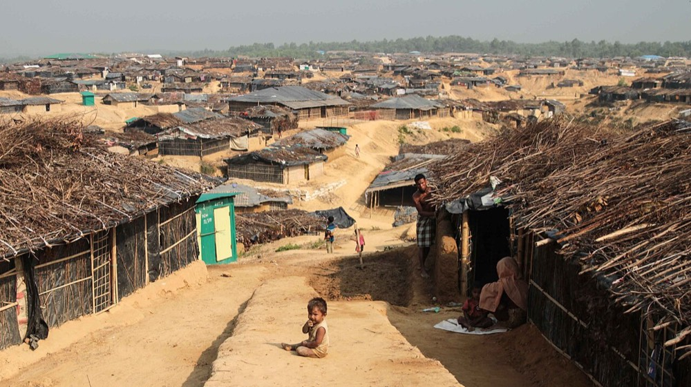
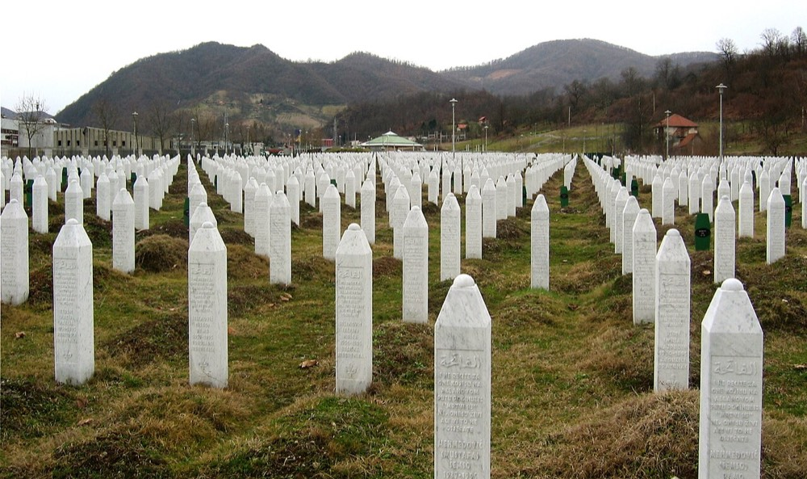

[← Protecting Humanity Through Law in War and Peace](README.md) · [← Lecture 18](14-crimes-against-humanity.md) · [Lecture 20 →](16-protecting-humanity-in-a-changing-world.md)

# Lecture 19: Genocide

*Kutupalong refugee camp, Cox's Bazar, Bangladesh.* Gambia v Myanmar (19 Nov 2026): by 9–6 the ICJ found that Myanmar committed genocide against the Rohingya.  
John Owens (VOA) · Public domain · [Wikimedia Commons](https://commons.wikimedia.org/wiki/File:Kutupalong_Refugee_Camp_(John_Owens-VOA).jpg)

*Srebrenica–Potočari memorial.* Krstić: the killing of some 7,000–8,000 Bosnian Muslim men at Srebrenica was genocide; a substantial, emblematic 'part' of the group.  
Michael Büker · CC BY-SA 3.0 · [Wikimedia Commons](https://commons.wikimedia.org/wiki/File:Srebrenica_massacre_memorial_gravestones_2009_1.jpg)

## Rules to know cold

1. Genocide Convention Art II (copied in Rome Art 6): acts committed with intent to destroy, in whole or in part, a national, ethnical, racial or religious group, as such: (a) killing members; (b) causing serious bodily or mental harm; (c) deliberately inflicting conditions of life calculated to bring about physical destruction; (d) imposing measures to prevent births; (e) forcibly transferring children.
2. It is both a crime for individuals (Art III punishable acts, including conspiracy, direct and public incitement, attempt, complicity) and a basis for State responsibility (Bosnia v Serbia: States are bound not to commit genocide, and have duties to prevent and punish, Art I).
3. Protected groups: four only (political and social groups excluded during the 1948 drafting, per Schabas). Akayesu's 'stable and permanent groups' extension has not been followed. Identification is through objective and subjective criteria (the perpetrator's perception, Jelisić; Stakić: positive, not negative, definition).
4. Dolus specialis: the intent to destroy the group as such, physical or biological destruction. Cultural genocide was excluded (Krstić; Bosnia para 344), though attacks on cultural property may evidence intent.
5. 'In part': a substantial part, quantitatively or qualitatively significant (Krstić: the Bosnian Muslims of Srebrenica, emblematic). It can be geographically limited (Bosnia para 199).
6. Proving intent: rarely direct, so it is inferred from circumstantial evidence. The ICJ still requires 'fully conclusive' evidence and 'the only reasonable inference' (Bosnia para 373; Croatia para 148), and Gambia v Myanmar (2026) kept both (paras 80, 438). But it REFINED the test. (1) It is a general test of international criminal law for circumstantial evidence (para 442). (2) Genocidal intent may coexist with other compatible intents such as displacement or punishment, and the test is met if 'the totality of the evidence can only be explained by the perpetrator's genocidal intent' even where some evidence allows other intentions (paras 443, 456, 464). (3) The respondent need not prove an alternative inference to a fully conclusive standard (para 450). (4) No prior 'pattern of conduct' finding is required; the Court weighs a non-exhaustive array of 'factors', including non-Art II conduct such as hate speech and discriminatory laws (paras 387-397). (5) A low death percentage is not decisive: compare with the targeted part and count all Art II victims (paras 429-430). This largely accepts the interveners' arguments (Canada and five others, the Maldives, Ireland, Slovenia, DRC, Belgium). The joint dissent of six judges says the standard was lowered in practice.
7. Kress's structural debate: individual intent versus a collective genocidal campaign (the Elements' 'manifest pattern of similar conduct' contextual element, ICC Al-Bashir). He criticises the ICJ in Bosnia v Serbia: it accepted collective genocidal intent only in theory, then examined the intent of unnamed individual perpetrators 'as though such intent could have existed in the absence of a collective genocidal act'. In his view the individual's genocidal intent normally presupposes knowledge of a collective genocidal campaign, without which there is only a 'vain genocidal hope'.
8. Divergence and fragmentation: ICTY and ICTR jurisprudence (Akayesu, the first conviction, rape as genocide; Krstić; Jelisić) versus the ICJ's stricter evidentiary approach (Bosnia: only Srebrenica, Serbia not responsible for commission). There is debate over whether the ICJ demands a higher 'fully conclusive' standard of proof.
9. ICJ genocide cases. Gambia v Myanmar was DECIDED on 19 Nov 2026 after merits hearings of 12-29 Jan 2026. By 9-6 Myanmar committed genocide against the Rohingya in northern Rakhine (2017 clearance operations), the first ICJ finding that a State itself committed genocide. It also breached the duties to prevent (9-6), to punish (11-4) and to legislate under Art V (14-1), and breached the 2020 provisional measure on preserving evidence (11-4). No incitement of private actors (14-1). Orders: legislate, investigate and prosecute, guarantees of non-repetition, restitution (return, property, rehabilitation, non-discrimination) and compensation to the Rohingya, with a report due within 2 years. Still pending: South Africa v Israel (provisional measures Jan, Mar and May 2024; Israel's Counter-Memorial, including jurisdictional objections, filed 12 Mar 2026; Reply due 22 Nov 2027, Rejoinder 22 May 2029); Ukraine v Russia (jurisdiction limited in 2024 to whether Ukraine committed genocide; Russia's counter-claims admitted Dec 2025); Nicaragua v Germany (hearings on preliminary objections Sept 2026).
10. Genocide in war: genocide can be committed in or outside armed conflict, and military objectives don't exclude genocidal intent (debate on dual intent). There is a relationship with CAH extermination and persecution (persecution versus genocide: discriminatory versus destructive intent).
11. Gambia v Myanmar (2026) on the elements. Rohingya = a distinct ethnic group on objective and subjective criteria (para 310). 'Destroy' is physical or biological but not limited to death: any Art II act, including serious mental harm, can destroy the group as such, and 'physical' appears only in Art II(c) (paras 289-293). Art II(c) 'calculated' is objective: conditions must be capable of causing the slow death of a substantial part, which was not proven (paras 345-356). Art II(d) was met by birth restrictions and sexual violence impairing procreation (paras 363-371). 'In part': about 815,000 northern Rakhine Rohingya, substantial on numbers alone (paras 379-380). IHL compliance may inform intent but does not exclude conduct from the Convention (para 305).
12. Gambia v Myanmar (2026) on the other obligations. PREVENT: breach is 'not conditioned on a finding that genocide has occurred', so a State cannot 'remain idle and gamble that the risk might not ultimately materialize' (para 487; a departure from Bosnia para 431 per Milanovic). PUNISH: an autonomous duty to investigate arises on 'reasonable grounds to suspect'; investigations must be prompt, effective, independent and impartial; prosecuting ordinary crimes is insufficient; Art IV includes command responsibility; destroying evidence and refusing to cooperate with UN mechanisms breaches Art VI (paras 513-554). ART V: genocide must be a distinct offence with genocidal intent and all Art III modes (paras 569-574). INCITEMENT: need not call for killing and may be coded, but must be a direct call to action (paras 499-506).
13. Schabas on ethnic cleansing: it is 'incorrect' to say ethnic cleansing is a form of genocide or even sometimes amounts to it. The material acts may look alike, but the specific intents differ, one to displace and one to destroy, and he thought it 'logically inconceivable' that the two agendas coexist. He adds that ethnic cleansing is a warning sign: genocide is 'the last resort of the frustrated ethnic cleanser'. The drafters deliberately excluded mass displacement (Syria's proposal was rejected). Contrast Gambia v Myanmar (2026, para 456): displacement and genocidal intent may coexist. A clear doctrinal shift to discuss.
14. Schabas on 'as such': the words were the Venezuelan compromise at the Sixth Committee. The UK wanted all reference to motive deleted; the USSR, Lebanon and others wanted listed motives. 'As such' was presented as reintroducing motive implicitly without listing it, though the US insisted the Committee did not necessarily adopt that reading. So whether genocide needs a motive (group membership as the reason) is not settled by the text. Today's courts treat motive as irrelevant to guilt, but the drafting history is ambiguous.
15. Schabas on the Convention's origins: genocide and CAH were 'forged in the same crucible' to describe Nazi crimes and used almost as synonyms at Nuremberg. The split arose only because the IMT tied CAH to the war, leaving peacetime atrocities unpunished, which prompted GA Res 96(I) (India, Cuba, Panama, days after the judgment). Had there been no nexus, 'there would have been no need to define genocide as a distinct international crime'. Now that CAH needs no nexus, the main legal consequence of the genocide label is ICJ access under Art IX; its weight is symbolic. Schwarzenberger: the Convention is 'unnecessary when applicable and inapplicable when necessary'.
16. Kress's knowledge-based approach to genocidal intent: it suffices that the perpetrator commits a prohibited act knowing that it furthers a campaign whose (realistic) goal is to destroy the group in whole or in part; personal desire for destruction is not required. His argument: the list of prohibited acts is drafted from the perspective of subordinates, while the dominant purpose-based approach imposes a leadership-level mens rea, which strains evidence and accessory liability. Eichmann and Arendt's 'banality of evil' show that executors often act without being 'personally imbued' with the collective aim. The purpose-based view remains dominant in the case law (Krstić, Jelisić).
17. Kress's critique of Srebrenica as genocide. First, treating the Bosnian Muslims of Srebrenica (about 40,000, roughly 2.9–3% of the group) as a 'part' lowers the quantitative threshold in a way that is hard to square with genocide's special stigma. Second, only 'part of a part' (the men) was killed and the rest expelled; calling lasting expulsion 'physical disappearance' reintroduces the rejected social concept of destruction 'through the backdoor' of 'in part'. A better route would have been Art II(d) (killing the men plus deporting the women as measures preventing births). In 2007 he faulted the ICJ for adopting Krstić without reasons, while praising it for rejecting Krstić's 'distinct entity' requirement and for limiting 'destroy' to physical or biological destruction. Its test of 'the area of the perpetrator's activity and control' wrongly uses the lone perpetrator as the yardstick.
18. Kress identifies three values protected by the crime: the survival of groups (Lemkin: a destroyed nation's lost 'future contributions to the world'; GA Res 96(I): 'great losses to humanity'), international peace and security, and the individual rights of victims on a massive scale. The perpetrator's view that individuals matter only as group members must not be confused with the law's protective aim.
19. Mazzeschi and Carli (on South Africa v Israel) defend the ICJ's high evidentiary bar: the 'only reasonable inference' test is correct 'by reason of the particular gravity of the crime', even if it approaches beyond reasonable doubt. Do not cite them as critics. They criticise applying the 'fully conclusive' standard to attribution as well. Their proposals: a State's genocidal intent is distinct from that of individual perpetrators (Bosnia separated the two but then examined both); for 'direct' State genocide the pattern of conduct should essentially be a widespread or systematic attack on a protected group; and the relevant intent is that of the Government acting collectively, identified through the primary rules of the Convention rather than ARSIWA attribution. Compare Gambia v Myanmar (2026), which inferred intent from the collective conduct of security forces and organs.

## Key passages

> Finds that the Republic of the Union of Myanmar has committed genocide against the Rohingya group in northern Rakhine State, in violation of its obligations under the Convention on the Prevention and Punishment of the Crime of Genocide;
>
> — **The Gambia v Myanmar**, ICJ Merits (19 Nov 2026), para 646(1), by 9 votes to 6

*Why it matters:* The first ICJ finding that a State itself committed genocide. Against: Sebutinde, Tomka, Abraham, Xue, Nolte and judge ad hoc Kress.

> …the Court will base its assessment of the existence of genocidal intent in the present case on the following factors: (a) the general context, including the perpetration of other culpable acts systematically directed against the Rohingya; (b) the selective targeting of the Rohingya; (c) the perpetration of acts that violate the foundations of the Rohingya group; and (d) the systematic nature and the scale of Myanmar's actions.
>
> — **The Gambia v Myanmar**, ICJ Merits (2026), para 397

*Why it matters:* A four-factor framework for inferring intent; use it to structure a problem answer.

> …genocidal intent may exist alongside other intentions, provided that such intentions are not incompatible with the existence of genocidal intent… When some elements of the evidentiary record may allow additional intentions to be inferred, but the totality of the evidence can only be explained by the perpetrator's genocidal intent, the only reasonable inference standard is met.
>
> — **The Gambia v Myanmar**, ICJ Merits (2026), para 443

*Why it matters:* The refined 'only reasonable inference' test: coexisting intents (displacement, counter-insurgency) no longer defeat the inference (see also para 456).

> …the obligation to prevent genocide does not allow a State that is in a position to act in the face of a serious risk of genocide to remain idle and gamble that the risk might not ultimately materialize… international responsibility for breach of the duty to prevent genocide is not conditioned on a finding that genocide has occurred.
>
> — **The Gambia v Myanmar**, ICJ Merits (2026), para 487

*Why it matters:* A departure from Bosnia para 431; criticised by Judges Tomka, Nolte and Abraham.

> …genocide means any of the following acts committed with intent to destroy, in whole or in part, a national, ethnical, racial or religious group, as such…
>
> — **Genocide Convention (1948)**, Art II

*Why it matters:* The protected groups, the five acts and the dolus specialis.

## What the lecturers stressed

- Origins: Lemkin (protecting minorities); not charged as such at Nuremberg; GA Res 96(I) (11 Dec 1946); Convention adopted 9 Dec 1948. Drafting fights: which groups, jurisdiction, cultural genocide, whether perpetrators must be officials, State responsibility.
- Three key aspects: specific intent to destroy; a specific group; via an enumerated act involving physical or biological destruction. The 'intellectual divide': the legal concept (specific intent, four groups) versus the social concept (mass killing of any human group).
- Dolus specialis (Mettraux): 'eminently specific and evidentially demanding' — an intent, to destroy, a group as such; two levels of special intent (the group as target, and its physical or biological destruction as the intended fate), on top of general intent for the underlying acts.
- 'Only reasonable inference': evidential narratives must be reduced to a single one that dispels any ambiguity. Questions raised: what counts as circumstantial evidence; when inference becomes proof; can intent be inferred from context in a military campaign (Croatia v Serbia, the Brioni transcripts, para 504); can intent exist without mass killing?
- Pillay Commission (UN COI on the OPT) report, 16 Sept 2025 (A/HRC/60/CRP.3): intent may be shown by direct evidence (statements) or circumstantial evidence from the totality and pattern of conduct, including sexual and gender-based violence, acts against children, and conduct before, during and after (para 158); scale, systematic nature, casualties 'far in excess of military necessity' (para 159); other motives for discrete acts do not preclude genocidal intent if it is the only reasonable inference (para 160); officials' statements were received by forces as orders and executed (paras 162–163, 176); no military necessity justified the pattern (paras 177–179); destruction of cultural and religious sites is relevant to intent though not itself an Art II act (paras 188–189); denial of infant milk causing starvation of newborns is 'especially powerful evidence' (para 190).
- 'Destroy' means physical or biological destruction, not of identity (Kamuhanda para 627; Krstić: attacking cultural or sociological characteristics alone is not genocide). Blagojević (para 659): a group is also its history, traditions and relationships; a forcible transfer that prevents the group reconstituting itself can amount to destruction — genocide without killing. Popović (2010, para 824): forcible transfer alone is insufficient to infer intent to destroy (displacement is distinct), but it is relevant.
- 'In part': Krstić — the 7,500 Bosnian Muslim men of Srebrenica were a substantial part of the protected group.
- Protected groups: political, economic and social groups were dropped in the Sixth Committee (opposed by China, the USSR and Poland as unstable) to save the international tribunal clause. No definitions in the Convention or travaux. Akayesu paras 512–515: national (a perceived legal bond of citizenship with reciprocal rights and duties), ethnic (shared language or culture), racial (hereditary physical traits linked to a region), religious (shared religion, denomination or worship). Semanza para 317: case by case, objective context plus perpetrators' subjective perceptions. Krstić paras 554–560: the four groups describe a single phenomenon, roughly 'national minorities'.
- Update (after the lectures): Gambia v Myanmar, Judgment of 19 Nov 2026. The newly developed jurisprudence the lecturers asked students to cite covers the refined 'only reasonable inference' test (coexisting intents, totality of evidence: paras 442-443, 450, 456, 464), the factor-based inference of intent (paras 387-397), scale measured against the targeted part (paras 429-430), and prevention without genocide having occurred (para 487). On Kress's structural debate: the Court inferred the State's intent from the collective conduct of its security forces and organs, without identifying an individual 'mastermind' or a written plan.

## Cases and materials

### Prosecutor v Akayesu
*ICTR · 1998*

The first international genocide conviction. Rape and sexual violence can constitute genocide (serious bodily or mental harm) when committed with intent to destroy. 'Stable and permanent groups' (not followed).

**Use it for:** Sexual violence as genocide; protected groups.

### Prosecutor v Krstić (Appeals)
*ICTY · 2004*

The killing of Bosnian Muslim men at Srebrenica was genocide: the targeted part was substantial and emblematic of the whole group, and forcible transfer of women and children supported the inference. Krstić was guilty as an aider and abettor.

**Use it for:** 'In part'; substantiality; physical destruction.

### Bosnia v Serbia (Genocide)
*ICJ · 2007*

States can be responsible for genocide. Srebrenica was genocide, but not attributable to Serbia. Serbia breached its duty to prevent (capacity to influence) and to punish. Intent must be the only reasonable inference from a pattern of conduct.

**Use it for:** State responsibility; prevention; the evidentiary standard.

### Croatia v Serbia
*ICJ · 2015*

Both claims were rejected. The actus reus was established for some acts, but the intent to destroy was not the only reasonable inference (the aim was forced displacement).

**Use it for:** The difficulty of proving dolus specialis.

### South Africa v Israel (provisional measures)
*ICJ · 2024*

The rights of Palestinians in Gaza to protection from acts of genocide are plausible. Israel was ordered to prevent genocidal acts and incitement, enable humanitarian aid, and (May 2024) halt its military offensive in Rafah in so far as it may inflict destructive conditions of life.

**Use it for:** The plausibility standard; current debates on intent (Mazzeschi and Carli).

### Prosecutor v Blagojević and Jokić
*ICTY · 2005*

Physical or biological destruction is not necessarily the death of group members; a forcible transfer conducted so the group cannot reconstitute itself, especially by separating members, can lead to material destruction (Trial Chamber, para 659). Note: on appeal (2007) Blagojević's conviction for complicity in genocide was quashed, so para 659 is a Trial Chamber dictum; contrast Popović para 824.

**Use it for:** Genocide without killing; the meaning of 'destroy'.

### Prosecutor v Popović et al.
*ICTY · 2010*

Forcible transfer alone is an insufficient basis to infer intent to destroy, because intent to displace differs from intent to destroy, but it is relevant in assessing genocidal intent (para 824).

**Use it for:** Ethnic cleansing versus genocide.

### UN Commission of Inquiry on the OPT (Pillay Commission) report
*UN HRC COI · 2025*

Found genocidal intent in Gaza from officials' statements (direct evidence) and the pattern of conduct (circumstantial), holding that alternative military aims for discrete acts do not exclude genocidal intent where it is the only reasonable inference from the totality of evidence.

**Use it for:** Applying the only-reasonable-inference test in war (lecture's main case study).

### The Gambia v Myanmar (Application of the Genocide Convention), Merits
*ICJ · 2026 (19 Nov)*

By 9-6, Myanmar committed genocide against the Rohingya in northern Rakhine (2017 clearance operations): killing, serious bodily and mental harm, and measures to prevent births, with intent to destroy a substantial part. The 'only reasonable inference' test was retained but met because intent explains the totality of the evidence; counter-insurgency, forcible displacement and punishment were rejected as alternative reasonable inferences (paras 438-467). Also breaches of prevent (9-6), punish (11-4), Art V (14-1) and provisional measure 3 (11-4); no incitement of private actors (14-1). Restitution and compensation are owed to the Rohingya as a group and as individuals, claimable by a non-injured State (paras 585-625).

**Use it for:** The leading authority on proving State genocidal intent (coexisting intents, totality of evidence, factors); duty to prevent without genocide having occurred; duty to investigate; erga omnes partes reparation. Contrast Bosnia (2007) and Croatia (2015).

## Test yourself

Open the questions (answers are folded under each)

**Q. What are the elements of genocide?**

Answer

Actus reus: one of the five Art II acts against members of a protected group (national, ethnical, racial, religious). Mens rea: general intent for the act, plus specific intent (dolus specialis) to destroy the group, in whole or in part, as such.

**Q. What is the 'only reasonable inference' standard?**

Answer

When intent is inferred from circumstantial evidence, genocidal intent must be the only reasonable inference (Bosnia para 373; Croatia para 148). Gambia v Myanmar (2026, paras 442-443) kept the test but clarified it. It is a general ICL test; genocidal intent may coexist with other compatible intents; and it is met when 'the totality of the evidence can only be explained by the perpetrator's genocidal intent', even if some evidence allows other intentions. Critics, including the six-judge joint dissent, say it was applied more loosely than in Croatia.

**Q. What does 'in part' mean in Krstić?**

Answer

A substantial part of the group, judged by numerical size relative to the whole, prominence and emblematic significance, and the perpetrator's area of activity and control (the last factor is contested: Kress 2007, p 627, criticises it as letting a geographically limited 'part of a part' qualify). A geographically limited part can qualify.

**Q. Persecution versus genocide?**

Answer

Both are discriminatory. Persecution (CAH) aims at deprivation of rights on prohibited grounds. Genocide requires intent to physically or biologically destroy the group. Persecution is 'the genus', genocide the extreme form (Kupreškić).

**Q. What duties do States have under Art I of the Genocide Convention?**

Answer

To prevent (due diligence, triggered once the State learns or should have learned of a serious risk; measured by capacity to influence) and to punish (prosecute, cooperate with competent international tribunals). Also the implied obligation not to commit genocide (Bosnia).

**Q. What are Akayesu's definitions of the four protected groups?**

Answer

National: a perceived legal bond of common citizenship with reciprocal rights and duties (para 512). Ethnic: a shared language or culture (513). Racial: hereditary physical traits often linked to a region (514). Religious: a shared religion, denomination or mode of worship (515). Later case law adds a subjective element (Semanza para 317).

**Q. Can genocide be committed without killing?**

Answer

Yes. Art II(b)–(e) acts suffice with the specific intent; and Blagojević held a forcible transfer preventing the group from reconstituting itself can amount to destruction. But Popović: forcible transfer alone does not prove intent to destroy.

**Q. How did the Pillay Commission (2025) handle military-necessity arguments?**

Answer

Other motives for discrete acts (military advantage, destroying an armed group) do not preclude genocidal intent if it remains the only reasonable inference from the totality of evidence; it found casualties far in excess of military necessity and no military necessity justifying the pattern (paras 159–160, 177–179).

**Q. Which factors did the ICJ use to infer Myanmar's genocidal intent (Gambia v Myanmar 2026, para 397)?**

Answer

(a) General context and other culpable acts: discriminatory laws and citizenship denial, Tatmadaw-organised hate speech, earlier operations, forcible displacement. (b) Selective targeting of the Rohingya, with burning of villages and resettlement of non-Rohingya. (c) Acts violating the group's foundations: sexual violence, targeting of children. (d) Systematic nature and scale. No prior pattern-of-conduct finding was required, and the factors are non-exhaustive (paras 387, 396).

**Q. How did Gambia v Myanmar distinguish genocide from ethnic cleansing?**

Answer

Forcible displacement is not genocide as such but can support an inference of intent (para 407). Displacement and genocidal intent may coexist (para 456). Unlike Bosnia and Croatia, there was no transfer or evacuation plan, and the security forces shot, mined and sank boats of fleeing Rohingya, burned villages so there was nothing to return to, and killed children. Displacement therefore did not explain the totality of the evidence (paras 457-462).

**Q. Does breach of the duty to prevent genocide require that genocide occurred?**

Answer

No, according to Gambia v Myanmar 2026, para 487: responsibility 'is not conditioned on a finding that genocide has occurred', and a State may not 'gamble that the risk might not ultimately materialize'. The duty is triggered by a serious risk, including a risk of genocidal intent (para 479). This departs from Bosnia para 431 (Milanovic). Myanmar breached it by failing to restrain non-Rohingya civilians who joined the clearance operations (para 488).

**Q. What does the duty to punish require after Gambia v Myanmar?**

Answer

To investigate (an autonomous, due-diligence duty triggered by reasonable grounds to suspect), to prosecute and to punish, including commanders (superior responsibility is read into Art IV), before a competent and impartial tribunal with effective penalties. Prosecution for ordinary crimes without genocidal intent does not suffice. Under Art VI the State must either prosecute or cooperate with an international penal tribunal. Destroying evidence breaches the duty (paras 513-554).

**Q. Schabas versus Gambia v Myanmar on ethnic cleansing and genocide?**

Answer

Schabas (2000): displacement and destruction are different specific intents and cannot logically coexist, so ethnic cleansing is never genocide, though it may be its 'warning sign'. ICJ (Gambia v Myanmar 2026, paras 407, 456–462): forcible displacement is not genocide as such and can support an inference of intent; displacement and genocidal intent may coexist, and here displacement could not explain the totality of the evidence (boats sunk, villages burned, children killed).

**Q. What are Mazzeschi and Carli's three proposals on proving State genocidal intent?**

Answer

(1) State intent is distinct from individual intent; (2) the relevant pattern of conduct for 'direct' State genocide is essentially a widespread or systematic attack on the protected group; (3) the intent that counts is the Government's, as a collective executive, under the Convention's primary rules rather than ARSIWA. They support the 'only reasonable inference' threshold as correct given the gravity, but reject applying 'fully conclusive' proof to attribution.

**Q. Knowledge-based versus purpose-based genocidal intent?**

Answer

Purpose-based (dominant case law: Akayesu, Krstić, Jelisić): the perpetrator must aim at the group's destruction. Knowledge-based (Kress, after Greenawalt): it suffices to commit a listed act knowing it furthers a collective campaign realistically aimed at destruction. Kress: the actus reus list targets subordinates, so a leadership-level 'purpose' requirement mismatches the definition; Eichmann's 'banality of evil'.

**Q. Why does Schabas say genocide and CAH were 'forged in the same crucible'?**

Answer

Both described the Nazi crimes and were near-synonyms in 1945. The IMT's war nexus for CAH left peacetime atrocities unpunished, so GA Res 96(I) and the 1948 Convention created genocide as a separate crime. With the nexus gone, the main legal difference is ICJ access under Art IX; the rest is symbolic (Bosnians and Darfur victims disappointed by 'only' CAH). Schwarzenberger: 'unnecessary when applicable and inapplicable when necessary'.

