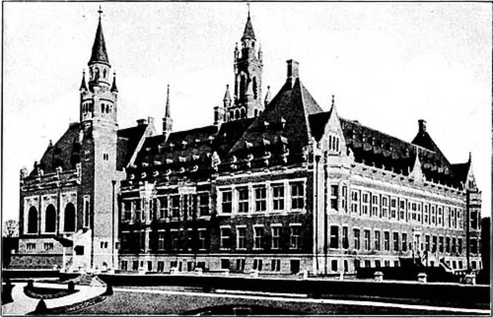

[← Public International Law](README.md) · [Week 2 →](02-states-and-peoples.md)

# Week 1: International law as a discipline

*The Peace Palace, The Hague, seat of the ICJ and the PCA.* A horizontal legal order with no compulsory court: the ICJ decides only with State consent.  
Anonymous (photographer) · Public domain · [Wikimedia Commons](https://commons.wikimedia.org/wiki/File:Peace_Palace_The_Hague_west_and_rear_fa%C3%A7ade.jpg)

## Rules to know cold

1. Definition (Restatement 3rd, 1987): the law concerned with the conduct of States and international organisations and their relations inter se, and some of their relations with natural and legal persons.
2. A horizontal system: no central legislator, executive or compulsory court; its subjects make the law (treaty, custom). Yet not fully equal: permanent membership and the veto (Charter Arts 23, 27(3)) — 'all States are equal, but some are more equal than others'.
3. 'Is it law?' objections: Austin (no sovereign command, no sanction); realists (Morgenthau, Aron: law 'merely ratifies the fate of arms'); Hart (primary rules without full secondary rules of recognition, change and adjudication).
4. Replies: States treat it as law and argue in its terms; sanctions exist in other forms (nullity, non-opposability, responsibility, countermeasures); high compliance (Henkin: 'almost all nations observe almost all principles … almost all of the time').
5. Voluntarism: Lotus (1927) — 'rules of law binding upon States … emanate from their own free will'. Qualified by jus cogens, erga omnes obligations, and custom binding new States.
6. Is it 'international'? Roberts: the field is dominated by a few Western States' practitioners, cases and textbooks.
7. Koskenniemi, 'Histories of International Law: Dealing with Eurocentrism' (compulsory): histories told from Europe (Westphalia, Vitoria, Grotius) as progress; postcolonial critique (Anghie: built through the colonial encounter and the civilising mission), yet the colonised used the same tools (sovereignty, self-determination). Ways to deal with Eurocentrism: colonial origins of rules, the colonial encounter as foundational, hybridisation and agency, 'provincialising' Europe.
8. Doctrinal traces of Eurocentrism: 'civilized nations' in ICJ Statute Art 38(1)(c); Island of Palmas treating agreements with native chiefs as non-treaties; Western Sahara (Bilad Chinguitti lacked personality); uti possidetis freezing colonial borders.
9. Pauwelyn, Wessel and Wouters (recommended): formal treaty-making stagnates while informal law-making (networks, standards, MOUs) grows.
10. Monism and dualism (Hernández ch 4). Monism (Kelsen's single Grundnorm; Lauterpacht placing international law at the apex): treaties apply without transformation (France, Spain, Germany, the Netherlands). Dualism (the UK, the US, Scandinavia): a treaty is not part of domestic law until enacted (Thomas v Baptiste, PC 1999; JH Rayner v DTI, HL 1989: treaties 'are not self-executing'). Custom is generally part of domestic law in both kinds of system (Trendtex 1977; Paquete Habana 1900). Fitzmaurice and Rousseau's coordination view: each order is supreme in its field, and conflicts are handled through State responsibility, not invalidity. Hernández: the debate shows 'fatigue', and one should not reduce dualism to legal nationalism or praise monism as 'courageous committed internationalism'.
11. On the international plane, international law prevails: internal law is no excuse (ARSIWA Art 3; VCLT Art 27; Alabama Claims), but the domestic act is not void; the State is responsible. LaGrand and Avena (US procedural default) and Medellín v Texas (US Sup Ct 2008: Avena not directly enforceable federal law) show the gap. Legislation can itself breach international law where it is designed to be applied (Nicaragua v Colombia 2022 para 194: bring Decree 1946 into conformity). International courts treat municipal law as fact (Upper Silesia) and defer to national courts' reading of their own law (Serbian Loans) unless it is manifestly incorrect (Diallo 2010).
12. Hernández's own answer to 'is it law?': it is 'too simplistic' to deny that international law is law because it is institutionally deficient. It has the 'seeds' of a legal system (recognised sources, legal persons, rules of interpretation applied by impartial third parties, responsibility for breach, even a hierarchy of norms) and an 'invisible college' of lawyers sharing a vocabulary; Crawford: it provides 'not merely the vocabulary of inter-State relations but its underlying grammar'. Its basis is consent, reciprocity and good faith (Charter Art 2(2)), challenged by Verdross and Simma's 'formless consensus' and Peters' 'humanization'. It grows by 'sedimentation', not revolution.

## Key passages

> International law governs relations between independent States. The rules of law binding upon States therefore emanate from their own free will as expressed in conventions or by usages generally accepted as expressing principles of law… Restrictions upon the independence of States cannot therefore be presumed.
>
> — **SS Lotus (France v Turkey)**, PCIJ, Series A No 10 (1927), p 18

*Why it matters:* The voluntarist, consent-based picture of IL that later doctrine (and Week 1) pushes back against.

## What the lecturers stressed

- Lecture 1 (Marhold) asks three questions: what is international law (Restatement definition); is it a European invention (jus gentium versus 'law among nations', 'international law' as Bentham's coinage); is it really law?
- The domestic-law analogy diagram: vertical national systems (legislature, executive, courts over individuals) versus horizontal PIL between States. Charter Art 23 illustrates hierarchy within formal equality.
- The three challenges taught: the domestic analogy (law as coercive command), classical realism ('international law can merely ratify the fate of arms and the arbitration of force'), and Hart's analytical theory (primary versus secondary rules).

## Cases and materials

### SS Lotus (France v Turkey)
*PCIJ · 1927*

Rules binding States emanate from their own free will; restrictions on independence cannot be presumed.

**Use it for:** The voluntarist baseline (and its critique).

### Island of Palmas (Netherlands v US)
*PCA (Huber) · 1928*

Sovereignty means independence, the exclusive right to exercise State functions over territory; title requires continuous and peaceful display of sovereignty. Agreements with native princes were not treaties.

**Use it for:** Sovereignty; intertemporal law; Eurocentrism critique.

## Test yourself

Open the questions (answers are folded under each)

**Q. What are the three classic objections to the legal character of international law?**

Answer

Austin: no sovereign command backed by sanction. Realists (Morgenthau, Aron): law merely ratifies power. Hart: a set of primary rules lacking full secondary rules of recognition, change and adjudication.

**Q. Give two doctrinal traces of Eurocentrism the course points to.**

Answer

'Civilized nations' in ICJ Statute Art 38(1)(c) (introduced by Descamps); Island of Palmas treating agreements with native chiefs as non-treaties; Western Sahara and the Bilad Chinguitti; uti possidetis freezing colonial borders.

**Q. Henkin's compliance line?**

Answer

'Almost all nations observe almost all principles of international law and almost all of their obligations almost all of the time.'

**Q. A ratified but unincorporated treaty: can a UK court apply it, and can a Dutch court?**

Answer

UK (dualist): no direct effect until Parliament enacts it (Thomas v Baptiste; JH Rayner), though courts may use it to interpret statutes. Netherlands (monist): treaty provisions that are binding on everyone by their content apply once published and prevail over conflicting statutes (Dutch Constitution Arts 93–94). Either way the State remains internationally responsible for a breach (VCLT Art 27; ARSIWA Art 3).

