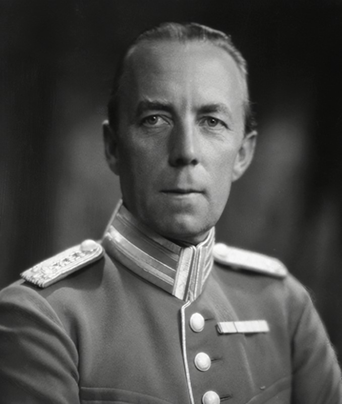

[← Public International Law](README.md) · [← Week 2](02-states-and-peoples.md) · [Week 4 →](04-the-law-of-treaties.md)

# Week 3: Non-state actors: IOs, individuals, corporations

*Count Folke Bernadotte, UN mediator, assassinated in Jerusalem in 1948.* His killing led to the Reparation for Injuries AO (1949): the UN has international personality and can bring claims for injury to its agents.  
Unknown author · Public domain · [Wikimedia Commons](https://commons.wikimedia.org/wiki/File:Folke_Bernadotte,_Count_of_Wisborg.png)

## Rules to know cold

1. Personality is not all-or-nothing (Reparation 1949): 'the subjects of law in any legal system are not necessarily identical in their nature or in the extent of their rights, and their nature depends upon the needs of the community'.
2. IO definition: ARIO Art 2(a) (established by treaty or other instrument governed by IL, with its own legal personality); Schermers & Blokker (an international agreement, at least one organ with a will of its own, established under IL); VCLT Art 2(1)(i) 'intergovernmental organization'.
3. Reparation: the UN's personality was inferred from its functions, organs, privileges and immunities (Art 105), treaty-making (Art 43) and members' obligations (Art 2(5)) — capacity to bring claims, including functional protection of agents (Bernadotte). 'Not the same thing as saying that it is a State … or a super-State.'
4. Objective personality: 50 States representing the vast majority could create an entity with personality opposable to non-members (Reparation), in tension with VCLT Art 34; applied to the ICC by PTC I (Bangladesh/Myanmar 2018, para 48).
5. Principle of speciality (WHO Nuclear Weapons AO 1996, para 25): IOs lack general competence. The WHO could ask about health effects, not legality of use, which belongs to the UN security organs — the third condition of Art 96(2) (within the scope of activities) failed.
6. Implied powers: powers 'conferred by necessary implication as being essential to the performance of its duties' (Reparation); Certain Expenses (1962): action appropriate to a stated purpose is presumed intra vires. Constituent instruments are treaties 'of a particular type' (WHO AO para 19): effectiveness and the organisation's practice weigh heavily (Namibia 1971: abstention is not a veto under Art 27(3)).
7. IOs are bound by general IL, their constitutions and their agreements (WHO–Egypt AO 1980 para 37); 1986 VCLT for their treaties; ARIO 2011 for responsibility. IO practice can contribute to custom (ILC Conclusion 4(2)).
8. Individuals: no general law-making or claim capacity, but rights under customary human rights law and duties under ICL (IMT: 'crimes … are committed by men, not by abstract entities'). Treaties can confer rights directly if intended (Danzig Railway Officials 1928; LaGrand 2001 para 77 on VCCR Art 36). Procedural capacity where a treaty gives it (ECtHR, IACtHR, investor–State arbitration). Cançado Trindade (Germany v Italy, separate opinion to the 2011 Order on Greece's intervention, para 34): individuals are true subjects. (In the 2012 merits judgment he dissented.)
9. Corporations: no general personality; they act through domestic law and treaties granting standing (BITs, ICSID). UNGPs (2011): Pillar I State duty to protect (legal), Pillar II corporate responsibility to respect through human rights due diligence (social expectation), Pillar III access to remedy. OECD Guidelines (2023): soft law with National Contact Points. CESCR General Comment 24 (2017): States must regulate companies domiciled in their territory, including conduct abroad.
10. Special cases: Holy See, Sovereign Order of Malta, insurgents and belligerents (limited personality under IHL), national liberation movements (API Art 1(4)). ILA Non-State Actors Committee (2016): involving NSAs without giving them State-like status.
11. Theories of IO personality: functionalist (implied from the functions and powers conferred), will theory (personality exists if the members intended it, inferred from the powers given) and objective (personality follows automatically once objective criteria are met, such as an organ with a will distinct from the members'). International personality does not automatically bring domestic personality: Charter Art 104 obliges members to grant it; monist States give effect on ratification, dualist ones by statute; non-members may recognise it through comity (Arab Monetary Fund v Hashim, HL 1991). Members are presumed not liable for the IO's debts (International Tin Council litigation; JH Rayner v DTI, HL 1989).
12. Attribution between an IO and its members (ARIO): the conduct of the IO's organs and agents acting in the performance of their functions belongs to the IO (Art 6). For State organs lent to an IO, such as peacekeepers, the test is effective control over the specific conduct (Art 7). The ECtHR in Behrami & Saramati (2007) used 'ultimate authority and control' to attribute KFOR/UNMIK conduct to the UN and declared the case inadmissible; Hernández calls this 'untenable' because States keep command yet escape liability. Al-Jedda (2011): the UK was responsible in Iraq. Nuhanović and Mustafić (Dutch Supreme Court 2013): Dutchbat's conduct at Srebrenica was attributable to the Netherlands, and dual attribution is possible. An IO may not circumvent its obligations by binding or authorising members (ARIO Art 17), and members may not hide behind the IO (Art 61). ARIO are criticised as one-size-fits-all, modelled too closely on ARSIWA, and thin on practice.
13. Review of SC decisions: the ICJ has no power of judicial review (Namibia 1971, though it checked that Res 276 was adopted in conformity with the Charter). Regional courts review implementing measures: Kadi (CJEU 2008; Kadi II 2013: targeted sanctions breached fundamental rights for lack of evidence) and Nada v Switzerland (ECtHR GC 2012). Judge ad hoc Lauterpacht (Bosnia Genocide, provisional measures 1993): Art 103 cannot extend to a conflict between an SC resolution and jus cogens.

## Key passages

> …the Organization is an international person. That is not the same thing as saying that it is a State, which it certainly is not, or that its legal personality and rights and duties are the same as those of a State.
>
> — **Reparation for Injuries Suffered in the Service of the United Nations**, ICJ Advisory Opinion (1949), p 179

*Why it matters:* Objective personality of the UN, derived from its functions; the basis for implied powers.

> International organizations are governed by the 'principle of speciality', that is to say, they are invested by the States which create them with powers, the limits of which are a function of the common interests whose promotion those States entrust to them.
>
> — **Legality of the Use by a State of Nuclear Weapons in Armed Conflict (WHO request)**, ICJ Advisory Opinion (1996), para 25

*Why it matters:* The limit on implied powers: the WHO could not ask about legality of use, only health effects.

## What the lecturers stressed

- Lecture 3 contrasts individuals and States: under general IL individuals have no capacity to operate on the international plane, make law or bring claims, but hold customary human rights and criminal accountability; under lex specialis they gain substantive rights (human rights and investment treaties) and procedural rights (regional courts, investor–State arbitration).
- Cançado Trindade's separate opinion in Germany v Italy (2011 Order, Greece intervening, para 34) is quoted on individuals as subjects.
- 'Objective' personality is tested against VCLT Art 34, Reparation, the ICC PTC I decision of 2018 (para 48) and Crawford's view (Brownlie, 9th edn, p 160).
- IOs on the international plane: what rules bind them (WHO–Egypt para 37), and the distinction between the international plane and domestic legal orders.

## Cases and materials

### Reparation for Injuries (AO)
*ICJ · 1949*

The UN has international personality and capacity to bring claims, including for injury to its agents (functional protection), even against a non-member, inferred from its functions and implied powers.

**Use it for:** IO personality; implied powers; objective personality.

### Legality of the Use of Nuclear Weapons (WHO request)
*ICJ (AO) · 1996*

The WHO's request fell outside the scope of its activities: IOs are governed by the principle of speciality; legality of use belongs to the UN.

**Use it for:** Speciality; Art 96(2) conditions.

### LaGrand (Germany v US)
*ICJ · 2001*

VCCR Art 36(1) creates individual rights, which the national State may invoke.

**Use it for:** Individual rights under treaties.

### Bangladesh/Myanmar (Art 19(3) decision)
*ICC PTC I · 2018*

The ICC has objective international legal personality (para 48), drawing on Reparation; jurisdiction where part of a crime (deportation) occurred on a State Party's territory.

**Use it for:** Objective personality; territorial jurisdiction.

### Netherlands v Nuhanović (and Mustafić)
*Supreme Court of the Netherlands (Hoge Raad) · 2013*

The Netherlands was responsible for Dutchbat's handing over of Bosnian Muslim men from the Srebrenica compound in July 1995. Applying effective control (ARIO Art 7, ARSIWA Art 8), conduct can be attributed to more than one actor; that the UN had command did not exclude attribution to the Netherlands, which in fact controlled the evacuation.

**Use it for:** Dual attribution in peace operations; contrast Behrami & Saramati (ECtHR 2007, 'ultimate authority and control' → UN).

## Test yourself

Open the questions (answers are folded under each)

**Q. Three conditions for a specialised agency's advisory-opinion request (Art 96(2))?**

Answer

Authorised organ; a legal question; arising within the scope of its activities. The WHO's 1996 request failed the third (speciality).

**Q. How did the ICJ find UN personality in Reparation?**

Answer

Not from an express provision, but by inference from its functions and the rights it was intended to exercise: organs, tasks, privileges and immunities (Art 105), treaty-making (Art 43), members' duties (Art 2(5)). Personality is functional, not State-like.

**Q. Is a corporation bound by human rights treaties?**

Answer

Not directly. Argue via the home or host State's duty to protect (UNGP Pillar I, CESCR GC 24, extraterritorial regulation), soft-law expectations on the company (UNGP Pillar II, OECD Guidelines), and any BIT the company may invoke against the State.

**Q. What is objective international personality, and why is it controversial?**

Answer

Personality opposable to non-members, as the ICJ held for the UN (50 States representing the vast majority) and ICC PTC I for the ICC (2018). Controversial because it sits uneasily with pacta tertiis (VCLT Art 34).

**Q. Peacekeepers lent to the UN commit a wrongful act: who is responsible?**

Answer

Whoever had effective control over the specific conduct (ARIO Art 7), and possibly both (dual attribution, Nuhanović 2013). The ECtHR's 'ultimate authority and control' test in Behrami & Saramati (2007) attributed the conduct to the UN alone; Al-Jedda (2011) distinguished it and held the UK responsible in Iraq. Hernández criticises Behrami because troop contributors keep national command but escape liability.

