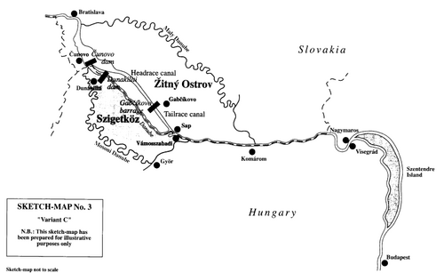

[← Public International Law](README.md) · [← Week 3](03-non-state-actors-ios-individuals-corporations.md) · [Week 5 →](05-custom-general-principles-and-other-sources.md)

# Week 4: The law of treaties

*The Gabčíkovo-Nagymaros Project and Variant C on the Danube.* Gabčíkovo (1997): necessity does not terminate a treaty; Variant C was a disproportionate countermeasure.  
International Court of Justice · Public domain · [Wikimedia Commons](https://commons.wikimedia.org/wiki/File:Gab%C4%8D%C3%ADkovo-Nagymaros_map_no.3.png)

## Rules to know cold

1. Scope (VCLT Arts 1–2(1)(a)): an agreement between States, in writing, governed by IL, 'whatever its particular designation'. The test is intent to be bound, read from text and circumstances (Qatar v Bahrain: Doha Minutes; Somalia v Kenya: MOU). Non-registration (Charter Art 102) does not affect validity. The VCLT is residual; excludes agreements with IOs (Art 3), succession, responsibility, hostilities (Art 73); non-retroactive (Art 4), but most of it reflects custom.
2. Who binds the State (Art 7): full powers, or ex officio Heads of State and Government and Foreign Ministers; heads of mission for adopting texts; other ministers may bind in their field (DRC v Rwanda para 47). Consent (Arts 11–15); entry into force (Art 24); Art 18 obligation not to defeat object and purpose before entry into force.
3. Internal law: Art 27 no excuse; Art 46 invalidity only if the violation of internal competence rules is manifest and of fundamental importance (Cameroon v Nigeria; Somalia v Kenya paras 48–49). Acquiescence bars relative invalidity grounds (Art 45).
4. Reservations (Arts 2(1)(d), 19–23; ILC Guide to Practice 2011): label irrelevant; interpretative declarations that modify effect are reservations (Belilos). Permissible unless prohibited, outside permitted categories, or contrary to object and purpose (Art 19; Genocide Reservations AO 1951). Tacit acceptance after 12 months (Art 20(5)). Effects (Art 21): accepted → modified reciprocally (Art 21(1)); simple objection → the provision does not apply to the extent of the reservation (Art 21(3)); maximum-effect objection → no treaty relations (Art 20(4)(b)). Invalid reservation: party without the benefit unless it shows it would not be bound (Guide 4.5.3); human rights bodies sever (Belilos, Loizidou, HRC GC 24).
5. DRC v Rwanda (2006): a reservation to Art IX of the Genocide Convention is not contrary to object and purpose; jus cogens does not itself confer jurisdiction. Joint Separate Opinion (Higgins, Kooijmans, Elaraby, Owada, Simma): the 1951 consent-based model is ill-suited to human rights treaties; courts now rule on compatibility; reservations to monitoring clauses may defeat object and purpose.
6. Third States (Arts 34–38): no obligations without express written consent (Art 35); rights presumed accepted (Art 36); a treaty rule may bind third States as custom (Art 38).
7. Interpretation (Arts 31–33): one integrated rule — good faith, ordinary meaning, context, object and purpose, subsequent agreements and practice (31(3)(a)–(b)), relevant rules of IL between the parties (31(3)(c)); supplementary means to confirm or resolve ambiguity (Art 32). Costa Rica v Nicaragua (2009): no restrictive interpretation of sovereignty limits (para 48); generic terms in treaties of unlimited duration are presumed to evolve (para 66: 'comercio' covers passenger transport). Ukraine v Russia (2024, ICSFT) paras 42–53: 'funds' means assets provided for their monetary value, not weapons or training. IACtHR OC-23/17 paras 40–45: living instrument, pro persona, Art 31(3)(c) bringing in environmental law.
8. Pauwelyn and Elsig: interpretation is political — dominant hermeneutic (text, intent, teleology), timing (original versus evolutive), activism, precedent, linkage; choices depend on interpretation space and incentives (institutional design). The ICJ evolves only where parties used generic terms in long-term treaties; human rights courts evolve from object and purpose.
9. Invalidity: relative (Arts 46–50: internal law, authority, error, fraud, corruption); absolute (51 coercion of a representative, 52 coercion by force, 53 jus cogens, void ab initio; 64 new jus cogens terminates).
10. Termination and suspension: by the treaty or consent (54, 57); denunciation without a clause only if intended or implied (56, 12 months' notice); material breach (60; not for humanitarian provisions, 60(5)); supervening impossibility (61); fundamental change of circumstances (62; not boundary treaties, not self-induced); procedure (65–67); custom survives (Art 43).
11. Gabčíkovo-Nagymaros (1997): necessity does not terminate a treaty, it only excuses non-performance (paras 47–48, 101); impossibility, fundamental change and material breach all rejected (paras 103–110); new environmental norms enter through the treaty's evolving provisions (paras 111–114); the treaty remains in force and the parties must negotiate in good faith.
12. Impermissible reservations, two schools: permissibility (validity is an objective question of compatibility with object and purpose; acceptance cannot cure it; the reservation can be severed) and opposability (validity depends on other parties' acceptance). Practice: when the Maldives acceded to CEDAW (1993) with Sharia and constitution reservations, Austria and Portugal objected but kept treaty relations (permissibility), while Sweden treated its consent as invalid (opposability). Human rights bodies sever: Belilos, Loizidou (Turkey bound despite its intention), Hilaire v Trinidad and Tobago (IACtHR 2001), HRC GC 24 and Rawle Kennedy (1999), after which Trinidad and Tobago denounced the First Optional Protocol. The 2007 meeting of the ILC and human rights bodies endorsed a 'reservations dialogue'.
13. Interpretation fine points: there is no hierarchy among the Art 31 elements (the ILC's 'crucible'; Koskenniemi: Art 31 lists 'virtually all thinkable interpretative methods'). Subsequent practice is read restrictively: Kasikili/Sedudu (1999) excluded one party's internal acts, and Whaling (2014) refused to treat IWC resolutions not supported by all parties as Art 31(3)(b) practice. Art 31(3)(c) was used in Oil Platforms (Charter on force) and Djibouti v France (2008), but Certain Iranian Assets (2019) refused to read customary immunities into the Treaty of Amity. The principle of effectiveness cannot override clear text and intent (Interpretation of Peace Treaties, 1950). Travaux are now routinely examined to confirm a reading (Georgia v Russia 2011; Qatar v UAE 2021).
14. Material breach and fundamental change, fine print. Art 60(3): a material breach is an unlawful repudiation or the violation of a provision essential to the object and purpose; it is rarely invoked (the OIC's 1979 suspension of Egypt). In a multilateral treaty, one party's breach does not excuse another towards non-breaching parties, and Art 60(5) protects only humanitarian treaties (Hernández regrets that environmental and disarmament treaties are left out). Fundamental change: Fisheries Jurisdiction (UK v Iceland, 1973) requires a radical transformation of the obligations still to be performed; only the ECJ in Racke (1998, the Yugoslav civil war) has ever upheld the plea. Supervening impossibility needs the permanent disappearance of an indispensable object (e.g. a river drying up) not caused by the invoking party.

## Key passages

> Every treaty in force is binding upon the parties to it and must be performed by them in good faith.
>
> — **Vienna Convention on the Law of Treaties (1969)**, Art 26

*Why it matters:* Pacta sunt servanda: the baseline that every termination or suspension argument (Arts 60–62) must overcome.

> A treaty shall be interpreted in good faith in accordance with the ordinary meaning to be given to the terms of the treaty in their context and in the light of its object and purpose.
>
> — **Vienna Convention on the Law of Treaties (1969)**, Art 31(1)

*Why it matters:* One holistic rule (not a hierarchy); Art 32 travaux only to confirm or when the meaning is ambiguous or absurd.

## What the lecturers stressed

- Lecture 4 (Marhold) frames two basic principles of the VCLT: safeguarding sovereignty (freedom to opt out of its rules, reservations, consent) and restricting sovereignty for the common interest (pacta sunt servanda Art 26, Art 18, jus cogens).
- A slide contrasts treaty law (conditions for lawfully denouncing or suspending treaties) with State responsibility (grounds precluding wrongfulness) — the Gabčíkovo separation, a classic exam link to weeks 10–11.
- Qatar v Bahrain and Somalia v Kenya quoted on 'whatever its particular designation'; the VCLT is 'subsidiary in nature', applying only where the treaty has no rule of its own.

## Cases and materials

### Maritime Delimitation and Territorial Questions (Qatar v Bahrain)
*ICJ · 1994*

Signed Minutes enumerating commitments are a treaty; the actual terms and circumstances decide, not a minister's later claim that he did not intend to be bound; non-registration does not affect validity.

**Use it for:** What is a treaty.

### Maritime Delimitation in the Indian Ocean (Somalia v Kenya), PO
*ICJ · 2017*

An MOU signed under full powers, with an entry-into-force-on-signature clause, registered and unprotested for years, is a valid treaty; Somalia's internal-law objection was not manifest (Art 46) and it had acquiesced (Art 45).

**Use it for:** Form, consent, internal law, acquiescence.

### Armed Activities (DRC v Rwanda), Jurisdiction
*ICJ · 2006*

Rwanda's reservation to Art IX of the Genocide Convention is valid; jus cogens and erga omnes do not confer jurisdiction. A minister of justice's statement could in principle bind the State but was not specific enough.

**Use it for:** Reservations; Art 7; unilateral acts.

### Navigational and Related Rights (Costa Rica v Nicaragua)
*ICJ · 2009*

'Comercio' in an 1858 treaty of unlimited duration is a generic term with an evolving meaning, now covering passenger transport including tourists; no restrictive interpretation in favour of sovereignty.

**Use it for:** The template interpretation sequence.

### Ukraine v Russia (ICSFT and CERD)
*ICJ · 2024*

'Funds' in ICSFT Art 1(1) refers to resources provided or collected for their monetary and financial value and does not include the means used to commit terrorist acts, so supplying weapons or organising training is not financing under the Convention (para 53).

**Use it for:** Textual and contextual interpretation narrowing a term.

### Gabčíkovo-Nagymaros (Hungary/Slovakia)
*ICJ · 1997*

Hungary's purported termination was ineffective: necessity is not a termination ground; no impossibility, fundamental change or prior material breach; the treaty remains in force.

**Use it for:** Termination grounds; treaty law versus State responsibility.

### Reservations to the Genocide Convention (AO)
*ICJ · 1951*

A reserving State can be a party if its reservation is compatible with the object and purpose; each State judges compatibility for itself.

**Use it for:** Origin of the object-and-purpose test.

### Anglo-French Continental Shelf (UK/France)
*Court of Arbitration · 1977*

France had reserved Art 6 of the 1958 Continental Shelf Convention; the UK objected without saying the treaty should not enter into force. A 'simple' objection does not prevent treaty relations: the combined effect was to make Art 6 inapplicable between the two States 'to the extent of the reservations', neither wholly applicable nor wholly inapplicable; custom filled the gap.

**Use it for:** Effect of a simple objection (VCLT Art 21(3)); a 'hard' objection must be stated expressly.

### Application of the Interim Accord of 13 September 1995 (FYROM v Greece)
*ICJ · 2011*

Greece breached the Interim Accord by objecting to FYROM's NATO membership. Its defences of exceptio non adimpleti contractus/material breach and countermeasures failed: FYROM's only breach (a prohibited symbol on its flag in 2004) had ceased when Greece complained, was not material, and was unconnected with Greece's conduct.

**Use it for:** Treaty-law and State-responsibility responses to breach can be pleaded together but both need a real, serious prior breach; link to Gabčíkovo and to Art 60 versus countermeasures.

### Fisheries Jurisdiction (UK v Iceland), Jurisdiction
*ICJ · 1973*

A fundamental change of circumstances may justify termination only if it radically transforms the extent of the obligations still to be performed, increasing their burden so that performance becomes something essentially different from what was undertaken. Iceland's argument from developments in fishing techniques and the law of the sea did not meet that test.

**Use it for:** The strict rebus sic stantibus test (VCLT Art 62).

## Test yourself

Open the questions (answers are folded under each)

**Q. What makes an instrument a treaty?**

Answer

An agreement between States, in writing, governed by international law, with intent to be bound, whatever its designation (VCLT Art 2(1)(a)). Judged by the actual terms and the circumstances of conclusion (Qatar v Bahrain; Somalia v Kenya).

**Q. When does a violation of internal law invalidate consent?**

Answer

Only if it is manifest (objectively evident to any State acting in good faith, at least properly publicised) and concerns a rule of fundamental importance (VCLT Art 46; Cameroon v Nigeria; Somalia v Kenya). Otherwise Art 27 applies.

**Q. Effects of a reservation that is accepted versus objected to?**

Answer

Accepted: the provision is modified for both parties reciprocally (Art 21(1)). Simple objection: the provision does not apply between them to the extent of the reservation (Art 21(3)). Maximum-effect objection: no treaty relations (Art 20(4)(b)).

**Q. What is the Costa Rica v Nicaragua sequence for interpretation?**

Answer

No restrictive presumption (para 48) → text ambiguous ('con objetos de comercio') → context resolves it (51–56) → contemporaneity argument (58) → reject over-broad reading (59–61) → common intention may be evolving (63–64) → generic terms in a perpetual treaty evolve (66) → apply: passengers and tourists covered (67–71).

**Q. Can necessity terminate a treaty?**

Answer

No. Gabčíkovo: necessity under State responsibility only excuses non-performance while it lasts; termination requires a VCLT ground (Arts 54–64). Hungary's impossibility, fundamental change and material breach arguments all failed.

**Q. Why do the ICJ and the IACtHR both interpret evolutively, but differently?**

Answer

The ICJ derives evolution from the parties' presumed common intention (generic terms in long treaties). The IACtHR derives it from the object and purpose of protecting individuals (living instrument, pro persona, Art 31(3)(c)). Pauwelyn and Elsig: institutional setting shapes method.

**Q. Permissibility or opposability: what happens to a reservation incompatible with object and purpose?**

Answer

Permissibility school: it is invalid objectively, acceptance cannot cure it, and it may be severed so the State is bound without it (Belilos, Loizidou, Hilaire, HRC GC 24; ILC Guide 4.5.3 presumption). Opposability school: validity depends on the other parties' reactions. Practice is mixed: most objectors to the Maldives' CEDAW reservation kept treaty relations; Sweden treated consent as invalid.

**Q. Has any court actually accepted a plea of fundamental change of circumstances?**

Answer

Only the ECJ in Racke (1998): the outbreak of civil war in Yugoslavia allowed the EC to suspend its trade agreement. The ICJ rejected it in Fisheries Jurisdiction (1973) and Gabčíkovo (1997, para 104); boundary treaties are excluded (Art 62(2)(a)), and a party cannot rely on a change it caused (Art 62(2)(b)).

