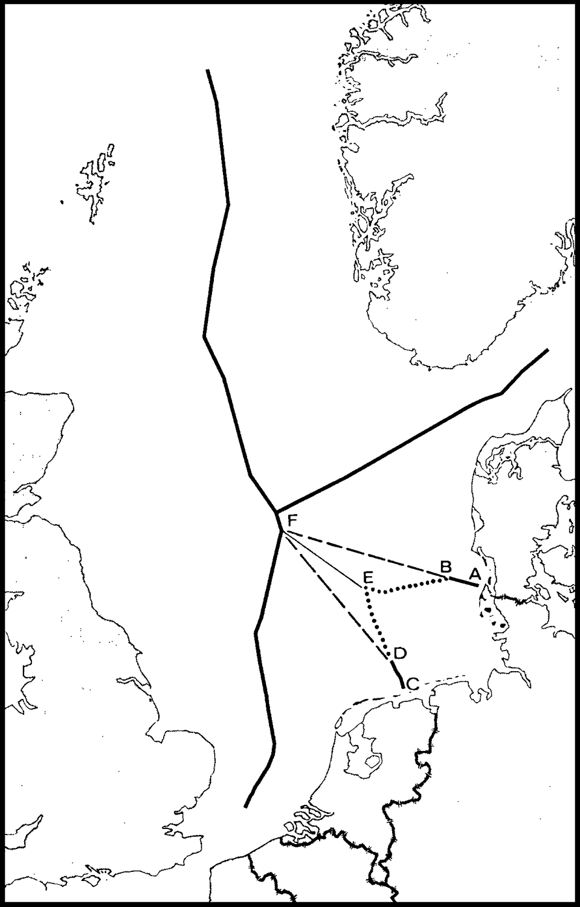

[← Public International Law](README.md) · [← Week 4](04-the-law-of-treaties.md) · [Week 7 →](06-jus-ad-bellum.md)

# Week 5: Custom, general principles and other sources

*The boundaries claimed in the North Sea Continental Shelf cases.* Equidistance (Geneva Art 6) had not become custom: practice must be extensive and virtually uniform, with opinio juris (para 77).  
International Court of Justice · Public domain · [Wikimedia Commons](https://commons.wikimedia.org/wiki/File:Continental_shelf_boundaries_parties_insisted_in_ICJ_cases_of_North_Sea_Continental_Shelf.png)

**Mind map:** [Sources of international law](https://tomasemilioeee-a11y.github.io/pil-humanity-study-guide/mind-maps/sources.html), interactive, with recall mode and search.

## Rules to know cold

1. Art 38(1) ICJ Statute: treaties, custom, general principles; judicial decisions and teachings as subsidiary means. Beyond Art 38: unilateral declarations (Nuclear Tests 1974), binding SC decisions (Charter Arts 25, 103), soft law as evidence.
2. Two elements (North Sea para 77; ILC Conclusions 2018, Concl. 2–3): general practice and opinio juris, each assessed separately with regard to context.
3. Practice: primarily States, sometimes IOs (Concl. 4); physical and verbal acts, sometimes inaction (Concl. 6); widespread, representative and consistent (Concl. 8). Abstention counts only if based on a conscious duty (Lotus p 28). Asylum: 'uncertainty and contradiction … fluctuation and discrepancy' defeats custom. Nicaragua para 186: perfect consistency not required; breaches justified by exceptions confirm the rule.
4. Time: no fixed duration if practice is extensive and virtually uniform, including specially affected States (North Sea paras 73–74).
5. Opinio juris: a sense of legal obligation, not courtesy (North Sea para 77); can coexist with other motives. GA resolutions can evidence it depending on content, adoption and voting (Nuclear Weapons paras 70–73: only 'nascent' opinio juris against deterrence practice; Chagos paras 150–153: Res 1514 declaratory).
6. Induction versus deduction: Nicaragua (paras 184–188) effectively started from opinio juris in GA resolutions (Res 2625) and then checked practice; Kupreškić (ICTY 2000, paras 527–534) used the Martens Clause to let opinio necessitatis outweigh scarce practice (reprisals against civilians prohibited; tu quoque irrelevant) — criticised as deductive.
7. Treaty and custom: a treaty provision may codify, crystallise or generate custom (North Sea): generation needs a norm-creating provision, widespread and representative participation including specially affected States, extensive and virtually uniform practice, and opinio juris. Equidistance in Geneva Art 6 failed. Treaty and custom coexist with separate identities (Nicaragua paras 175–179; VCLT Art 43).
8. Climate AO 2025: the climate treaties are not a lex specialis excluding general IL; customary duties of due diligence and cooperation bind all States; a non-party must show equivalent conduct, otherwise it bears 'the full burden' (paras 309–315).
9. Regional and bilateral custom: the party relying on it must prove it binds the other (Asylum); bilateral custom exists (Right of Passage 1960; Costa Rica v Nicaragua para 141 on subsistence fishing). Persistent objector: consistent, open objection during formation (Fisheries 1951; ILC Concl. 15); never against jus cogens. A State that objects only after a rule has formed is normally bound, but Hernández recognises a 'subsequent objector': a State that accepted an existing rule and objects to its proposed modification is not bound by the changed rule if the others acquiesce (he reads Fisheries 1951 this way).
10. General principles (Art 38(1)(c)): principles of law generally (good faith, reparation — Chorzów), principles from domestic orders (res judicata, estoppel, burden of proof), principles of the international system (ex injuria jus non oritur). Ignore the anachronistic 'civilized nations'.
11. Subsidiary means (Art 38(1)(d)): no binding precedent (Art 59) but the ICJ follows its case law; the ILC, ILA, IDI, ICRC Customary IHL Study (contested by the US: Bellinger and Haynes). Equity infra, praeter, contra legem; ex aequo et bono only by consent (Art 38(2)).
12. Unilateral declarations (Nuclear Tests 1974): public, by a competent authority, with intent to be bound — binding without acceptance, read restrictively (ILC Guiding Principles 2006; DRC v Rwanda: the justice minister's statement was not specific enough). Hierarchy: no formal hierarchy among Art 38 sources, but jus cogens (VCLT 53, 64), Charter Art 103, erga omnes.
13. Sources architecture: formal sources (binding law-creation methods) versus material sources (evidence of a rule: judgments, ILC studies, resolutions, textbooks). Art 38 is technically the ICJ's lex arbitri but works as the authoritative statement of sources; the ILC's work is an 'indirect but influential' source. SC decisions bind under Art 25 and prevail under Art 103; Res 1373 (2001) laid down general rules close to 'legislating'. Soft law is non-binding (the term is 'misleading'): it can be a 'subterfuge' for inaction or point to future hard law (Stockholm and Rio; the ecocide proposal).
14. Relativity of custom (Hernández): acquiescence must be 'clear and consistent' (a high threshold). New States are bound by existing custom; a tabula rasa has been rejected even by new States. Bilateral custom exists (Right of Passage), but a State cannot claim a special custom exempting itself alone. Persistent objection examples: the US and Japan against expansive territorial-sea claims (1970s), China against restrictive immunity. Hernández warns that objector rules favour 'power asymmetries' and fragment general custom.
15. Jus cogens fine print: Art 53 requires 'double' recognition, as a norm of general international law and as non-derogable, by the international community of States as a whole (positivist; contrast the naturalists Orakhelashvili and Cassese, and Thirlway's custom-based view). ILC 2022 Conclusions: custom is the 'most common basis' (Concl. 5), there is no regional jus cogens, and all peremptory norms are erga omnes (Concl. 17). Candidates with some support: enforced disappearance, the right to life, non-refoulement. Effects: a treaty conflicting at conclusion is void ab initio in its entirety (Arts 53, 44(5)); one conflicting with a new peremptory norm terminates from then on (Arts 64, 71(2)); no derogation by reservation, custom or unilateral act; no circumstance precluding wrongfulness (Art 26). It confers neither jurisdiction (DRC v Rwanda) nor an exception to immunity (Germany v Italy). Abi-Saab: an 'empty box' waiting to be filled.

## Key passages

> Not only must the acts concerned amount to a settled practice, but they must also be such, or be carried out in such a way, as to be evidence of a belief that this practice is rendered obligatory by the existence of a rule of law requiring it.
>
> — **North Sea Continental Shelf (Germany v Denmark; Germany v Netherlands)**, ICJ (1969), para 77

*Why it matters:* The two elements, practice and opinio juris; equidistance had not crystallised into custom.

> …instances of State conduct inconsistent with a given rule should generally have been treated as breaches of that rule, not as indications of the recognition of a new rule. If a State acts in a way prima facie incompatible with a recognized rule, but defends its conduct by appealing to exceptions or justifications contained within the rule itself… the significance of that attitude is to confirm rather than to weaken the rule.
>
> — **Military and Paramilitary Activities in and against Nicaragua (Nicaragua v US)**, ICJ Merits (1986), para 186

*Why it matters:* Why widespread violations of Art 2(4) do not destroy the customary prohibition.

## What the lecturers stressed

- Lecture 5 (Marhold) restates the 'traditional framework' from Lotus ('International law governs relations between independent States …') before the two-element doctrine.
- Practice questions on the slides: whose practice, what practice (ILC Conclusion 6: physical and verbal acts, inaction), abstention (Lotus), 'constant and uniform' (Asylum), time (North Sea), and how to read breaches (Nicaragua paras 186–188).
- The working group adds the method debate: should custom be identified differently by field (immunities, continental shelf, environment, IHL)? Does judicial ethos matter — activism versus conservatism? One sentence of this earns originality marks.
- Whose and what practice (slides 11–12, ILC Conclusions 2018): primarily States, sometimes IOs; the conduct of other actors (NGOs, individuals) is not practice, but may be relevant in assessing it (Concl 4(3)). Forms include diplomatic acts and correspondence, conduct on resolutions and treaties, executive and operational conduct 'on the ground', legislative and administrative acts, and national court decisions, with no predetermined hierarchy among them (Concl 6(2)–(3)).
- Opinio juris with mixed motives (slides 19–20): in Nicaragua v Colombia (2023, paras 77–79) States' practice before the CLCS was 'indicative of opinio juris, even if such practice may have been motivated in part by considerations other than a sense of legal obligation', and opinio juris may be shown 'by induction based on the analysis of a sufficiently extensive and convincing practice'. Contrast Nuclear Weapons para 73: GA resolutions revealing the 'desire' of much of the community are not yet opinio juris.
- The persistent objector's origins, 'two ambiguous judicial statements' (slides 24–25): Fisheries (1951, p 131: the ten-mile rule 'would appear to be inapplicable as against Norway inasmuch as she has always opposed' it) and Asylum (1950, pp 277–278: any regional custom could not be invoked against Peru, which repudiated it by not ratifying the 1933 and 1939 Montevideo Conventions).
- The tension (slides 26–28): North Sea para 63 says general customary rules 'must have equal force for all members of the international community' and allow no 'unilateral exclusion exercisable at will'; the Climate AO para 315 adds that 'customary obligations are the same for all States', so a non-party must show equivalent conduct or bear 'the full burden'. The slide asks whether this confirms or undermines the persistent objector.
- General principles (slide 30): three notions, principles of law in general (good faith, the duty to make reparation), principles derived from domestic legal orders (mostly procedural), and principles derived from the spirit of international law (legality, ex injuria jus non oritur, proportionality). They are subsidiary: courts reach for them when treaty and custom run out. Doctrine mattered far more in the 'infancy' of European international law (Grotius, Vattel) than today (slide 32).
- Unilateral acts of IOs (slide 37): distinguish acts addressed to the organisation's own organs from acts addressed to others (States, individuals), and the instrumentum (the form, e.g. a 'resolution') from the negotium (its legal content: a binding decision or a mere recommendation).
- Codification and progressive development (slide 38): the ILC under Charter Art 13(1)(a) (the VCLT, the VCDR, ARSIWA 2001); private codification by the ILA, the Institut de droit international and the ICRC's Customary IHL Study; and the soft law versus hard law debate.

## Cases and materials

### North Sea Continental Shelf (FRG v Denmark/Netherlands)
*ICJ · 1969*

Equidistance in Geneva Art 6 was neither codified custom nor crystallised nor generated afterwards; custom needs settled practice and opinio juris (para 77); short time can suffice with extensive, virtually uniform practice including specially affected States.

**Use it for:** The two elements; treaty-to-custom routes.

### Asylum (Colombia v Peru)
*ICJ · 1950*

Colombia failed to prove a regional custom of diplomatic asylum binding Peru: practice showed too much uncertainty and contradiction, and Peru had repudiated it.

**Use it for:** Regional custom; consistency; persistent objection.

### Fisheries (UK v Norway)
*ICJ · 1951*

The ten-mile rule for bays was not general custom and in any event did not bind Norway, which had always opposed it.

**Use it for:** Persistent objector.

### Nuclear Tests (Australia/NZ v France)
*ICJ · 1974*

France's public statements that it would stop atmospheric tests were binding unilateral undertakings, made with intent to be bound; the dispute had no object.

**Use it for:** Unilateral declarations.

### Prosecutor v Kupreškić
*ICTY · 2000*

Reprisals against civilians are prohibited by custom; through the Martens Clause, principles of humanity and public conscience let opinio juris weigh more where practice is scarce; tu quoque has no place in IHL.

**Use it for:** Deductive custom-finding (and its critique).

### Obligations of States in respect of Climate Change (AO)
*ICJ · 2025*

The climate treaties do not exclude general IL; customary duties of due diligence to prevent significant harm and to cooperate bind all States; non-parties bear the full burden of showing equivalent conduct.

**Use it for:** Treaty–custom interaction; due diligence.

### Question of the Delimitation of the Continental Shelf beyond 200 nm (Nicaragua v Colombia)
*ICJ · 2023*

Under customary international law, a State's entitlement to an extended continental shelf beyond 200 nautical miles from its baselines may not extend within 200 nautical miles of another State's baselines, so Nicaragua's claim failed (paras 77–79). The Court inferred opinio juris from widespread, long-standing practice before the CLCS, even if partly motivated by other considerations, and noted that opinio juris may be shown by induction from extensive and convincing practice.

**Use it for:** Recent ICJ method on custom: inducing opinio juris from practice with mixed motives.

## Test yourself

Open the questions (answers are folded under each)

**Q. What are the three treaty-to-custom routes (North Sea)?**

Answer

A treaty provision may (1) codify existing custom, (2) crystallise an emerging rule at the time of adoption, or (3) generate a new rule through later practice — which needs a norm-creating provision, widespread and representative participation including specially affected States, extensive and virtually uniform practice, and opinio juris.

**Q. Why did the ICJ turn to custom in Nicaragua, and what did it say about treaty and custom?**

Answer

The US multilateral treaty reservation barred applying the Charter. The Court held custom exists and applies independently even with identical content to a treaty (paras 175–179); a jurisdictional bar on the treaty does not remove the parallel customary rule.

**Q. How is Nicaragua's custom method criticised compared with North Sea?**

Answer

North Sea demanded extensive practice and was sceptical of inferring opinio juris from treaty participation; Nicaragua deduced opinio juris from consent to GA resolutions (Res 2625) and then treated inconsistent practice as breaches. Explained by the subject matter (force), but inconsistent.

**Q. Conditions for the persistent objector rule?**

Answer

Objection expressed clearly, made known to other States, and maintained consistently while the rule is forming (Fisheries; ILC Concl. 15). Not available against jus cogens; objecting after the rule has formed normally comes too late (but see Hernández on the 'subsequent objector' resisting a modification); new States are bound by existing custom.

**Q. When is a unilateral declaration binding?**

Answer

When made publicly by an authority competent to bind the State, with intent to be bound (Nuclear Tests); no acceptance or quid pro quo needed; interpreted restrictively (ILC Guiding Principles 2006; DRC v Rwanda).

**Q. Three types of general principles?**

Answer

Principles of law generally (good faith, full reparation — Chorzów); principles drawn from domestic legal orders (res judicata, estoppel, burden of proof); principles formed within the international system (ex injuria jus non oritur, proportionality).

**Q. Treaty in conflict with jus cogens: what is the difference between Art 53 and Art 64 VCLT?**

Answer

Art 53: conflict at conclusion, so the whole treaty is void ab initio (no severance, Art 44(5)) and the parties must eliminate the consequences of acts performed under it (Art 71(1)). Art 64: a new peremptory norm emerges, so the treaty becomes void and terminates from then on, and rights acquired earlier survive so far as their maintenance does not conflict with the new norm (Art 71(2)).

**Q. Can opinio juris be inferred from practice that States pursue partly for other reasons?**

Answer

Yes: in Nicaragua v Colombia (2023, paras 77–79) practice before the CLCS was 'indicative of opinio juris' even if partly motivated by other considerations, and opinio juris may be shown 'by induction' from extensive and convincing practice. But the mere 'desire' of the community expressed in GA resolutions is not enough (Nuclear Weapons para 73).

**Q. Where does the persistent objector doctrine come from, and what pulls against it?**

Answer

Two ambiguous statements: Fisheries (1951, the ten-mile rule inapplicable against Norway, which always opposed it) and Asylum (1950, Peru repudiated the alleged custom). Against it: North Sea para 63 (customary rules have equal force for all and allow no unilateral exclusion) and the Climate AO para 315 ('customary obligations are the same for all States').

**Q. How should you analyse a unilateral act of an international organisation?**

Answer

Ask whom it addresses (the organisation's own organs, or States and others outside it) and separate its form, the instrumentum (e.g. a resolution), from its legal content, the negotium (a binding decision or a recommendation).

