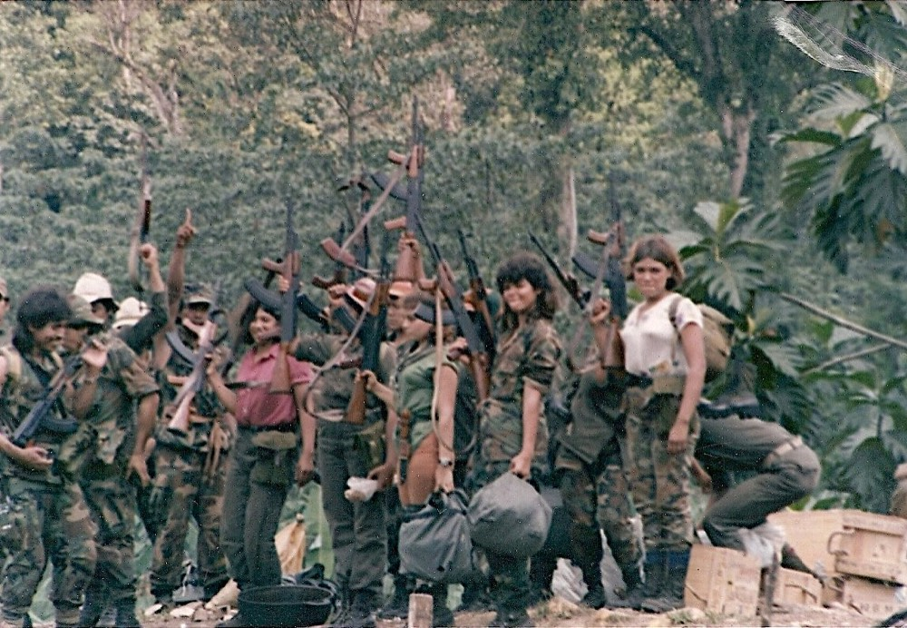
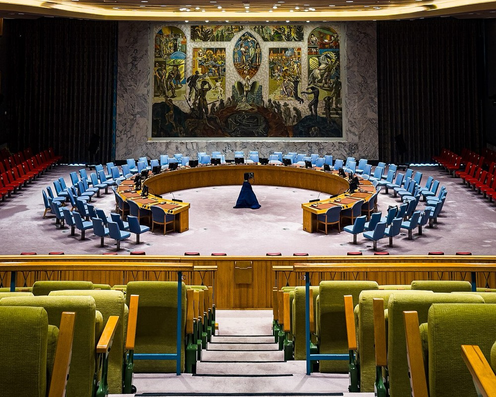

[← Public International Law](README.md) · [← Week 5](05-custom-general-principles-and-other-sources.md) · [Week 8 →](07-jurisdiction-and-immunities.md)

# Week 7: Jus ad bellum

*Contra fighters in Nicaragua, 1987.* Nicaragua v US: US arming, training and funding of the contras was a use of force and unlawful intervention, but not an armed attack, and their acts were not attributable to the US without effective control.  
Tiomono · CC BY-SA 3.0 · [Wikimedia Commons](https://commons.wikimedia.org/wiki/File:Contra_commandas_1987.jpg)

*The UN Security Council chamber, New York.* Chapter VII: Art 39 determination, then Art 41 or 42 measures; authorisation by 'all necessary means'.  
Jdforrester · CC BY 4.0 · [Wikimedia Commons](https://commons.wikimedia.org/wiki/File:United_Nations_Headquarters_-_Security_Council_chamber,_straight-on_view.jpg)

**Mind map:** [The prohibition of the use of force](https://tomasemilioeee-a11y.github.io/pil-humanity-study-guide/mind-maps/use-of-force.html), interactive, with recall mode and search.

## Rules to know cold

1. Art 2(4) UN Charter prohibits the threat or use of force against the territorial integrity or political independence of any State. It is also customary law (Nicaragua) and widely regarded as jus cogens.
2. Only two Charter exceptions: (1) Security Council authorisation under Chapter VII (Art 39 determination, then Art 42 measures), and (2) individual or collective self-defence under Art 51.
3. Self-defence needs an armed attack, meaning the 'most grave forms' of the use of force (Nicaragua para 191 for 'most grave forms'; para 195 for 'scale and effects' and for frontier incidents and arms supply). Frontier incidents and arms supply are not armed attacks.
4. Custom adds necessity and proportionality (Nicaragua para 176; Nuclear Weapons para 41). Measures must be reported to the SC (Art 51) and are allowed only until the SC has taken the necessary measures. Failing to report does not by itself make self-defence unlawful; in custom it is evidence that the State did not believe it was acting in self-defence (Nicaragua para 200; DRC v Uganda para 145).
5. Collective self-defence requires the victim State to declare itself attacked and to request help (Nicaragua paras 195–199).
6. The State claiming self-defence bears the burden of proving the armed attack, and that it was the target. An attack must be 'specifically aimed' at it, and accumulation of events can count (Oil Platforms paras 51, 57–64).
7. Non-state actors: an armed attack by armed bands counts where they are 'sent by or on behalf of' a State, or the State has 'substantial involvement' (Res 3314 Art 3(g); Nicaragua para 195). The Wall AO (para 139) read Art 51 as covering armed attack 'by one State against another State' and rejected Israel's claim because the attacks were not imputable to a foreign State and the threat came from territory Israel controls. DRC v Uganda (paras 146–147) found the ADF attacks not attributable to the DRC, and expressly left open 'whether and under what conditions' international law allows self-defence against large-scale attacks by irregular forces. State practice since 9/11 and the 'unwilling or unable' doctrine remain contested.
8. Anticipatory self-defence against an imminent attack is debated (Caroline formula: 'instant, overwhelming, leaving no choice of means'). Pre-emptive self-defence against non-imminent threats is not lawful.
9. Intervention by invitation: valid consent from the government in effective control precludes wrongfulness (Art 20 ARSIWA; DRC v Uganda paras 42–53). Consent must be real, and its withdrawal ends the justification.
10. Humanitarian intervention or R2P without SC authorisation has no clear legal basis. Corfu Channel rejected a 'right of intervention' as a manifestation of a policy of force.
11. Lesser uses of force short of an armed attack violate Art 2(4) and the non-intervention principle (coercion in matters within domestic jurisdiction, Nicaragua para 205). Third States have no right of 'collective' armed response to acts that are not an armed attack (Nicaragua para 211), and only the victim State could take 'proportionate counter-measures' (para 249). The Court expressly left open what direct reactions, possibly involving force, the victim itself may take (para 210). Today ARSIWA Art 50(1)(a) bars countermeasures involving force.
12. Proportionality in self-defence is measured against what is needed to halt and repel the attack (and recover territory), not against the size of the initial attack: a lawful response 'may well have to assume dimensions disproportionate to those of the attack suffered'. ICJ practice looks at the scale of the whole operation, its geographic reach into the target State (DRC v Uganda para 147: airports and towns hundreds of kilometres from the border) and the weapons used. Necessity means no non-forcible means of repelling the attack; in Oil Platforms it failed because the US had never complained about the platforms' military use and called one strike a 'target of opportunity'.
13. 'Against the territorial integrity or political independence' is not a loophole for 'limited' force. Corfu Channel rejected the UK's minesweeping as 'the manifestation of a policy of force'; Nicaragua rejected a restrictive reading; and the Eritrea–Ethiopia Claims Commission held that force used to recover territory a State claims is unlawfully occupied still breaches Art 2(4), since otherwise border disputes would make 'a large and dangerous hole' in the rule. Compare the claims over Goa (1961), the Falklands (1982), Kuwait (1990) and China's position on Taiwan.
14. Self-defence against non-State actors, three positions. (1) Restrictive, the ICJ's case law on its face: the armed attack must be attributable to a State (Res 3314 Art 3(g)). (2) Middle: Judges Higgins and Buergenthal (Wall) and Kooijmans and Simma (DRC v Uganda) say Art 51 does not require a State attacker, but force in the host State must be confined to the group and strictly necessary and proportionate. (3) Expansive, 'unwilling or unable': the US, UK, Australia, Canada and Turkey in Syria from 2014. Hernández: the 'most plausible' argument is that an unwilling or unable host is effectively 'aiding and abetting', but most scholars are sceptical because the acting State decides alone that the test is met. One innovative view (Paddeu) treats self-defence against non-State actors as a circumstance precluding wrongfulness rather than an Art 51 exception.
15. Hernández on Gaza (2023–): the 7 October attacks meet the factual threshold of an armed attack, but Art 51 fits poorly. Self-defence cannot be directed against Palestine (its statehood is contested by Israel itself) or rest on attribution to it, and Gaza remains occupied territory (SC Res 2720 (2023), preamble; OPT AO 2024 para 93: Israel kept 'key elements of authority'). So the Wall AO para 139 logic applies: Israel's powers there come from the law of occupation. Hezbollah in Lebanon (from Sept 2024) is a cross-border case for the non-State actor debate, and necessity and proportionality apply in any event.
16. Anticipatory versus pre-emptive self-defence in UN and expert texts: the 2004 High-level Panel and the 2005 'In Larger Freedom' report say imminent threats 'are fully covered by Article 51', while non-imminent threats go to the SC; IDI Resolution 10A (2007) accepts only an 'actual or manifestly imminent' armed attack. Practice: the SC unanimously condemned Israel's 1981 strike on Iraq's Osirak reactor as a 'clear violation of the Charter' (Res 487); Israel did not plead anticipatory self-defence in 1967; the 2002 Bush Doctrine, dropping imminence, went 'considerably beyond the bounds of international law'. DRC v Uganda para 148: Art 51 does not allow force 'to protect perceived security interests'.
17. Protection of nationals abroad has been claimed as self-defence by the US (Dominican Republic 1965, Grenada 1983, Panama 1989, the failed 1980 Tehran rescue), Israel (Entebbe 1976), the UK (Suez 1956), France, and Russia (Georgia 2008, Crimea 2014). The SC has rarely condemned it, largely because of the veto, but its legality 'remains contentious'. In an answer, argue it at most as a narrow form of self-defence and check necessity and proportionality strictly.
18. Collective security details: the SC's Art 39 discretion is wide. It has found a 'breach of the peace' only four times (Korea 1950, Falklands 1982, Iran–Iraq 1987, Kuwait 1990) and has never formally determined an 'act of aggression'. The SC must act within the Purposes and Principles (Art 24(2)) and, arguably, jus cogens, but Art 103 lets its decisions prevail over other treaty obligations. Korea (Res 83, 1950), adopted while the USSR was absent, became the blueprint for authorising Member States. The GA has used Uniting for Peace (Res 377 (V)) eleven times when the veto blocks the SC (e.g. ES-11/1 on Ukraine). Regional enforcement action needs SC authorisation (Art 53).
19. Humanitarian intervention in practice: most interventions that looked humanitarian were justified as self-defence (India in Bangladesh 1971, Tanzania in Uganda 1979, Vietnam in Cambodia 1979). Only the UK (Iraq no-fly zones; Kosovo) and Belgium (before the ICJ in 1999) pleaded humanitarian intervention as law. Res 1244 neither endorsed nor condemned NATO, and the G77 rejected the doctrine (1999). Hernández: the negative reactions to Kosovo 'seem to confirm the unlawfulness' of unilateral humanitarian intervention and led to R2P, whose third pillar runs through SC authorisation. The call on the P5 not to use the veto is only 'a polite intimation'.
20. Hernández's closing argument (useful for 'Is Art 2(4) dead?'): law 'functions simultaneously to constrain and to facilitate violence', so one should not presume 'a linear progression towards stronger rules against using force'. 'The arc of history does not bend unequivocally towards peace.'

## Key passages

> All Members shall refrain in their international relations from the threat or use of force against the territorial integrity or political independence of any state, or in any other manner inconsistent with the Purposes of the United Nations.
>
> — **Charter of the United Nations**, Art 2(4)

*Why it matters:* The prohibition, also custom and arguably jus cogens; the only exceptions are Art 51 and Chapter VII authorisation.

> …it will be necessary to distinguish the most grave forms of the use of force (those constituting an armed attack) from other less grave forms.
>
> — **Nicaragua v US**, ICJ Merits (1986), para 191

*Why it matters:* The gravity gap: not every use of force is an armed attack triggering Art 51.

> …the Court does not believe that the concept of 'armed attack' includes not only acts by armed bands where such acts occur on a significant scale but also assistance to rebels in the form of the provision of weapons or logistical or other support. Such assistance may be regarded as a threat or use of force, or amount to intervention in the internal or external affairs of other States.
>
> — **Nicaragua v US**, ICJ Merits (1986), para 195

*Why it matters:* Arming and funding rebels is a use of force or intervention, not an armed attack; the victim State must declare itself attacked and request help for collective self-defence.

> Intervention is wrongful when it uses methods of coercion in regard to such choices, which must remain free ones. The element of coercion, which defines, and indeed forms the very essence of, prohibited intervention, is particularly obvious in the case of an intervention which uses force…
>
> — **Nicaragua v US**, ICJ Merits (1986), para 205

*Why it matters:* Coercion over matters in the domaine réservé: the test for prohibited intervention.

> Article 51 of the Charter thus recognizes the existence of an inherent right of self-defence in the case of armed attack by one State against another State. However, Israel does not claim that the attacks against it are imputable to a foreign State… Consequently, the Court concludes that Article 51 of the Charter has no relevance in this case.
>
> — **Legal Consequences of the Construction of a Wall in the OPT**, ICJ Advisory Opinion (2004), para 139

*Why it matters:* The contested 'State-to-State' reading of Art 51; compare Judges Higgins, Kooijmans and Buergenthal, and post-9/11 practice on non-State actors.

> …the taking of airports and towns many hundreds of kilometres from Uganda's border would not seem proportionate to the series of transborder attacks it claimed had given rise to the right of self-defence, nor to be necessary to that end.
>
> — **Armed Activities on the Territory of the Congo (DRC v Uganda)**, ICJ (2005), para 147

*Why it matters:* Necessity and proportionality as limits on self-defence; the Court avoided the non-State actor question.

## What the lecturers stressed

- History arc the lecture uses: just war theory (12th–17th c.) → League Covenant Art 12 (procedural limits only) → Kellogg-Briand Pact 1928 (renounced war, Germany, Japan, Italy were parties) → Art 2(4).
- Art 2(4) elements flagged on the slides: 'international relations' (international character), the threat of force (Nuclear Weapons AO), and the open question whether economic coercion counts (the dominant view: no, it falls under non-intervention).
- Status: customary (Nicaragua) and jus cogens, with the consequence that a treaty conflicting with it is void (VCLT Arts 53, 64).
- Exceptions listed as three: self-defence, Chapter VII, and consent.
- Art 51 requirements on the slides: armed attack, reporting to the SC (not a customary condition, cf. Nicaragua), necessity, proportionality. 'Inherent' signals a pre-existing customary right.
- Collective self-defence: the victim State must itself meet the conditions and must request help.
- Anticipatory versus pre-emptive self-defence, illustrated with Israel's Defence Minister in Feb 2026 calling strikes on Iran a 'pre-emptive attack … to remove threats' — a claim that, on its own terms, falls outside Art 51.
- Chapter VII ladder: Art 39 (threat to the peace), Art 40 (provisional measures), Art 41 (non-forcible measures), Art 42 (force). Authorisation formula: 'all necessary means' (Res 678 (1990), Kuwait).
- Contested extensions: non-state actors after 9/11 and 'unwilling or unable'; humanitarian intervention (Kosovo 1999, no SC authorisation); R2P operating through SC authorisation (Libya 2011, Res 1973).
- 'Is Art 2(4) dead?' — examples: Iran 2025/26, Ukraine 2014/2022, Gaza 2023, Venezuela 2026 (US forces at Maduro's compound), Greenland 2026, Cambodia/Thailand 2025. Three responses: (1) it was always like this (Franck, 'Who killed Article 2(4)?': national self-interest wins), yet Hathaway and Shapiro (The Internationalists) argue the ban did reduce conquest; (2) this time is different, because States no longer bother with legal justifications (contrast the UK Attorney General's 2003 Iraq 'revival' argument based on Res 678, 687, 1441); (3) does it matter? Systemic consequences, compliance, legitimacy, reputation, and multilateralism.
- 'Is Art 2(4) dead?' — examples: Iran 2025/26, Ukraine 2014/2022, Gaza 2023, Venezuela 2026 (US forces at Maduro's compound), Greenland 2026, Cambodia/Thailand 2025. Dated facts: Israel–Iran 12-day war 13–24 June 2025, with US strikes 22 June under collective self-defence (Art 51 letter 27 June 2025). US–Israel war on Iran from 28 Feb 2026 (Khamenei killed; US Art 51 letter 10 Mar 2026; ceasefire 8 Apr 2026). US capture of Maduro 3 Jan 2026, framed as 'law enforcement' plus Art 51 and condemned at the SC on 5 Jan. Greenland threats Jan 2026 (threat of force, tariffs). Cambodia–Thailand 24–28 July and Dec 2025 (dueling Art 51 letters). India–Pakistan 7–10 May 2025.

## Cases and materials

### Corfu Channel (UK v Albania)
*ICJ · 1949*

Albania was responsible for not warning of mines it knew about: every State must not knowingly allow its territory to be used for acts contrary to the rights of others. The UK's minesweeping 'Operation Retail' violated Albanian sovereignty, and there is no 'right of intervention'.

**Use it for:** Due diligence over territory; rejecting self-help or intervention arguments.

### Nicaragua v US (Merits)
*ICJ · 1986*

Art 2(4) and self-defence also exist in custom. An armed attack is the gravest form of force; arming and training the contras was a use of force and intervention but not an armed attack. Collective self-defence needs a declaration and a request. There is no collective countermeasure against a non-armed-attack intervention.

**Use it for:** Gravity threshold; armed bands; requirements of collective self-defence; non-intervention.

### Legality of Nuclear Weapons AO
*ICJ · 1996*

Self-defence is subject to necessity and proportionality whatever weapon is used. A threat of force is unlawful if the force threatened would be unlawful.

**Use it for:** Necessity and proportionality; the threat of force.

### Wall AO
*ICJ · 2004*

Art 51 recognises self-defence in case of armed attack by one State against another. Israel could not rely on Art 51 against attacks from territory it controlled (occupied territory) and not imputable to a foreign State (para 139).

**Use it for:** Self-defence against non-state actors (restrictive view); occupied territory.

### Oil Platforms (Iran v US)
*ICJ · 2003*

The US failed to prove that Iran was responsible for the attacks on the Sea Isle City and the Samuel B. Roberts, or that they were aimed at the US. The attacks on the platforms were not shown to be necessary (para 76). On proportionality, the 1988 strikes, part of the wider Operation Praying Mantis, were not proportionate; the 1987 strike might have been proportionate had it been necessary (para 77).

**Use it for:** Burden of proof; 'specifically aimed'; accumulation of events; necessity of the targets.

### Armed Activities (DRC v Uganda)
*ICJ · 2005*

Uganda's presence was lawful while the DRC consented, and unlawful after consent was withdrawn. The ADF attacks were not attributable to the DRC, so the conditions for self-defence were not met. Uganda's actions were a grave violation of Art 2(4), and Uganda was an occupying power in Ituri.

**Use it for:** Consent and its withdrawal; non-state actors; the Art 51 reporting requirement.

### Russian letter to the UN, 24 Feb 2022 (S/2022/154)
*UNSC document · 2022*

Russia invoked Art 51 (individual and collective self-defence of the 'DPR' and 'LPR' and of Russia against NATO threats) and the protection of people from 'genocide'. GA Res ES-11/1 deplored this as aggression.

**Use it for:** Sample abusive self-defence claim: no armed attack, no recognised State to request collective self-defence, no imminence.

### Kosovo intervention (NATO)
*State practice · 1999*

NATO bombed the FRY without SC authorisation, invoking a humanitarian catastrophe. The Independent International Commission called it 'illegal but legitimate'. No general right of humanitarian intervention emerged.

**Use it for:** Humanitarian intervention argument and its weakness.

### Libya (SC Res 1973)
*UNSC · 2011*

The SC authorised 'all necessary measures' to protect civilians, the first R2P-based authorisation. Critics argue the coalition went beyond civilian protection to regime change.

**Use it for:** R2P works through Chapter VII, not around it.

### Iraq 2003 (UK Attorney General's advice)
*State practice · 2003*

The UK argued authority to use force revived from the combined effect of Res 678, 687 and 1441. Most scholars reject the 'revival' theory.

**Use it for:** How States justify force; the 'this time is different' response in the lecture.

### US Art 51 letter on 'Operation Epic Fury' (Iran)
*UN SC correspondence · 2026*

Letter of 10 Mar 2026: strikes on Iran from 28 Feb 2026 are 'necessary and proportionate actions in exercise of the inherent right of self-defense', also 'in the collective self-defense of Israel', citing Iran's long-running attacks via proxies. No specific imminent armed attack identified.

**Use it for:** Testing imminence (Caroline) and accumulation of events (Oil Platforms) against a pre-emptive rationale; collective self-defence requires the victim's request (Nicaragua para 199).

### US Art 51 letter on strikes on Iranian nuclear facilities
*UN SC correspondence · 2025*

Letter of 27 June 2025 (S/2025/426): strikes of 22 June on Fordow, Natanz and Isfahan were collective self-defence of Israel, 'necessary and proportionate', directed solely at the nuclear programme. Iran replied (S/2025/436) that Art 51 requires an armed attack that 'occurs'.

**Use it for:** Anticipatory vs pre-emptive self-defence; the role of Art 51 reporting.

### US capture of Maduro (Venezuela)
*UN SC debate (5 Jan 2026) · 2026*

US forces seized Maduro in Caracas on 3 Jan 2026. The US called it a 'law enforcement operation' supported by the military (Noriega analogy) and invoked Art 51. Most SC members, including US allies, criticised it as a violation of the Charter.

**Use it for:** Art 2(4) and political independence; no armed attack, consent or SC authorisation; also head-of-State immunity ratione personae (Arrest Warrant) and male captus.

### SC Res 2803 (Gaza: Board of Peace and International Stabilization Force)
*UN SC · 2025*

Adopted 17 Nov 2025 (13–0–2). Endorses the US peace plan, welcomes a Board of Peace as transitional administration and authorises an International Stabilization Force to use 'all necessary measures' until 31 Dec 2027.

**Use it for:** Chapter VII authorisation formula ('all necessary measures'), the SC's continued relevance, and self-determination concerns.

### Eritrea–Ethiopia Claims Commission, Jus ad Bellum (Ethiopia's Claims 1–8)
*Eritrea–Ethiopia Claims Commission (PCA) · 2005*

Eritrea's May 1998 resort to armed force around Badme breached Art 2(4) and was not self-defence. A State may not use force to recover territory it claims is unlawfully occupied: such an exception would create 'a large and dangerous hole in a fundamental rule of international law'.

**Use it for:** No 'territorial claim' exception to Art 2(4); answers the argument that force restoring one's own territory is not 'against territorial integrity'.

### Israeli strike on Osirak (SC Res 487)
*UN Security Council · 1981*

The SC unanimously condemned Israel's strike on an Iraqi nuclear reactor under construction as a 'clear violation of the Charter'. Israel had claimed a right of pre-emption against future nuclear weapons; the US read the condemnation as limited to the facts.

**Use it for:** Preventive or pre-emptive self-defence rejected by the SC; contrast with the 2025–26 strikes on Iran in the notes.

## Test yourself

Open the questions (answers are folded under each)

**Q. What are the only two Charter exceptions to Art 2(4)?**

Answer

SC authorisation under Chapter VII (Arts 39 and 42) and self-defence under Art 51. Consent is not an exception: where it is valid there is no use of force against the State at all (or Art 20 ARSIWA).

**Q. What threshold does Nicaragua set for an armed attack?**

Answer

The 'most grave forms' of the use of force, judged by scale and effects. Sending armed bands of sufficient gravity counts. Supplying weapons or logistical support does not.

**Q. What are the conditions for collective self-defence?**

Answer

An armed attack on the victim State, its declaration that it has been attacked, its request for help, necessity and proportionality (Nicaragua paras 195, 199). Art 51 also requires an immediate report to the SC; in custom a missing report is not a condition of lawfulness but evidence that the State did not believe it was acting in self-defence (para 200).

**Q. Who carries the burden of proof in self-defence, and what did Oil Platforms add?**

Answer

The State invoking self-defence must prove it was the victim of an armed attack attributable to the other State and specifically aimed at it. The targets struck must also be necessary (a military objective linked to the attack).

**Q. What does Res 3314 Art 3(g) cover?**

Answer

Sending by or on behalf of a State armed bands, groups, irregulars or mercenaries that carry out acts of armed force of such gravity as to amount to listed acts, or substantial involvement therein. It is the customary benchmark for indirect armed attack (Nicaragua para 195).

**Q. What is the Caroline formula?**

Answer

The necessity of self-defence must be 'instant, overwhelming, leaving no choice of means, and no moment for deliberation'. It is the basis of the anticipatory self-defence debate.

**Q. Can a State respond with force to an intervention that is not an armed attack?**

Answer

Not lawfully: self-defence needs an armed attack, and countermeasures may not involve force (ARSIWA Art 50(1)(a)). Nicaragua held that only the victim may take proportionate countermeasures and that third States have no right of collective armed response (paras 211, 249), but it expressly left open whether the victim's own reaction may involve force (para 210).

**Q. What are Franck's thesis and the counter-view in 'Is Art 2(4) dead?'**

Answer

Franck (1970): the Charter's normative system failed because national self-interest, especially of the superpowers, overrides treaty obligations. Counter-view: Hathaway and Shapiro show the outlawry of war sharply reduced territorial conquest. The lecture adds that what changed recently is that States increasingly stop offering legal justifications at all.

**Q. Is economic coercion a 'use of force' under Art 2(4)?**

Answer

The prevailing view is no: 'force' means armed force (travaux; Res 2625). Economic coercion is addressed by the non-intervention principle (Nicaragua para 205; Res 2625; OAS resolutions).

**Q. Pre-emptive versus anticipatory self-defence, with the lecture's example.**

Answer

Anticipatory: against an imminent attack (Caroline), debated. Pre-emptive: against a non-imminent future threat, unlawful. Example: Israel's Defence Minister (Feb 2026) described strikes on Iran as a 'pre-emptive attack … to remove threats', which fails the imminence requirement.

**Q. How did States justify the 2025 Cambodia–Thailand and India–Pakistan uses of force?**

Answer

Cambodia–Thailand (24–28 July 2025; Dec 2025): both sides claimed Art 51 and accused the other of aggression (Thailand at the SC 25 July 2025; dueling letters 9–10 Dec 2025); ceasefire 28 July and KL Joint Declaration 26 Oct 2025. India–Pakistan (7–10 May 2025): India's Operation Sindoor answered the Pahalgam attack as a 'right to respond' to cross-border terrorism, without a formal Art 51 letter; Pakistan invoked Art 51. Shows frontier incidents vs armed attack (Nicaragua para 191) and non-State attribution (para 195).

**Q. Was the Greenland episode (Jan 2026) a breach of Art 2(4)?**

Answer

Possibly a prohibited threat of force: a threat is unlawful if the threatened force would itself be unlawful (Nuclear Weapons AO para 47), and acquisition of territory by force is prohibited (Res 2625). US statements refusing to rule out force, then ruled out at Davos, plus tariff threats (economic coercion falls under non-intervention, not Art 2(4)). Denmark told the SC it was a prohibited threat.

**Q. Is proportionality in self-defence measured against the size of the armed attack?**

Answer

No. It is measured against what is needed to halt and repel the attack and recover territory, so it may exceed the original attack. The ICJ weighs the scale of the whole operation, its reach into the target State (DRC v Uganda para 147) and the weapons used. Necessity asks whether there was any non-forcible way to repel the attack (Oil Platforms: no prior complaint, 'target of opportunity').

**Q. Nicaragua para 195 versus para 115: what does each test do?**

Answer

Para 195 (with Res 3314 Art 3(g)) decides when an attack by armed bands counts as an armed attack by a State for Art 51: sending them, or substantial involvement, with sufficient scale and effects. Para 115 (effective control) decides whether a group's conduct is attributable to a State for State responsibility (ARSIWA Art 8). Do not mix them: one is jus ad bellum, the other attribution.

**Q. How can a State be responsible for a proxy group without the group's acts being attributable to it?**

Answer

DRC v Uganda paras 160–165: the MLC was not a Ugandan organ and acted on no instructions or control, so its acts were not attributable. But Uganda's own training and military support breached non-intervention and Art 2(4) (Res 2625; Nicaragua paras 206, 209), whatever its motive (para 163). Three layers: (1) own troops' force; (2) no attribution of the group's acts; (3) responsibility for its own support. Nicaragua has the same structure.

**Q. What are the two readings of the Wall AO para 139?**

Answer

Broad: Art 51 covers only armed attacks by one State against another, so attacks not attributable to a State never trigger it (the Court's wording). Narrow: the decisive point was that the attacks came from territory Israel itself occupies, where its powers come from the law of occupation; on this reading the AO says nothing about attacks from a foreign State's territory and can be reconciled with Res 1368/1373. Hernández's Gaza analysis relies on the occupation point.

**Q. Has the SC ever determined an 'act of aggression' under Art 39?**

Answer

No. It has found a 'breach of the peace' four times (Korea 1950, Falklands 1982, Iran–Iraq 1987, Kuwait 1990); most determinations are of a 'threat to the peace', read widely (intra-State violence, terrorism, even Ebola). The 2022 condemnation of Russia's 'aggression' came from the GA (ES-11/1) under Uniting for Peace.

