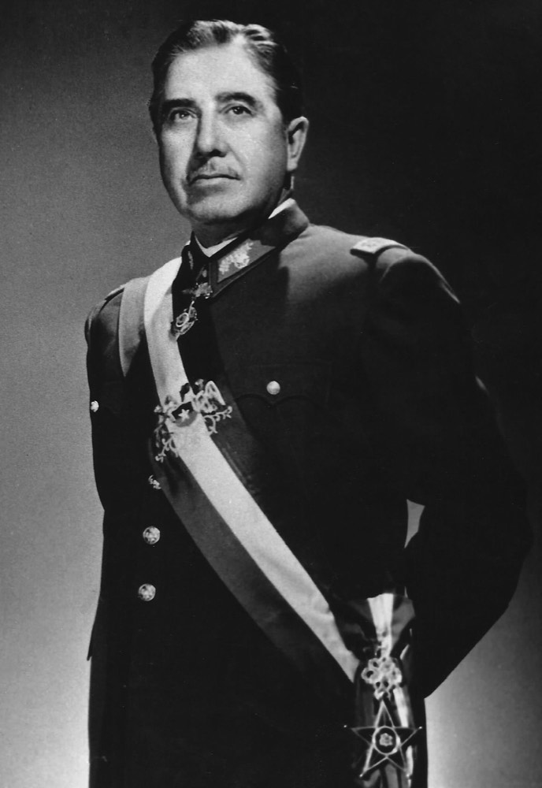

[← Public International Law](README.md) · [← Week 7](06-jus-ad-bellum.md) · [Week 9 →](08-international-economic-law.md)

# Week 8: Jurisdiction and immunities

*Augusto Pinochet, official portrait.* Pinochet (No 3), House of Lords 1999: no functional immunity for torture under the Torture Convention for a former Head of State.  
Ministerio de Relaciones Exteriores de Chile · CC BY 2.0 cl · [Wikimedia Commons](https://commons.wikimedia.org/wiki/File:Augusto_Pinochet_foto_oficial_(cropped)(2).jpg)

**Mind map:** [Jurisdiction and immunities](https://tomasemilioeee-a11y.github.io/pil-humanity-study-guide/mind-maps/jurisdiction-immunities.html), interactive, with recall mode and search.

## Rules to know cold

1. There are three types of jurisdiction: prescriptive (making law), adjudicative (courts) and enforcement (arrest, seizure). Enforcement is strictly territorial without consent (Lotus, p. 18).
2. Bases of prescriptive jurisdiction: territoriality, either subjective (the act starts here) or objective (it is completed or takes effect here, the effects doctrine); active nationality (the offender is a national); passive personality (the victim is a national, accepted for terrorism and serious crimes); protective principle (vital State interests such as currency or security); universal jurisdiction (piracy, grave breaches, torture, genocide, CAH, war crimes).
3. Lotus presumption: States may extend their laws unless a prohibitive rule exists. Today this is heavily criticised: in Arrest Warrant, President Guillaume and the Joint Separate Opinion (Higgins, Kooijmans, Buergenthal) treated the Lotus dictum as belonging to a laissez-faire era since overtaken, and most modern scholarship requires a permissive basis. Judge Van den Wyngaert, by contrast, relied on Lotus (no prohibitive rule) to support universal jurisdiction in absentia.
4. Universal jurisdiction in absentia is contested. In Arrest Warrant the Joint Separate Opinion (Higgins, Kooijmans, Buergenthal) accepted it with safeguards, while President Guillaume rejected it.
5. State immunity is restrictive: acta jure imperii (sovereign acts) are immune, acta jure gestionis (commercial acts) are not (UN Convention 2004, Arts 5, 10–17). It is a procedural bar, separate from the lawfulness of the conduct (Germany v Italy para 93).
6. Immunity ratione personae belongs to the troika (Head of State, Head of Government, Foreign Minister) and diplomats. It covers all acts, official and private, but only while in office, and it is absolute before foreign national courts, even for international crimes (Arrest Warrant paras 51–61).
7. Immunity ratione materiae covers official acts of all State officials and continues after office. It is debated whether it covers international crimes: Pinochet said no for torture under CAT. ILC draft Art 7 (first reading 2022) listed genocide, CAH, war crimes, apartheid, torture and enforced disappearance; on second reading (completed May 2026, now draft art 6 [7]) aggression, slavery and the slave trade were added. The list remains controversial (recorded votes; codification versus progressive development).
8. Arrest Warrant para 60: immunity does not mean impunity. Para 61 lists four avenues: prosecution in their own State; waiver by their own State; after leaving office, by another State's court with jurisdiction, for acts committed before or after the period of office and for acts committed during office in a private capacity; and certain international criminal courts with jurisdiction.
9. Before international courts, Art 27 Rome Statute removes official capacity. Art 98 creates tension with cooperation duties (Al-Bashir Jordan Appeal 2019: no customary head-of-State immunity before international courts).
10. Jus cogens and immunity: there is no conflict, because the rules operate on different planes, procedural versus substantive (Germany v Italy paras 92–97; Al-Adsani).
11. Immunity before international and hybrid courts, 2025–26: ICC PTC II (Tajikistan, referred 7 May 2026) and PTC I (Hungary, 24 July 2025) applied Art 27 against non-party Heads of State (Putin, Netanyahu). The Ukraine Special Tribunal (CoE treaty) instead respects the troika's personal immunity while in office (Art 23(5)) but removes functional immunity (Art 23(4)). This is evidence that States still treat immunity ratione personae as unresolved outside the ICC.
12. Russian Central Bank assets (about €185–210bn, mostly at Euroclear, Belgium): the EU immobilised them indefinitely (Council decision, 12 Dec 2025) instead of six-monthly unanimous renewal. The 'reparations loan' failed (Belgian opposition: immunity from execution, UNCSI Art 21(1)(c) central-bank property, litigation risk). The European Council (18–19 Dec 2025) chose a €90bn EU-borrowed loan for 2026–27, reserving the right to use the assets. Exam frame: an immobilisation is not confiscation; using the principal needs a countermeasures justification (ARSIWA Arts 49–53: reversibility, injured-State or Art 54 'non-injured State' debate) plus an answer to enforcement immunity.
13. Hernández on Lotus: the passage is 'invariably quoted' for a permissive presumption, 'yet this is not fully accurate'. Objecting States never accept that they must prove a prohibitive rule; they reply that the acting State has 'no right'. A linking point is required, and only territoriality and nationality are firmly established, so a State legislating beyond its territory and nationals bears the burden of justifying it. Any basis must at least be 'tolerated by other States'. Use this to argue burden of proof in a jurisdiction question.
14. Effects doctrine: US v Alcoa (1945) took jurisdiction over a foreign cartel's intended effects on the US market; the Helms–Burton Act (1996) met EU and UK 'blocking statutes'. The CJEU in Intel v Commission (2017, para 49) adopted a 'qualified effects test': EU competition law applies where it is foreseeable that conduct will have an 'immediate and substantial effect' in the EU. Contrast Ben El Mahi v Denmark (ECtHR 2006): effects abroad of the Danish cartoons created no jurisdictional link under the ECHR.
15. Passive personality remains unsettled as custom but is accepted by treaty: Hostages Convention Art 5(1)(d) (Hernández cites it as Art 9), Tokyo Convention Art 4(b), Terrorism Financing Convention Art 7(2)(a). Hernández stresses its imperial pedigree (nineteenth-century unequal treaties and capitulations; the Cutting case of 1886, where the US protested Mexico's claim) and why it is resented: it implies the territorial State's legal system is deficient. The protective principle is limited to essential State functions (security, currency, immigration documents), not, for example, sexual offences abroad or antitrust.
16. Universality: piracy jurisdiction rests on a pragmatic rationale (the high seas are beyond any State's jurisdiction: 'common interest and mutual convenience'), not on heinousness, so keep it apart from universal jurisdiction over international crimes. Most States now require a minimal link: Belgium amended its law in 2003 after US and Israeli pressure (the Sharon complaint; the threat to NATO headquarters funding). Argentina is the outlier with 'pure' universal jurisdiction (Rohingya complaint 2019; warrant for Maduro, Sept 2024). Aut dedere aut judicare is treaty-based, not custom (Belgium v Senegal applied only CAT Art 7), and there is no duty to open universal civil jurisdiction for torture (Naït-Liman v Switzerland, ECtHR GC 2018).
17. Immunity is a procedural bar, distinct from 'act of State' (a substantive rule that courts will not adjudicate a foreign State's sovereign acts in its own territory) and non-justiciability. Belhaj v Straw (UKSC 2017) treats non-justiciability as a narrow sub-category of act of State; Kuwait Airways (HL 2002) refused to apply the doctrine to Iraq's seizure of aircraft because the invasion of Kuwait was a flagrant breach of international law. In a problem, deal with immunity first, then act of State.
18. Who is the 'State' for immunity: UNCSI Art 2(1)(b) covers organs; federal units and State agencies only if they are entitled to perform AND actually perform sovereign acts (cumulative; the UK SIA is similar, the US FSIA broader). Separate State entities are presumed distinct, and 'quite extreme circumstances' are needed to treat them as the State (Gécamines, Privy Council). A central bank's commercial letter of credit is not immune (Trendtex, 1977). Waiver may be express or implied: prior written agreement, bringing proceedings, or taking steps in them.
19. Restrictive immunity in practice: about two-thirds of States apply it and one-third still apply absolute immunity (2015 study); Russia (2016) and China (2024) switched to restrictive. UNCSI is still not in force (22 of the 30 ratifications needed). Exceptions to note: employment contracts, but not for staff doing governmental functions (Benkharbouche, UKSC 2017: embassy domestic workers can sue); territorial tort (Art 12), limited to physical injury or damage caused on forum territory, e.g. Al Masarir v Saudi Arabia (EWHC 2022) on spyware hacking devices in the UK. On nature versus purpose, UNCSI Art 2(2) lets purpose count only if agreed or under forum practice; I Congreso del Partido (HL 1981) looks at the 'whole context', but governmental motive cannot turn a commercial act into a sovereign one.
20. Hernández's critique of Germany v Italy: the Court chose to lay down a general rule, and its strict procedural/substantive split ignores developments in other courts and elevates judge-made procedural canons over substantive norms. It could have decided on narrower grounds: Germany had paid reparations and Italy had waived further claims in the 1961 agreements. His broader point: there is no 'linear progress from sovereignty to human rights' in the law of immunities.
21. Officials, three refinements. (1) Territorial exception: functional immunity does not cover crimes committed by a foreign official on the forum State's territory where that State consented neither to the official's presence nor to the activity (assassination, sabotage, espionage); Khurts Bat (EWHC 2011): a Mongolian intelligence chief's alleged abduction in Germany. (2) Immunity belongs to the State and can be waived by it (the Philippines for Marcos; Chad for Habré). (3) Head-of-State immunity is breached only by a 'constraining act of authority': a French judge's invitation to Djibouti's President to testify did not violate it (Djibouti v France, 2008).
22. Diplomatic and consular law (VCDR and VCCR codify custom; a 'self-contained regime', per Tehran Hostages). Mission premises are inviolable and the receiving State must protect them (VCDR Art 22; the 2024 Ecuadorian raid on Mexico's embassy, now before the ICJ). Agrément can be refused and a diplomat declared persona non grata 'at any time' without reasons (Art 9). Diplomatic agents have full criminal immunity and civil immunity subject to Art 31(1): private immovable property, succession, and private professional or commercial activity (Wong v Basfar, UKSC 2022: exploiting a domestic worker in modern-slavery conditions fell within 'commercial activity'). Consuls have only functional immunity and can be arrested for a 'grave crime' (VCCR Arts 41, 43). A receiving State may object to a designation of mission premises only if its objection is timely, non-arbitrary and non-discriminatory (Equatorial Guinea v France, 2020).

## Key passages

> Far from laying down a general prohibition to the effect that States may not extend the application of their laws and the jurisdiction of their courts to persons, property and acts outside their territory, it leaves them in this respect a wide measure of discretion…
>
> — **SS Lotus (France v Turkey)**, PCIJ, Series A No 10 (1927), p 19

*Why it matters:* The permissive Lotus principle for prescriptive jurisdiction; contrast the strict territoriality of enforcement jurisdiction.

> It has been unable to deduce from this practice that there exists under customary international law any form of exception to the rule according immunity from criminal jurisdiction and inviolability to incumbent Ministers for Foreign Affairs, where they are suspected of having committed war crimes or crimes against humanity.
>
> — **Arrest Warrant of 11 April 2000 (DRC v Belgium)**, ICJ (2002), para 58

*Why it matters:* Personal immunity of the troika is absolute while in office, even for international crimes.

> Accordingly, the immunities enjoyed under international law by an incumbent or former Minister for Foreign Affairs do not represent a bar to criminal prosecution in certain circumstances.
>
> — **Arrest Warrant (DRC v Belgium)**, ICJ (2002), para 61

*Why it matters:* The four routes: trial at home; waiver; after office, for acts before or after office or private acts; certain international criminal courts.

## What the lecturers stressed

- Starting point: domaine réservé — nationality is for each State to confer, but international law decides its limits and consequences (Nottebohm).
- Territoriality quoted from Island of Palmas (1928): sovereignty means independence, the exclusive right to exercise State functions over a portion of the globe. Domestic examples: Dutch Criminal Code s.2; Swiss Criminal Code Art 8 (place of act and place of effect).
- Nationality: active personality (Dutch CC s.5(2), double criminality), passive personality (Dutch CC s.5b for listed serious offences against Dutch nationals). Ships and aircraft have the nationality of registration (Chicago Convention Arts 17–18).
- Corporate nationality: renvoi to domestic law (incorporation or seat); no genuine-link requirement (Barcelona Traction). Why it matters: treaty shopping, as in Philip Morris v Australia (restructuring to gain BIT protection, claim dismissed as abuse of rights).
- Universal jurisdiction is primarily treaty-based: CAT Art 6(1) (custody of a present offender) and Art 7(1) (extradite or prosecute). Rationale: heinousness gives all States an interest (cf. piracy).
- State immunity sources: custom built from domestic court practice; UN Convention on Jurisdictional Immunities 2004 (not in force, parts reflect custom); European Convention on State Immunity 1972; VCDR and VCCR. Immunity is a procedural bar decided before the merits.
- Sovereign versus commercial acts: what counts is the nature of the act, not its purpose (US v Irsa, Italian Court of Cassation 1963: a public works contract is private in nature even if it serves a public end).
- Enforcement immunity of State property is stricter. Mixed-use embassy bank accounts are immune (Philippine Embassy, German Constitutional Court 1977, followed in the UK, NL, Belgium; codified in UNCSI Art 21). Central-bank property is protected only where clearly linked to monetary policy; a sovereign wealth fund was not immune (Ascom v Kazakhstan, Swedish Supreme Court 2021). Topical: on 2 Sept 2026 Norway attached the Russian vessel Professor Molchanov at Svalbard to enforce Naftogaz's 2023 Crimea investment award against Russia, and a Norwegian court upheld the attachment (reported Oct 2026). Russia claims it is a State scientific vessel (UNCSI Arts 19, 21).
- Officials: ratione personae attaches to office, is needed for the function, belongs to the troika, and covers acts 'during or prior to' office (ILC draft Art 4(2), 2022). Ratione materiae attaches to official acts. The ILC's crimes exception (first-reading Art 7, revised by the Drafting Committee in 2025, renumbered draft art 6 [7]) excludes functional immunity for genocide, CAH, war crimes, aggression, apartheid, torture, enforced disappearance, slavery and slave trade. Adopted on second reading 15 May 2026 after a 23–4–3 recorded vote.

## Cases and materials

### SS Lotus (France v Turkey)
*PCIJ · 1927*

Turkey could prosecute the French officer because the effects of the collision were felt on the Turkish ship (objective territoriality). Restrictions on independence are not presumed. Enforcement outside territory is prohibited.

**Use it for:** Permissive presumption (to criticise); enforcement is territorial; effects.

### Nottebohm (Liechtenstein v Guatemala)
*ICJ · 1955*

Nationality conferred without a 'genuine connection' could not be opposed to Guatemala for diplomatic protection.

**Use it for:** Nationality as a basis of jurisdiction and protection; genuine link.

### Arrest Warrant (DRC v Belgium)
*ICJ · 2002*

Issuing and circulating an arrest warrant against the incumbent DRC Foreign Minister violated his full immunity and inviolability. There is no customary exception for war crimes or CAH. The Court did not decide on universal jurisdiction.

**Use it for:** The troika's immunity ratione personae; para 61 avenues; the universal jurisdiction debate (separate opinions).

### Van den Wyngaert dissent, Arrest Warrant
*ICJ · 2002*

The Court should have considered international criminal law and the fight against impunity. Universal jurisdiction in absentia is permitted under Lotus and there is no prohibitive rule. She would have found no immunity for core crimes.

**Use it for:** The counter-argument for accountability.

### R v Bow Street, ex parte Pinochet (No 3)
*UK House of Lords · 1999*

Lord Browne-Wilkinson: torture, under the CAT definition, cannot be an official function attracting immunity ratione materiae once the UK, Spain and Chile were all CAT parties. A former Head of State can be extradited.

**Use it for:** Functional immunity does not cover torture (former officials only).

### Al-Adsani v UK
*ECtHR (GC, 9–8) · 2001*

Granting Kuwait immunity in a civil torture claim did not violate the Art 6 right of access to court. Immunity pursues a legitimate aim and is proportionate. No accepted jus cogens exception exists for civil suits.

**Use it for:** Civil State immunity versus jus cogens; dissent on the hierarchy of norms.

### Jurisdictional Immunities (Germany v Italy)
*ICJ · 2012*

Italy violated Germany's immunity by allowing civil claims for Nazi-era crimes. Acts of armed forces in armed conflict are acta jure imperii. The territorial tort exception does not cover them. Neither the gravity of the violation, jus cogens, nor 'last resort' removes immunity.

**Use it for:** The procedural nature of immunity; the leading case against the jus cogens exception.

### Philippine Embassy case
*German Federal Constitutional Court · 1977*

A general current account used for an embassy's expenses serves diplomatic functions and is immune from execution, even if individual payments are commercial.

**Use it for:** Mixed-use accounts; immunity from execution (UNCSI Art 21).

### Ascom v Kazakhstan
*Swedish Supreme Court · 2021*

Central-bank protection covers only property clearly connected with monetary policy. A sovereign wealth fund built from oil revenues for unspecified future needs was not immune from execution.

**Use it for:** Limits of central-bank and State-property immunity.

### US v Irsa
*Italian Court of Cassation · 1963*

A public works contract is private (jure gestionis) in nature even though it serves a public purpose: the nature of the act decides, not its purpose.

**Use it for:** Nature versus purpose test.

### Barcelona Traction (Belgium v Spain)
*ICJ · 1970*

A company's national State (incorporation and seat) protects it, not the shareholders' State. No genuine-link requirement for corporations. Famous obiter on erga omnes obligations (para 33).

**Use it for:** Corporate nationality; erga omnes (links to Week 11).

### ILC Draft Articles on Immunity of State Officials from Foreign Criminal Jurisdiction (second reading)
*ILC · 2026*

17 draft articles adopted 15 May 2026. Draft art 6 [7]: immunity ratione materiae shall not apply to genocide, CAH, war crimes, aggression, apartheid, torture, enforced disappearance, slavery and slave trade; procedural safeguards in Arts 8–17 (notification, consultation, transfer). Convention recommended 20 July 2026.

**Use it for:** Current state of the 'international crimes exception' debate (Pinochet vs Germany v Italy, Arrest Warrant).

### Attorney-General of Israel v Eichmann
*District Court of Jerusalem (affirmed by the Supreme Court of Israel, 1962) · 1961*

Israel could try Eichmann for crimes against the Jewish people and war crimes: besides universality (delicta juris gentium), the court relied on the protective principle, with the 'crime against the Jewish people' as the linking point. His abduction from Argentina violated Argentina's sovereignty, not his rights, and the breach was 'cured' by Argentina's waiver in a joint communiqué.

**Use it for:** Shows that a judgment usually rests on several jurisdictional bases; illegal enforcement abroad (abduction) does not by itself bar trial (male captus, bene detentus), but it is a wrong against the territorial State.

### Intel v European Commission (C-413/14 P)
*CJEU · 2017*

EU competition law may be applied to a US company's rebates to manufacturers outside the EU under a 'qualified effects test': it is justified under public international law when it is foreseeable that the conduct will have an immediate and substantial effect in the EU.

**Use it for:** The modern, limited version of the effects doctrine (objective territoriality).

### Khurts Bat v Investigating Judge of the German Federal Court
*High Court of England and Wales · 2011*

The head of Mongolia's intelligence agency could be extradited to Germany for an alleged abduction committed there on Mongolia's instructions: he had no special-mission immunity, and functional immunity does not cover acts done on another State's territory without its consent to the presence or the activity.

**Use it for:** The territorial exception to immunity ratione materiae; covert operations abroad.

## Test yourself

Open the questions (answers are folded under each)

**Q. What are the five bases of prescriptive jurisdiction?**

Answer

Territoriality (subjective, objective, effects), active nationality, passive personality, the protective principle, and universality.

**Q. Immunity ratione personae versus ratione materiae: who, what, and when?**

Answer

Personae: the troika and diplomats, all acts, only while in office, absolute before foreign courts. Materiae: any official, official acts only, continues after office.

**Q. What are the four Arrest Warrant para 61 avenues?**

Answer

Prosecution in their own State; waiver by their State; after office, for acts before or after office or private acts during it; before an international criminal court with jurisdiction.

**Q. Why doesn't jus cogens override State immunity in Germany v Italy?**

Answer

The rules address different matters. Immunity is procedural and decides whether a court may exercise jurisdiction, not whether the conduct was lawful, so there is no conflict.

**Q. What did Pinochet decide, and what are its limits?**

Answer

A former Head of State has no functional immunity for torture under the CAT regime, because torture can't be an official function. It concerns criminal proceedings against a former official, not incumbents, and not civil suits against States.

**Q. What is the Lotus principle, and why is it criticised?**

Answer

Whatever is not prohibited is permitted, so States may extend jurisdiction absent a prohibitive rule. Critics say it is outdated and inconsistent with sovereign equality; modern practice requires a recognised permissive basis.

**Q. Why is enforcement immunity stricter than adjudicative immunity?**

Answer

Execution against State property interferes more directly with sovereignty. Even if a court can hear a claim (commercial exception), property is only attachable if in commercial use and not covered by specific protections (diplomatic accounts, central-bank property, military property): UNCSI Arts 19–21; Philippine Embassy; Ascom.

**Q. What did the ILC adopt on officials' immunity?**

Answer

Draft Art 4(2) (2022, kept): ratione personae covers all acts of the troika, private or official, during or prior to office. The second reading was completed in May 2026 with 17 draft articles (A/CN.4/L.1034). Former Art 7 is now Art 6 [7]: no ratione materiae immunity before foreign criminal courts for genocide, CAH, war crimes, aggression, apartheid, torture, enforced disappearance, slavery and the slave trade (aggression, slavery and the slave trade were added in 2025). Adopted after a recorded vote and contested as lex ferenda (thin State practice). Part Four sets procedural safeguards (notification, invocation and waiver, transfer of proceedings).

**Q. Assad sample question: which jurisdictional bases does Germany have?**

Answer

Universal jurisdiction for war crimes, CAH and torture (CAT Arts 5(2) and 7 since he is present; VStGB). Passive personality for the 10 German victims. Not territoriality (acts in Syria), not active nationality, and the protective principle fails: refugee costs are not a vital State interest threatened by the offence.

**Q. May the EU confiscate immobilised Russian central-bank assets to fund Ukraine?**

Answer

Freezing is a reversible measure. Confiscation breaches State immunity from execution (central-bank property, UNCSI Art 21(1)(c), Art 19) unless justified as a countermeasure (ARSIWA Arts 49–53: reversibility, proportionality; for non-directly-injured States the Art 54 'lawful measures' debate). The EU (Dec 2025) kept the assets frozen indefinitely and chose a €90bn borrowed loan instead of the 'reparations loan'.

**Q. Why is universal jurisdiction over piracy different from universal jurisdiction over torture?**

Answer

Piracy: a pragmatic rule, because pirates operate on the high seas outside any State's jurisdiction (UNCLOS Arts 101, 105). Torture, genocide and similar crimes: jurisdiction justified by their gravity, mostly through treaties (CAT Arts 5(2), 7: custody plus extradite or prosecute). Most States now require a link such as the offender's presence (Belgium after 2003); aut dedere aut judicare is a treaty duty, not custom.

**Q. Immunity, act of State and non-justiciability: what is the difference?**

Answer

Immunity is a procedural bar tied to the defendant (the State or its official) and decided first (Germany v Italy para 93). Act of State is a substantive rule that a court will not rule on the validity of a foreign State's sovereign acts in its own territory. Non-justiciability bars certain sensitive political questions (Belhaj, UKSC 2017: a narrow sub-category). Kuwait Airways (HL 2002): public-policy exception for flagrant breaches of international law.

**Q. When can a foreign intelligence officer not rely on functional immunity?**

Answer

When the territorial exception applies: the crime was committed on the forum State's territory and that State consented neither to the official's presence nor to the activity (Khurts Bat, EWHC 2011). The ILC's draft articles leave this exception out of the crimes list because territorial sovereignty already covers it. Also check special-mission immunity (needs the receiving State's consent to the mission).

**Q. Can the receiving State arrest a diplomat or a consul suspected of a crime?**

Answer

A diplomatic agent: no. They are inviolable (VCDR Art 29) and immune from criminal jurisdiction (Art 31); remedies are waiver by the sending State (Art 32) or declaring them persona non grata (Art 9). A consular officer: only for a 'grave crime' and by a judicial decision (VCCR Art 41(1)); they have immunity only for official acts (Art 43).

